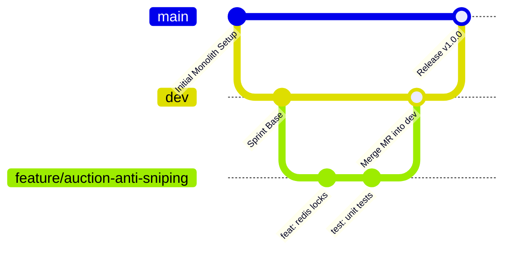

# Contributing to Project Nexus

Thank you for contributing to **Project Nexus**! This document outlines our git workflow, branching strategy, commit guidelines, code quality gates, and the Merge Request lifecycle.

---

## 1. Git Branching Strategy

Our git branching model revolves around a protected `main` branch and an active integration branch `dev`:



### Branch Roles

- **`main`:** Protected production branch. Direct commits and pushes are strictly forbidden.
- **`dev`:** Active integration branch. All feature branches must branch off `dev` and merge back into `dev`.
- **Feature Branches:** `feature/<module>-<short-description>` (e.g., `feature/auction-anti-sniping`, `feature/commerce-checkout`, `feature/staff-chat`).
- **Bugfix Branches:** `bugfix/<module>-<task>`: Dedicated branches for resolving defects during development.
- **Hotfix Branches:** `hotfix/<issue>`: Critical production patches branching directly off `main` and merged back into both `main` and `dev`.

---

## 2. Commit Message Standards

All commits must strictly comply with the [Conventional Commits v1.0.0](https://www.conventionalcommits.org/) specification:

### Format

```text
<type>(<scope>): <short description in English>
```

### Allowed Types (enforced via `commitlint.config.js`):

- `feat`: A new user-facing feature or API capability.
- `fix`: A bug fix.
- `docs`: Documentation updates only.
- `style`: Formatting, missing semi-colons, white-space fixes (no production code change).
- `refactor`: Code restructuring without bug fixes or new features.
- `test`: Adding or refactoring unit or integration tests.
- `chore`: Maintenance, repository configuration, dependency bumps.
- `perf`: Performance optimizations.
- `ci`: CI/CD pipeline modifications.
- `build`: Build system or dependency management changes.
- `revert`: Reverting a previous commit.

---

## 3. Engineering Quality Standards & Checklists

Before opening a Merge Request or committing, all contributors must ensure their changes comply with our engineering specifications in [`docs/`](docs/):

- **File Length Constraint (< 300 Lines Limit):** No component or source file may exceed 300 lines of code. Decompose larger views into subcomponents, hooks, or configuration files (see [`docs/standards/CLEAN_CODE.md`](docs/standards/CLEAN_CODE.md)). All pages, including `HomePage.tsx`, adhere to this rule.
- **Clean Code & Strict TypeScript:**
  - Zero usage of `any` (`@typescript-eslint/no-explicit-any`).
  - Public methods must declare explicit return types.
  - No `console.log` statements in production services or components.
  - Inputs validated using DTOs with `class-validator`.
- **Design Patterns:** Adhere to established patterns in [`docs/architecture/DESIGN_PATTERNS.md`](docs/architecture/DESIGN_PATTERNS.md) (IoC, Repository, Strategy, In-Process Events, AuthContext deduplication).

### Pre-MR Local Verification Checklist

Run these commands locally to verify compliance before opening a Merge Request:

```bash
# 1. Verify code formatting with Prettier
npm run format:check

# 2. Run static analysis with ESLint
npm run lint

# 3. Verify TypeScript build and production bundle
npm run build:web
npm run build:backend
```

---

## 4. Step-by-Step Merge Request Workflow

1. **Keep Your Branch Updated:** Rebase on the latest `dev` branch before opening an MR:

   ```bash
   git checkout dev
   git pull origin dev
   git checkout feature/your-branch-name
   git rebase dev
   ```

2. **Push to GitLab:**

   ```bash
   git push -u origin feature/your-branch-name
   ```

3. **Open a Merge Request on GitLab:**
   - **Target Branch:** **`dev`** ⚠️ _(Never target `main` directly)_.
   - **Title:** Conventional Commits format (e.g., `feat(auction): implement anti-sniping duration extension`).
   - **Description:** Complete the checklist from `.gitlab/merge_request_templates/default.md`.
   - **Check Option:** `Delete source branch when merge request is accepted`.
   - **Assignee:** Yourself | **Reviewer:** Tech Lead or designated peer reviewer.

4. **Code Review & Approval:**
   - Address reviewer comments and resolve all open discussion threads.
   - Ensure all automated CI/CD pipeline checks pass.
   - Once approved (minimum 1 peer approval required), the MR is merged into `dev`.
