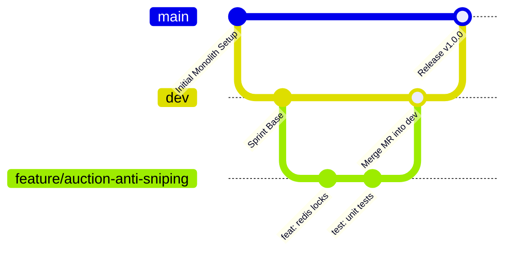

# Contributing to Project Nexus

This is a guide for contributing to **Project Nexus**! This document outlines our branching strategy, commit guidelines, code standards, and the Merge Request lifecycle on GitLab.

---

## Git Workflow

- Branching:
  - `main`: Protected production branch.
  - `dev`: Active integration branch.
  - Feature branches: `feature/<module>-<short-description>` (e.g., `feature/auction-live-board`).
- Commit Standards: Strictly conforms to Conventional Commits v1.0.0 (`feat`, `fix`, `docs`, `refactor`, etc.).
- Pre-MR Quality Gate:

  ```bash
  npm run lint
  npm run format:check
  ```

---

## Contributing Workflow



### Branch Roles

- `main`: Protected production branch. Direct commits are forbidden.
- `dev`: The active integration branch. All feature branches originate from `dev` and merge back into `dev`.
- Feature Branches: `feature/<module>-<short-description>` (e.g., `feature/auction-anti-sniping`, `feature/commerce-checkout`, `feature/auction-live-board`).
- Bugfix Branches: `bugfix/<module>-<task>`: Dedicated branches for resolving defects during development.
- Hotfix Branches: `hotfix/<issue>`: Urgent production fixes branching directly off `main` and merged back into both `main` and `dev`.

---

## Commit Message Standards

All commit messages must strictly comply with the [Conventional Commits v1.0.0](https://www.conventionalcommits.org/) specification.\
Commits must be atomic—each commit encapsulates a single logical change.

### Format

```text
<type>(<scope>): <short description>
```

### Allowed Types (enforced via `commitlint.config.js`):

- `feat`: A new user-facing feature or API capability.
- `fix`: A bug fix.
- `docs`: Documentation updates only.
- `style`: Formatting, missing semi-colons, white-space fixes (no production code change).
- `refactor`: Code restructuring without bug fixes or new features.
- `test`: Adding or refactoring unit or integration tests.
- `chore`: Maintenance, repository configuration, dependency bumps.
- `perf`: Performance optimizations.
- `ci`: CI/CD pipeline modifications.
- `build`: Build system or dependency management changes.
- `revert`: Reverting a previous commit.

---

## Coding Standards

All contributors must adhere to our formal engineering specifications:

- Read and follow [CLEAN_CODE.md](./docs/standards/CLEAN_CODE.md) for naming conventions, formatting, ESLint rules, strict TypeScript (`no-explicit-any`), and DTO validation.
- Read [DESIGN_PRINCIPLES.md](./docs/standards/DESIGN_PRINCIPLES.md) for SOLID, KISS, YAGNI, DRY, and Twelve-Factor App guidelines.
- Read [DESIGN_PATTERNS.md](./docs/architecture/DESIGN_PATTERNS.md) for Repository, Strategy (PayOS/Stripe/GHN), In-Process Observer/Events, PostgreSQL ACID transactions, and Three.js lifecycle management.
- Read [ARCHITECTURE.md](./docs/architecture/ARCHITECTURE.md) for modular boundaries, in-process event communication (`@nestjs/event-emitter`), and presentation layers.

### Quick Quality Checklist Before Committing

- [ ] No `any` type used (`@typescript-eslint/no-explicit-any`).
- [ ] Public methods have explicit return types.
- [ ] Code formatted with Prettier (`npm run format:check`).
- [ ] Code passes all linter checks (`npm run lint`).
- [ ] No `console.log` statements in production logic.
- [ ] Inputs validated using DTOs with `class-validator`.
- [ ] Commit message conforms to Conventional Commits (enforced via `commitlint`).

---

## Step-by-Step Merge Request Workflow

1. Pre-MR Local Verification:

   ```bash
   npm run lint
   npm run format:check
   ```

2. Rebase on Latest `dev`: Always sync and rebase the latest changes from `origin/dev` before pushing:

   ```bash
   git checkout dev && git pull origin dev
   git checkout feature/your-branch-name
   git rebase dev
   ```

3. Push to GitLab:

   ```bash
   git push -u origin feature/your-branch-name
   ```

4. Open a Merge Request on GitLab:
   - Target branch: **`dev`** ⚠️ _(Never target `main`)_.
   - Title: Follow Conventional Commits format (e.g., `feat(auction): add live bidding broadcast`).
   - Description: Complete the template loaded from `.gitlab/merge_request_templates/default.md`.
   - Check: `Delete source branch when merge request is accepted`.
   - Assignee: Yourself | Reviewer: Tech Lead / Peer reviewer.

5. Code Review & Merge: Address comments, resolve threads, receive approval (minimum 1 approval required), ensure CI passes, and merge into `dev`.
