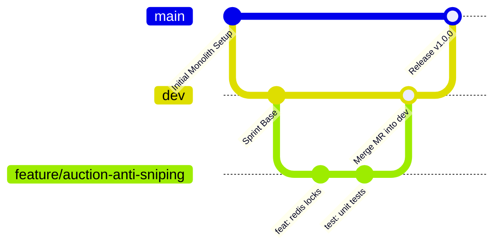

# Project Nexus

Project Nexus is an e-commerce platform that seamlessly integrates traditional online retail with real-time 3D live auctions. The system is built using a Modular Monolith architecture.

---

## Features

- Effortlessly switch between Buyer and Seller modes within a single session without re-authenticating.
- High-concurrency live bidding rooms featuring WebGL 3D item showcases (Three.js), sub-300ms bidding queues, and anti-sniping bid extensions (+5 minutes if bid placed in final 2 minutes).
- Buyer funds are securely held in platform escrow upon order creation and disbursed to the seller (minus a 7% platform fee) only after the buyer confirms receipt without dispute.
- Automated penalty algorithm that deducts reputation scores for unwarranted order cancellations or payment defaults to safeguard marketplace integrity.
- SKU-based inventory across warehouses, immutable movement ledgers, and dynamic shipping calculations via GHN logistics.
- Shared contracts and DTOs maintained centrally in `@nexus/types`.

---

## Tech Stack

- Monorepo: NPM Workspaces (`packages/*`, `backend`, `frontend/*`).
- Frontend: React 18, TypeScript, Tailwind CSS, Three.js (WebGL 3D rendering), Vite, TanStack Query, Zustand.
- Backend: NestJS (Modular Monolith Architecture, TypeScript).
- Database: PostgreSQL 17 (Prisma ORM, ACID transactions, Logical Schema Separation).
- Cache & Real-Time: Redis 7 (caching, distributed Redlock, in-memory atomic bidding queues, Socket.IO adapter).
- Infrastructure: Docker & Docker Compose.
- Payments: PayOS (Vietnamese domestic banking QR), Stripe (International cards).
- Logistics: GHN API (Giao Hàng Nhanh logistics adapter).

---

## Repository Source Tree Structure

```text
project-nexus/
├── .editorconfig
├── .env.example
├── .gitattributes
├── .gitignore
├── .prettierignore
├── .prettierrc.json
├── commitlint.config.js
├── CONTRIBUTING.md
├── docker-compose.yml
├── eslint.config.mjs
├── package.json
├── README.md
├── .gitlab/
│   └── merge_request_templates/
│       └── default.md
├── docs/
│   ├── api/
│   ├── architecture/
│   ├── srs/
│   └── standards/
├── infra/
│   ├── docker/
│   │   ├── Dockerfile.backend
│   │   └── Dockerfile.web
│   ├── docker-compose.yml
│   └── README.md
├── packages/
│   ├── types/
│   │   ├── package.json
│   │   ├── tsconfig.json
│   │   └── src/
│   │       ├── enums/
│   │       ├── events/
│   │       ├── models/
│   │       └── index.ts
│   └── config/
│       ├── package.json
│       └── tsconfig.base.json
├── backend/
│   ├── package.json
│   ├── tsconfig.json
│   ├── tsconfig.build.json
│   ├── nest-cli.json
│   ├── prisma/
│   │   ├── schema.prisma
│   │   ├── migrations/
│   │   └── seeds/
│   └── src/
│       ├── main.ts
│       ├── app.module.ts
│       ├── core/
│       │   ├── prisma/
│       │   ├── redis/
│       │   ├── filters/
│       │   └── exceptions/
│       └── modules/
│           ├── auth/
│           ├── users/
│           ├── catalog/
│           ├── commerce/
│           ├── fulfillment/
│           ├── auction/
│           ├── notification/
│           └── backoffice/
└── frontend/
    ├── web/
    │   ├── package.json
    │   ├── vite.config.ts
    │   ├── tsconfig.json
    │   ├── public/models-3d/
    │   └── src/
    │       ├── components/
    │       ├── context/
    │       ├── features/
    │       │   └── auction/
    │       │       ├── components/
    │       │       ├── hooks/
    │       │       └── three/
    │       └── stores/
    └── admin/
        ├── package.json
        ├── vite.config.ts
        ├── tsconfig.json
        └── src/
            ├── components/
            └── features/
```

---

## Documentation Reading Roadmap

To build a clear mental model without feeling overwhelmed, we recommend reading the documentation in `docs/` in the following sequence:

```text
[1. SRS] ──> [2. Architecture] ──> [3. Design Patterns] ──> [4. Clean Code Standards] ──> [5. API Specs]
```

1. [docs/srs/README.md](docs/srs/README.md): Full requirements, System Configurations, RBAC Privileges Matrix, 60+ Domain Events, and NFR performance SLAs.
2. [docs/architecture/ARCHITECTURE.md](docs/architecture/ARCHITECTURE.md): Modular Monolith design, in-process event emission, logical schema separation, and Redis distributed lock design.
3. [docs/architecture/DESIGN_PATTERNS.md](docs/architecture/DESIGN_PATTERNS.md): Repository pattern, Strategy pattern (PayOS, Stripe, GHN), and Three.js WebGL scene lifecycle management.
4. [docs/standards/CLEAN_CODE.md](docs/standards/CLEAN_CODE.md) & [docs/standards/DESIGN_PRINCIPLES.md](docs/standards/DESIGN_PRINCIPLES.md): Naming standards, strict TypeScript (`no-explicit-any`), DTO validation, and SOLID principles.
5. [docs/api/README.md](docs/api/README.md): RESTful endpoint matrix (`/api/v1/...`) and WebSocket real-time contracts (`/ws/auctions`).

---

## Development Environment

Ensure your development machine has the following tools installed:

- Node.js: Recommended LTS v22.x (`node -v`).
- NPM: Bundled with Node.js, minimum v11.x (`npm -v`).
- Git: Minimum v2.50+ (`git --version`).
- Docker & Docker Compose: For running PostgreSQL 17 and Redis 7 (`docker compose version`).
- Recommended IDE Extensions (VS Code):
  - _ESLint_ (`dbaeumer.vscode-eslint`)
  - _Prettier_ (`esbenp.prettier-vscode`)
  - _EditorConfig_ (`editorconfig.editorconfig`)
  - _Prisma_ (`Prisma.prisma`)

---

## Cloning the repository from GitLab

The repository is hosted on the Project Nexus GitLab server.\
Clone using:

```bash
git clone https://github.com/MinhPhuc00ne/project-nexus.git
cd project-nexus
```

Git might prompt for your Project Nexus GitLab credentials. Use your Project Nexus username and password or personal access token.

---

## Local Git Configuration

Set up your local Git identity and line endings:

1. Configure User Name and Email:

   ```bash
   git config user.name "Your Name"
   git config user.email "your_email@your.domain"
   ```

2. Configure Line Endings (CRLF vs LF):

   ```bash
   # Windows:
   git config core.autocrlf true

   # macOS / Linux:
   git config core.autocrlf input
   ```

3. Switch to Development Branch (`dev`):

   ```bash
   git checkout dev
   git pull origin dev
   ```

---

## Project Setup

### Step 1: Install Dependencies

Run from the root directory to link monorepo workspaces and activate Husky hooks:

```bash
npm install
```

### Step 2: Build Shared Types

Compile the `@nexus/types` package so Backend and Frontends can consume shared contracts:

```bash
npm run build:types
```

### Step 3: Configure Environment Variables

```bash
# Windows (PowerShell):
Copy-Item .env.example .env

# macOS / Linux:
cp .env.example .env
```

### Step 4: Start Local Infrastructure with Docker

Launch PostgreSQL 17 and Redis 7 in detached mode:

```bash
npm run docker:up
```

Verify containers are running:

```bash
docker ps
```

- `nexus-postgres`: PostgreSQL database on port `5432` (`POSTGRES_DB=nexus_main`).
- `nexus-redis`: Redis cache and distributed lock engine on port `6379`.

### Step 5: Initialize Database Schema

Generate Prisma client and run initial migrations:

```bash
npm run prisma:generate
npm run prisma:migrate
```

### Step 6: Run Applications

- Backend NestJS Application:

  ```bash
  npm run dev:backend
  ```

  _(Server runs at `http://localhost:3000`, Swagger documentation at `http://localhost:3000/api/docs`)_

- Frontend Web Portal (Buyer & Seller):

  ```bash
  npm run dev:web
  ```

  _(Web portal runs at `http://localhost:5173`)_

- Frontend Admin Portal (Staff & Operations):

  ```bash
  npm run dev:admin
  ```

  _(Admin portal runs at `http://localhost:5174`)_

---

## Frequently Used Commands

| Command                   | Description                                                 |
| :------------------------ | :---------------------------------------------------------- |
| `npm install`             | Install monorepo dependencies and activate Husky hooks      |
| `npm run build:types`     | Compile `@nexus/types` shared package                       |
| `npm run build:all`       | Build shared types, backend, and both frontend applications |
| `npm run dev:backend`     | Start NestJS Modular Monolith backend in watch mode         |
| `npm run dev:web`         | Start React Buyer/Seller web portal with Vite               |
| `npm run dev:admin`       | Start React Backoffice admin portal with Vite               |
| `npm run prisma:generate` | Generate Prisma client from `backend/prisma/schema.prisma`  |
| `npm run prisma:migrate`  | Apply database migrations in development                    |
| `npm run prisma:studio`   | Open interactive database UI in browser                     |
| `npm run lint`            | Run ESLint across all monorepo workspaces                   |
| `npm run lint:fix`        | Automatically fix auto-fixable ESLint issues                |
| `npm run format`          | Format entire codebase using Prettier                       |
| `npm run format:check`    | Verify formatting compliance with Prettier                  |
| `npm run docker:up`       | Launch PostgreSQL and Redis background containers           |
| `npm run docker:down`     | Stop local Docker containers                                |
| `npm run docker:logs`     | Stream logs from PostgreSQL and Redis                       |

---

## Contributing & Git Workflow

- Branching:
  - `main`: Protected production branch.
  - `dev`: Active integration branch.
  - Feature branches: `feature/<module>-<short-description>` (e.g., `feature/auction-live-board`).
- Commit Standards: Strictly conforms to Conventional Commits v1.0.0 (`feat`, `fix`, `docs`, `refactor`, etc.).
- Pre-MR Quality Gate:

  ```bash
  npm run lint
  npm run format:check
  ```

## Contributing Workflow



### Branch Roles

- `main`: Protected production branch. Direct commits are forbidden.
- `dev`: The active integration branch. All feature branches originate from `dev` and merge back into `dev`.
- Feature Branches: `feature/<module>-<short-description>` (e.g., `feature/auction-anti-sniping`, `feature/commerce-checkout`).

---

## Commit Standards

We enforce [Conventional Commits v1.0.0](https://www.conventionalcommits.org/)\
Atomic commits are also required, make sure its have a single purpose and are self-contained.

```text
<type>(<scope>): <short summary in imperative mood>
```

- Allowed Types: `feat`, `fix`, `docs`, `style`, `refactor`, `test`, `chore`, `perf`, `ci`, `build`, `revert`.
- Git Hooks:
  - `pre-commit`: Runs `lint-staged` (`eslint --fix`, `prettier --write`).
  - `commit-msg`: Validates commit message via `commitlint`.

---

## Step-by-Step Merge Request Workflow

1. Pre-MR Local Verification:

   ```bash
   npm run lint
   npm run format:check
   ```

2. Rebase on Latest `dev`:

   ```bash
   git checkout dev && git pull origin dev
   git checkout feature/your-branch-name
   git rebase dev
   ```

3. Push to GitLab:

   ```bash
   git push -u origin feature/your-branch-name
   ```

4. Open a Merge Request on GitLab:
   - Target branch: **`dev`** ⚠️ _(Never target `main`)_.
   - Title: Follow Conventional Commits format.
   - Description: Complete the template loaded from `.gitlab/merge_request_templates/default.md`.
   - Check: `Delete source branch when merge request is accepted`.
   - Assignee: Yourself | Reviewer: Tech Lead / Peer reviewer.

5. Code Review & Merge: Address comments, resolve threads, receive approval, and merge into `dev`.

---

## Common Pitfalls

1. Commit Rejected by `commitlint`: Ensure message matches `<type>(<scope>): <summary>` (e.g., `feat(catalog): add pagination`).
2. Commit Blocked by `pre-commit`: Staged files have `any` types or lint errors. Run `npm run lint` to find and resolve.
3. CRLF vs LF Warnings on Windows: Run `git config core.autocrlf true` and `npm run format`.
4. Docker Port Allocation Conflict: Port `5432` or `6379` is already allocated by a host service. Stop the local service or change ports in `.env`.
