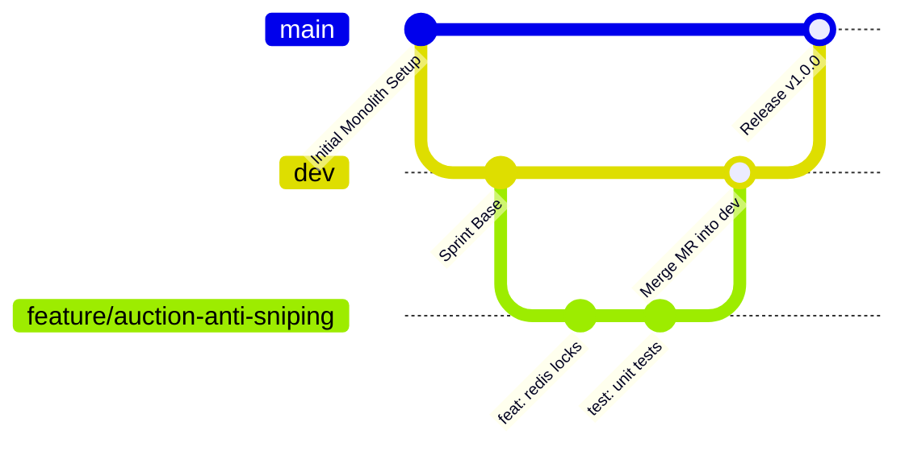

# Project Nexus

Project Nexus is an e-commerce platform that seamlessly integrates traditional online retail with real-time 3D live auctions. The system is built using a Modular Monolith architecture.

---

## Features

- Effortlessly switch between Buyer and Seller modes within a single session without re-authenticating.
- High-concurrency live bidding rooms featuring WebGL 3D item showcases (Three.js) and anti-sniping bid extensions.
- Buyer funds are securely held in platform escrow and disbursed to the seller only when the buyer confirms receipt without dispute.
- Automated penalty algorithm that deducts reputation scores for unwarranted order cancellations or non-payments to safeguard marketplace integrity.

---

## Tech Stack

- Frontend: React 18, TypeScript, Tailwind CSS, Three.js (WebGL 3D rendering), Vite, TanStack Query, Zustand.
- Backend: NestJS (Modular Monolith Architecture, TypeScript).
- Database: PostgreSQL 16 (Prisma ORM).
- Cache: Redis 7 (caching, distributed locks, in-memory bidding queues).
- Infrastructure: Docker & Docker Compose.
- Payments: PayOS (Vietnamese domestic banking QR), Stripe (International cards).
- Logistics: GHN API (Giao Hàng Nhanh logistics).

---

## System Architecture

Project Nexus is architected as a Modular Monolith:

- Backend (`backend/`):
  - A unified NestJS application cleanly partitioned into decoupled domain modules (`auth`, `users`, `catalog`, `commerce`, `fulfillment`, `auction`, `backoffice`, `common`). Inter-module communication uses in-process dependency injection and the `@nestjs/event-emitter` event bus. Database transactions execute with full PostgreSQL ACID guarantees via `prisma.$transaction()`.
- Frontend Clients (`frontend/`):
  - `frontend/web`: Primary customer web application for Buyers and Sellers with interactive 3D WebGL auction rooms.
  - `frontend/admin`: Administrative dashboard for Staff dispute resolution and platform operations.

---

## Documentation Reading Roadmap

To build a clear mental model without feeling overwhelmed, we recommend reading the documentation in `docs/` in the following sequence:

```text
[1. SRS] ──> [2. Architecture] ──> [3. Design Patterns] ──> [4. Clean Code Standards] ──> [5. API Specs]
```

1. Read [docs/srs/README.md](docs/srs/README.md)

- Learn about the core pillars: E-commerce checkout, Live 3D Auctions, Escrow protection, and Dynamic Reputation scores.
- Familiarize yourself with platform roles: Guest, Buyer, Seller, Staff, and Admin.

2. Read [docs/architecture/ARCHITECTURE.md](docs/architecture/ARCHITECTURE.md)

- Learn how domain modules are encapsulated within a single runtime.
- Understand in-process communication via `@nestjs/event-emitter`.
- Master PostgreSQL ACID transactions (`prisma.$transaction()`) and Redis atomic queues.

3. Read [docs/architecture/DESIGN_PATTERNS.md](docs/architecture/DESIGN_PATTERNS.md)

- Clean database abstraction with Prisma.
- Pluggable payment providers (PayOS, Stripe) and logistics (GHN).
- Decoupled domain events (`@nestjs/event-emitter`).
- Proper asset loading, camera controls, and WebGL memory cleanup.

4. Read [docs/standards/CLEAN_CODE.md](docs/standards/CLEAN_CODE.md) & [docs/standards/DESIGN_PRINCIPLES.md](docs/standards/DESIGN_PRINCIPLES.md)

- Naming conventions: `kebab-case` for files, `PascalCase` for classes/components, `camelCase` for functions/variables.
- Zero tolerance for `any` types; all public methods must declare explicit return types.

5. Read [docs/api/README.md](docs/api/README.md)

- Standard RESTful endpoints (`/api/v1/...`) and Swagger UI at `/api/docs`.
- WebSocket events for live auction rooms (`/ws/auctions`).

---

## Development Environment

Ensure your development machine has the following tools installed:

- Node.js: Recommended LTS **v22.x** (`node -v`).
- NPM: Bundled with Node.js, minimum **v11.x** (`npm -v`).
- Git: Minimum **v2.50+** (`git --version`).
- Docker & Docker Compose: For running PostgreSQL and Redis (`docker -v` and `docker compose version`).
- Recommended IDE: [Visual Studio Code](https://code.visualstudio.com/) with recommended extensions:
  - _ESLint_ (`dbaeumer.vscode-eslint`)
  - _Prettier - Code formatter_ (`esbenp.prettier-vscode`)
  - _EditorConfig for VS Code_ (`editorconfig.editorconfig`)
  - _Prisma_ (`Prisma.prisma`)

---

## Cloning the repository from GitLab

The repository is hosted on the Project Nexus GitLab server.\
Clone using:

```bash
git clone https://github.com/MinhPhuc00ne/project-nexus.git
cd project-nexus
```

Git might prompt for your Project Nexus GitLab credentials. Use your Project Nexus username and password or personal access token.

---

## Local Git Configuration

Set up your local Git identity and line endings:

1. Configure User Name and Email:

   ```bash
   git config user.name "Your Name"
   git config user.email "your_email@your.domain"
   ```

2. Configure Line Endings (CRLF vs LF):

   ```bash
   # Windows:
   git config core.autocrlf true

   # macOS / Linux:
   git config core.autocrlf input
   ```

3. Switch to Development Branch (`dev`):

   ```bash
   git checkout dev
   git pull origin dev
   ```

---

## Project Setup

### Step 1: Install Dependencies

Run from the root directory:

```bash
npm install
```

_(This automatically activates the Husky Git hooks in `.husky/`)_.

### Step 2: Create Environment Variables

```bash
# Windows (PowerShell):
Copy-Item .env.example .env

# macOS / Linux:
cp .env.example .env
```

### Step 3: Start Local Infrastructure with Docker

Launch PostgreSQL 16 and Redis 7 in detached mode:

```bash
npm run docker:up
```

Verify containers are running:

```bash
docker ps
```

- `nexus-postgres`: PostgreSQL database on port `5432` (`POSTGRES_DB=nexus_main`, user `postgres`).
- `nexus-redis`: Redis cache and locking engine on port `6379`.

To view container logs: `npm run docker:logs`\
To stop containers: `npm run docker:down`

### Step 4: Run the Applications

- Backend:

  ```bash
  npm run dev:backend
  ```

  _(Server runs at `http://localhost:3000`, Swagger documentation at `http://localhost:3000/api/docs`)_

- **Frontend Web Client**:

  ```bash
  npm run dev:web
  ```

  _(Web app runs at `http://localhost:5173`)_

- **Frontend Admin Portal**:

  ```bash
  npm run dev:admin
  ```

  _(Admin app runs at `http://localhost:5174`)_

---

## Contributing Workflow



### Branch Roles

- `main`: Protected production branch. Direct commits are forbidden.
- `dev`: The active integration branch. All feature branches originate from `dev` and merge back into `dev`.
- Feature Branches: `feature/<module>-<short-description>` (e.g., `feature/auction-anti-sniping`, `feature/commerce-checkout`).

---

## Commit Standards

We enforce [Conventional Commits v1.0.0](https://www.conventionalcommits.org/)\
Atomic commits are also required, make sure its have a single purpose and are self-contained.

```text
<type>(<scope>): <short summary in imperative mood>
```

- Allowed Types: `feat`, `fix`, `docs`, `style`, `refactor`, `test`, `chore`, `perf`, `ci`, `build`, `revert`.
- Git Hooks:
  - `pre-commit`: Runs `lint-staged` (`eslint --fix`, `prettier --write`).
  - `commit-msg`: Validates commit message via `commitlint`.

---

## Step-by-Step Merge Request Workflow

1. Pre-MR Local Verification:

   ```bash
   npm run lint
   npm run format:check
   ```

2. Rebase on Latest `dev`:

   ```bash
   git checkout dev && git pull origin dev
   git checkout feature/your-branch-name
   git rebase dev
   ```

3. Push to GitLab:

   ```bash
   git push -u origin feature/your-branch-name
   ```

4. Open a Merge Request on GitLab:
   - Target branch: **`dev`** ⚠️ _(Never target `main`)_.
   - Title: Follow Conventional Commits format.
   - Description: Complete the template loaded from `.gitlab/merge_request_templates/default.md`.
   - Check: `Delete source branch when merge request is accepted`.
   - Assignee: Yourself | Reviewer: Tech Lead / Peer reviewer.

5. Code Review & Merge: Address comments, resolve threads, receive approval, and merge into `dev`.

---

## Frequently Used Commands

| Command                | Description                                                |
| :--------------------- | :--------------------------------------------------------- |
| `npm install`          | Install monorepo dependencies and activate Husky git hooks |
| `npm run dev:backend`  | Start the NestJS Modular Monolith backend in watch mode    |
| `npm run dev:web`      | Start the React Buyer/Seller web portal (Vite)             |
| `npm run dev:admin`    | Start the React Backoffice admin portal (Vite)             |
| `npm run lint`         | Run ESLint across all workspaces                           |
| `npm run lint:fix`     | Automatically fix auto-fixable ESLint warnings and errors  |
| `npm run format`       | Format all codebase files with Prettier                    |
| `npm run format:check` | Verify Prettier styling compliance                         |
| `npm run docker:up`    | Launch PostgreSQL and Redis in the background              |
| `npm run docker:down`  | Stop local Docker containers                               |
| `npm run docker:logs`  | Stream real-time logs from PostgreSQL and Redis            |

---

## Common Pitfalls

1. Commit Rejected by `commitlint`: Ensure message matches `<type>(<scope>): <summary>` (e.g., `feat(catalog): add pagination`).
2. Commit Blocked by `pre-commit`: Staged files have `any` types or lint errors. Run `npm run lint` to find and resolve.
3. CRLF vs LF Warnings on Windows: Run `git config core.autocrlf true` and `npm run format`.
4. Docker Port Allocation Conflict: Port `5432` or `6379` is already allocated by a host service. Stop the local service or change ports in `.env`.
