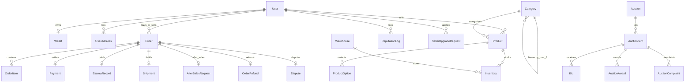

# Cơ sở dữ liệu (PostgreSQL 17 + Prisma 7)

Toàn bộ mô hình dữ liệu quan hệ của Project Nexus được định nghĩa tập trung trong `backend/prisma/schema.prisma` với **44 models** và **27 enums**, ánh xạ sang bảng/cột PostgreSQL theo chuẩn `snake_case` (`@map` / `@@map`).

## 1. Sơ đồ Quan hệ Thực thể (ERD Tổng quan)

## 2. Phân nhóm Chi tiết 44 Bảng Dữ liệu

### Nhóm 1: Định danh, Phân quyền & Uy tín

| Model                  | Vai trò chính                                                    | Ràng buộc / Mặc định quan trọng                                                                       |
| :--------------------- | :--------------------------------------------------------------- | :---------------------------------------------------------------------------------------------------- |
| `User`                 | Tài khoản hợp nhất (`BUYER`, `SELLER`, `SUPPORT_STAFF`, `ADMIN`) | `reputationScore @default(50)`, `trustLevel @default(PROBATION)`, `isSellerActive`, `isShopSuspended` |
| `UserAddress`          | Sổ địa chỉ giao/nhận hàng (tích hợp mã Tỉnh/Quận/Phường GHN)     | Đánh dấu `isDefault` cho địa chỉ mặc định                                                             |
| `RefreshToken`         | Lưu token làm mới có thời hạn & thu hồi (rotation)               | Liên kết `userId`, kiểm tra `revokedAt` & `expiresAt`                                                 |
| `SellerUpgradeRequest` | Hồ sơ đăng ký nâng cấp Buyer → Seller                            | Trạng thái `PENDING` → `APPROVED` / `REJECTED`, đính kèm minh chứng                                   |
| `StaffInvitation`      | Lời mời kích hoạt tài khoản `SUPPORT_STAFF` (`@staff.com`)       | Gửi token + OTP qua `personalEmail`                                                                   |
| `ReputationLog`        | Nhật ký biến động điểm uy tín                                    | Ghi `delta`, `penaltyType`, lý do và `referenceId`                                                    |

### Nhóm 2: Ví Nội bộ, Ký quỹ & Tài chính

| Model               | Vai trò chính                              | Ràng buộc / Mặc định quan trọng                                                    |
| :------------------ | :----------------------------------------- | :--------------------------------------------------------------------------------- |
| `Wallet`            | Ví `NEXUS Pay` cho mỗi User & ví sàn Admin | Tách biệt `balance` (khả dụng) và `lockedBalance` (đang khóa rút/hoàn)             |
| `WalletTransaction` | Sổ cái giao dịch ví bất biến               | `WalletTransactionType` (nạp, thanh toán, giải ngân, hoàn tiền, cọc, tịch thu cọc) |
| `WithdrawalRequest` | Yêu cầu rút tiền từ ví về ngân hàng        | Tối đa 3 yêu cầu `PENDING`, khóa tiền vào `lockedBalance` khi tạo                  |
| `EscrowRecord`      | Bản ghi ký quỹ 1-1 với `Order`             | `HELD` → `DISBURSED` / `REFUNDED`, lưu `platformFee` (`7%`) & `sellerPayout`       |
| `OrderRefund`       | Hạch toán hoàn tiền sau hủy/trả hàng       | `PENDING` (chờ Admin xác nhận `externalReference` nếu PayOS) hoặc `SUCCESS`        |

### Nhóm 3: Catalog, Tồn kho Đa kho & Banner

| Model                                      | Vai trò chính                                   | Ràng buộc / Mặc định quan trọng                                                |
| :----------------------------------------- | :---------------------------------------------- | :----------------------------------------------------------------------------- |
| `Category`                                 | Cây danh mục đa cấp                             | Giới hạn **tối đa 3 cấp** (`level` 1–3), kiểm tra chống vòng lặp khi di chuyển |
| `Product`, `ProductImage`, `ProductOption` | Sản phẩm, bộ ảnh/3D & biến thể                  | Hỗ trợ `salePrice`, `saleStartsAt`, `saleEndsAt`                               |
| `Warehouse`, `Inventory`                   | Kho hàng của Seller & số lượng khả dụng         | Tách `availableQty` và `reservedQty`                                           |
| `InventoryReservation`, `InventoryLedger`  | Giữ chỗ tồn kho tạm thời & sổ cái xuất/nhập kho | Mọi biến động tồn kho đều ghi `InventoryLedger` để truy vết                    |
| `EventBanner`, `BannerDisableHistory`      | Banner sự kiện trang chủ & lịch sử bật/tắt      | Tạo bởi `ADMIN` hoặc `SUPPORT_STAFF`                                           |

### Nhóm 4: Thương mại, Hậu mãi & Đánh giá

| Model                                       | Vai trò chính                                     | Ràng buộc / Mặc định quan trọng                          |
| :------------------------------------------ | :------------------------------------------------ | :------------------------------------------------------- |
| `Cart`, `CartItem`                          | Giỏ hàng bền vững (TTL 7 ngày)                    | Hỗ trợ merge giỏ hàng Guest sau khi đăng nhập            |
| `Order`, `OrderItem`, `Payment`             | Đơn hàng tách theo Shop & giao dịch thanh toán    | `PaymentProvider`: `PAYOS`, `WALLET`, `COD`              |
| `AfterSalesRequest`, `Dispute`              | Yêu cầu hủy/trả hàng (cửa sổ 3 ngày) & tranh chấp | Đóng băng `EscrowRecord` (`DISPUTED`) khi phát sinh      |
| `Review`, `ProductReview`, `CustomerReview` | Đánh giá sản phẩm (1–5 sao) & đánh giá khách hàng | Kiểm tra quyền đã mua hàng thành công trước khi đánh giá |

### Nhóm 5: Đấu giá 3D nhiều Lô

| Model              | Vai trò chính                                        | Ràng buộc / Mặc định quan trọng                                   |
| :----------------- | :--------------------------------------------------- | :---------------------------------------------------------------- |
| `Auction`          | Phiên đấu giá (chứa nhiều lô)                        | `DRAFT` → `SCHEDULED` → `ACTIVE`/`EXTENDED` → `ENDED` → `SETTLED` |
| `AuctionItem`      | Lô đấu giá cụ thể, đính kèm model `.glb` & chứng thư | Duyệt ký gửi `PENDING_REVIEW` → `APPROVED` / `REJECTED`           |
| `Bid`              | Lịch sử đặt giá trên từng `AuctionItem`              | Khóa bi quan + Redis lock khi ghi                                 |
| `AuctionAward`     | Kết quả trao giải cho người thắng                    | `PRIMARY_WINNER` hoặc `SECOND_CHANCE`                             |
| `AuctionComplaint` | Khiếu nại kết quả/vật phẩm đấu giá                   | Xử lý bởi Staff/Admin                                             |

### Nhóm 6: Vận chuyển, Chat, Thông báo & Quản trị Shop

- **Vận chuyển**: `SellerGhnAccount` (cấu hình shop GHN theo môi trường), `Shipment` (mã vận đơn GHN, tracking chiều đi & chiều về `NX-RETURN-*`).
- **Chat**: `ChatConversation` (hội thoại Buyer–Seller hoặc Support Queue), `ChatMessage`, `ChatAutoReply`.
- **Thông báo & Audit**: `Notification`, `NotificationPreference`, `EventLog`, `ShopActionLog`, `ShopViolation`.
