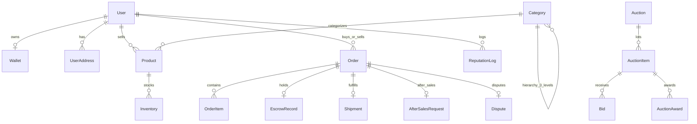

# Cơ sở dữ liệu (PostgreSQL 17 + Prisma 7)

Sơ đồ dữ liệu thực tế trong `backend/prisma/schema.prisma` bao gồm các nhóm thực thể chính sau:

## Các nhóm bảng quan trọng (đối chiếu từ `schema.prisma`)

1. **Định danh & Uy tín**: `User`, `UserAddress`, `RefreshToken`, `ReputationLog`, `SellerUpgradeRequest`, `StaffInvitation`.
2. **Ví & Tài chính**: `Wallet`, `WalletTransaction`, `WithdrawalRequest`, `EscrowRecord`, `OrderRefund`.
3. **Catalog & Tồn kho**: `Category` (tối đa 3 cấp), `Product`, `ProductImage`, `ProductOption`, `Warehouse`, `Inventory`, `InventoryReservation`, `InventoryLedger`, `EventBanner`, `BannerDisableHistory`.
4. **Thương mại & Hậu mãi**: `Cart`, `CartItem`, `Order`, `OrderItem`, `Payment`, `AfterSalesRequest`, `Dispute`, `Review`, `ProductReview`, `CustomerReview`.
5. **Đấu giá**: `Auction` (phiên), `AuctionItem` (lô đấu giá kèm chứng thư giám định), `Bid`, `AuctionAward` (`PRIMARY_WINNER` / `SECOND_CHANCE`), `AuctionComplaint`.
6. **Vận chuyển & Chat**: `SellerGhnAccount`, `Shipment`, `ChatConversation`, `ChatMessage`, `ChatAutoReply`, `Notification`, `NotificationPreference`, `ShopActionLog`, `ShopViolation`.
