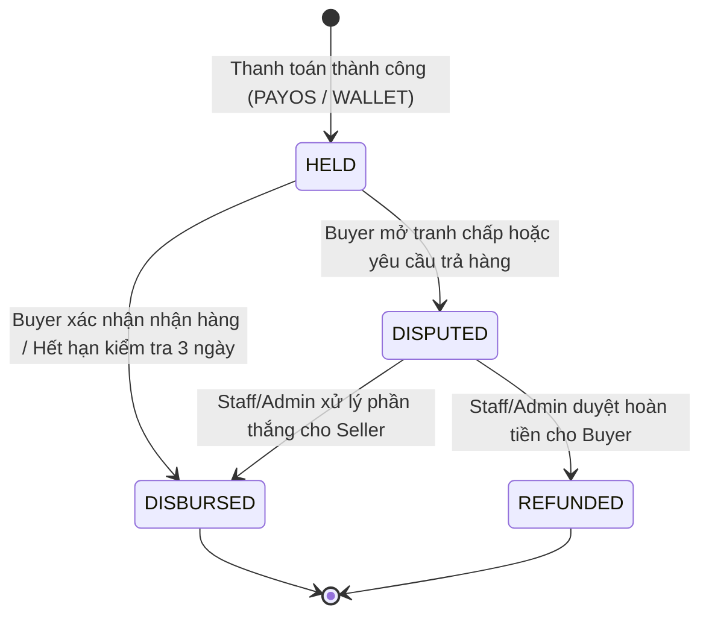
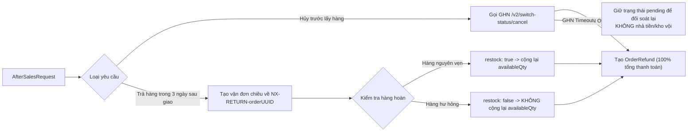
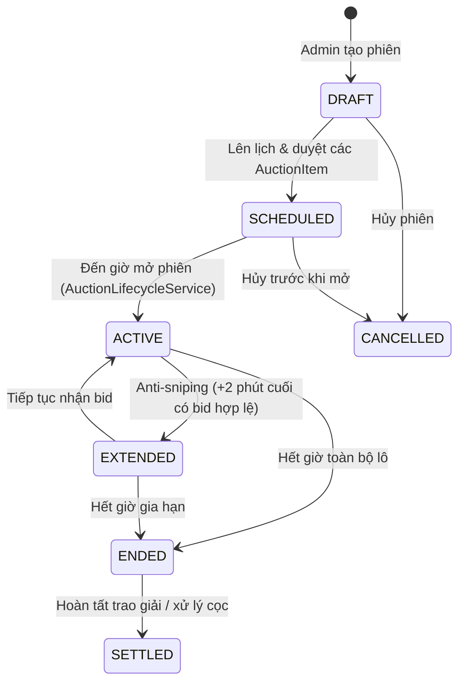

# State Machines (Đơn hàng, Escrow, Hậu mãi & Đấu giá)

Tài liệu này mô tả chi tiết các máy trạng thái (State Machines) đang điều khiển vòng đời giao dịch trong Project Nexus.

## 1. Vòng đời Ký quỹ (`EscrowStatus`)

- Khi ở `DISBURSED`: Ví Seller nhận `subtotal - platformFee (7%) + shippingFee` (tùy cấu hình trả cước), ví Admin ghi nhận phí sàn.
- Khi ở `REFUNDED`: Toàn bộ số tiền hoàn được điều phối qua `RefundService` và `OrderRefund`.

## 2. Hủy đơn & Trả hàng / Hoàn tiền (`AfterSalesRequest` & `OrderRefund`)

### Quy tắc Hạch toán Hoàn tiền (`OrderRefund`)

- **Phạm vi**: Hỗ trợ hủy toàn bộ đơn trước khi GHN lấy hàng và trả toàn bộ đơn trong **cửa sổ kiểm tra 3 ngày** sau khi giao.
- **Mức hoàn**: Hoàn **100% tổng thanh toán đã xác nhận** (bao gồm cả phí vận chuyển chiều đi), không khấu trừ tùy tiện.
- **Kênh hoàn tiền**:
  - Đơn thanh toán bằng **`WALLET`**: Hoàn tự động tức thì vào `Wallet.balance` của Buyer (`OrderRefund.status = SUCCESS`).
  - Đơn thanh toán bằng **`PAYOS`**: Tạo `OrderRefund` trạng thái `PENDING` (chuyển tiền từ `balance` sang `lockedBalance` của ví sàn), chỉ chuyển `SUCCESS` khi Admin xác nhận mã giao dịch chuyển khoản `externalReference` thực tế (trừ trường hợp Buyer chọn hoàn về ví nội bộ).

## 3. Vòng đời Đấu giá nhiều Lô (`Auction` → `AuctionItem` → `AuctionAward`)

### Quy trình Lô & Trao giải (`AuctionItem` & `AuctionAward`)

1. **Kiểm duyệt Ký gửi (`AuctionItemStatus`)**: Seller đăng ký vật phẩm + chứng thư giám định → `PENDING_REVIEW` → Staff/Admin duyệt `APPROVED` (gắn vào phiên) hoặc `REJECTED`.
2. **Trao giải chính (`PRIMARY_WINNER`)**: Lô kết thúc với giá cao nhất hợp lệ → tạo `AuctionAward` (`AWAITING_CHECKOUT` / `AWAITING_DEPOSIT` → `PAID`).
3. **Cơ hội thứ hai (`SECOND_CHANCE`) & Tịch thu cọc**: Nếu người thắng chính từ chối (`DECLINED`), rút lui (`BUYER_WITHDRAWN`) hoặc quá hạn thanh toán (`PAYMENT_DEFAULT`), hệ thống ghi nhận `AUCTION_DEPOSIT_FORFEIT` / `AUCTION_DEPOSIT_COMPENSATION` và có thể phát lời mời `SECOND_CHANCE` cho người trả giá cao tiếp theo.
