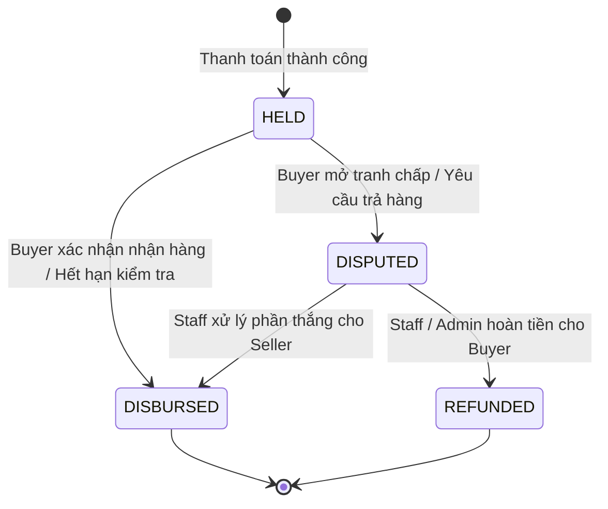

# State Machines (Đơn hàng, Escrow, Hậu mãi & Đấu giá)

## 1. Vòng đời Ký quỹ (Escrow)

## 2. Hủy đơn & Trả hàng / Hoàn tiền (`AfterSalesRequest` & `OrderRefund`)

- **Phạm vi**: Hỗ trợ hủy toàn bộ đơn trước khi GHN lấy hàng, và yêu cầu trả toàn bộ đơn sau khi giao trong cửa sổ kiểm tra 3 ngày.
- **Số tiền hoàn**: Hoàn 100% tổng thanh toán đã xác nhận (bao gồm phí vận chuyển chiều đi), không khấu trừ tùy tiện.
- **Tích hợp GHN**:
  - Hủy đơn trước lấy hàng gọi `POST /v2/switch-status/cancel`; nếu GHN timeout, yêu cầu giữ trạng thái pending bền vững để đối soát lại thay vì nhả tiền/kho vội.
  - Trả hàng sau giao dùng vận đơn chiều về `NX-RETURN-<orderUUID>` và kiểm tra thực nhận trước khi hoàn tiền/nhập kho (`restock: true/false`, hàng hỏng không được cộng lại vào `availableQty`).
- **Hạch toán hoàn tiền (`OrderRefund`)**:
  - Thanh toán qua `WALLET` hoàn tự động ngay vào ví Buyer.
  - Thanh toán qua kênh ngoài (`PAYOS`) tạo `OrderRefund` trạng thái `PENDING` (chuyển tiền từ `balance` sang `lockedBalance` của ví sàn), chỉ chuyển `SUCCESS` khi Admin xác nhận `externalReference` thực tế (trừ khi Buyer đồng ý hoàn về ví nội bộ).

## 3. Vòng đời Đấu giá nhiều Lô (`Auction` → `AuctionItem` → `AuctionAward`)

- Phiên đấu giá (`Auction`: `DRAFT` → `SCHEDULED` → `ACTIVE` / `EXTENDED` → `ENDED` → `SETTLED` / `CANCELLED` / `FAILED`).
- Lô đấu giá (`AuctionItem`) đi qua quy trình ký gửi & kiểm duyệt chứng thư (`PENDING_REVIEW` → `APPROVED` / `REJECTED`).
- Trao giải (`AuctionAward`):
  - `PRIMARY_WINNER` nhận quyền mua (`AWAITING_CHECKOUT` / `AWAITING_DEPOSIT` → `PAID`).
  - Nếu hết hạn, từ chối (`DECLINED`) hoặc rút lui (`BUYER_WITHDRAWN`), hệ thống có thể kích hoạt `SECOND_CHANCE` cho người trả giá cao tiếp theo hoặc tịch thu cọc (`PAYMENT_DEFAULT`).
