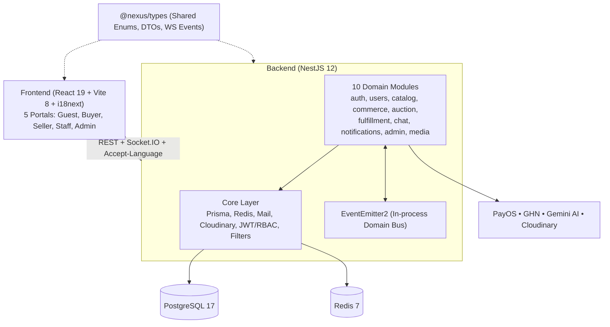

# Kiến trúc Hệ thống (Modular Monolith)

Project Nexus được tổ chức theo mô hình **Level 1.5 Modular Monolith** trong một monorepo `npm workspaces` + `Turborepo`:

## Quy tắc cô lập Module

- Mỗi module sở hữu các bảng Prisma riêng và giao tiếp qua Service public hoặc `EventEmitter2`.
- Các thao tác đa bước nhạy cảm tài chính/tồn kho (thanh toán, đặt giá đấu giá, escrow, hoàn tiền) thực thi bên trong `prisma.$transaction()` kết hợp `SELECT ... FOR UPDATE` hoặc Redis lock.
