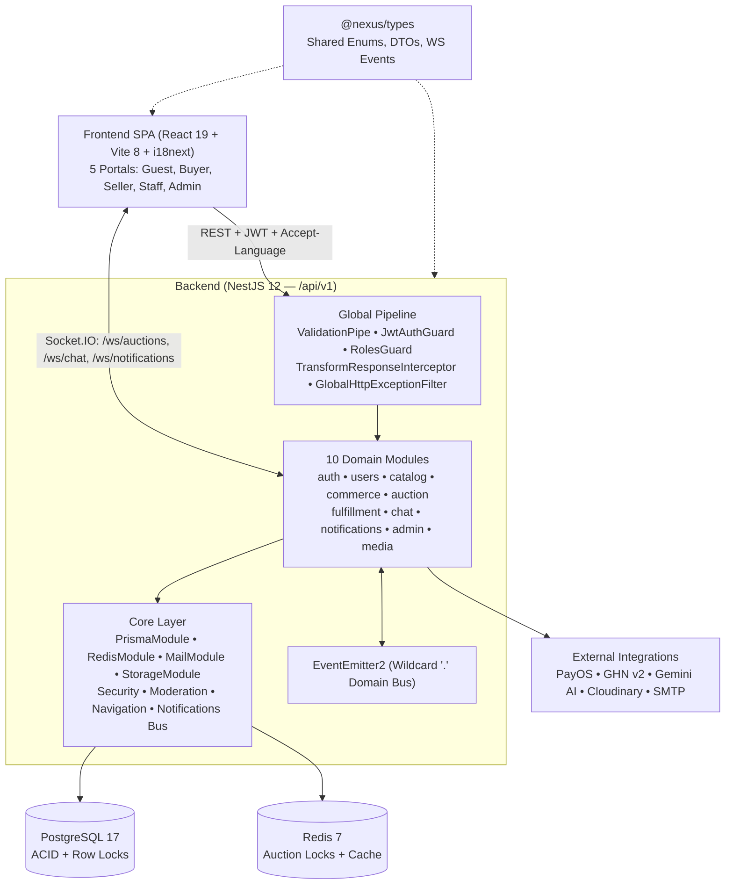

# Kiến trúc Hệ thống (Modular Monolith Level 1.5)

Project Nexus được thiết kế theo mô hình **Level 1.5 Modular Monolith** trên nền **NestJS 12** và **Turborepo**: toàn bộ nghiệp vụ chạy trong một tiến trình Backend thống nhất để đảm bảo ACID transaction xuyên bảng, nhưng mã nguồn được phân rã thành **10 Domain Modules** cô lập, giao tiếp qua Public Service API hoặc in-process Event Bus (`EventEmitter2`).

## 1. Phân tầng Kiến trúc Backend (`backend/src`)

### Core Layer (`backend/src/core`)

- **`prisma/`**: `PrismaService` kết nối PostgreSQL 17 qua Prisma 7, cung cấp `$transaction` và delegate wrapper phát sự kiện realtime khi tạo `Notification`.
- **`redis/`**: `RedisService` quản lý kết nối Redis 7 phục vụ distributed lock (đấu giá, đồng bộ tồn kho) và cache ngắn hạn.
- **`mail/`**: `MailService` gửi email OTP xác thực, đặt lại mật khẩu và thư mời kích hoạt tài khoản Support Staff (`@staff.com`).
- **`storage/`**: Trừu tượng hóa lưu trữ file (Cloudinary cho production hoặc static `/uploads` cho local).
- **`filters/` & `interceptors/`**: `GlobalHttpExceptionFilter` chuẩn hóa JSON lỗi (`statusCode`, `errorCode`, `message`, `errors`); `TransformResponseInterceptor` chuẩn hóa response envelope.
- **`moderation/` & `security/`**: Bộ lọc kiểm duyệt nội dung (`content-moderation.util.ts`), bảo vệ tài liệu mật (`document-security`).

### Domain Layer (`backend/src/modules`)

10 module nghiệp vụ độc lập: `auth`, `users`, `catalog`, `commerce`, `auction`, `fulfillment`, `chat`, `notifications`, `admin`, `media`. Mỗi module đóng gói controller, DTO, service và helper riêng; không import trực tiếp internal service của module khác nếu chưa được export qua `Module` hoặc `commerce-query.module.ts`.

## 2. Cơ chế Giao tiếp Liên Module

| Cơ chế                                | Khi nào sử dụng                                                      | Ví dụ thực tế                                                                                                                      |
| :------------------------------------ | :------------------------------------------------------------------- | :--------------------------------------------------------------------------------------------------------------------------------- |
| **Inject Public Service**             | Cần đọc dữ liệu đồng bộ hoặc tham gia cùng `prisma.$transaction()`   | `CommerceModule` gọi `InventoryService` (Catalog) để giữ chỗ tồn kho; `FulfillmentModule` đọc `ShopShippingProfileService` (Users) |
| **EventEmitter2 (`@OnEvent`)**        | Tác vụ phụ bất đồng bộ, giảm coupling vòng                           | Đơn hàng thanh toán/hủy phát sự kiện để cập nhật uy tín (`ReputationModule`) hoặc đẩy thông báo (`NotificationsModule`)            |
| **Shared Contracts (`@nexus/types`)** | Đồng bộ hằng số, Enum, tên sự kiện WebSocket giữa Backend & Frontend | `Role`, `OrderStatus`, `AuctionStatus`, `AUCTION_EVENTS`, `CHAT_EVENTS`                                                            |

## 3. Chiến lược Đảm bảo Tính nhất quán (Concurrency & Consistency)

- **ACID Transaction (`prisma.$transaction`)**: Áp dụng cho checkout, giữ tiền `EscrowRecord`, giải ngân, hoàn tiền `OrderRefund`, rút tiền `WithdrawalRequest`, và đặt giá `Bid`.
- **Pessimistic Row Lock (`SELECT ... FOR UPDATE`)**: Chặn race condition khi hai người mua cùng đặt sản phẩm cuối cùng trong kho hoặc hai người đấu giá cùng gửi `Bid` vào một `AuctionItem`.
- **Idempotency (`Idempotency-Key`)**: Endpoint checkout/thanh toán chống double-charge khi mạng chập chờn hoặc người dùng click nhiều lần.
- **Webhook Verification**: PayOS webhook kiểm tra chữ ký HMAC (`PAYOS_CHECKSUM_KEY`), GHN webhook kiểm tra secret (`GHN_WEBHOOK_SECRET`).
