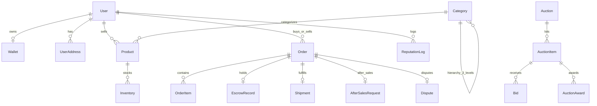

# Database Schema (PostgreSQL 17 + Prisma 7)

Audited entity topology from `backend/prisma/schema.prisma`:

## Entity Groups (Verified in `schema.prisma`)

1. **Identity & Reputation**: `User`, `UserAddress`, `RefreshToken`, `ReputationLog`, `SellerUpgradeRequest`, `StaffInvitation`.
2. **Wallet & Finance**: `Wallet`, `WalletTransaction`, `WithdrawalRequest`, `EscrowRecord`, `OrderRefund`.
3. **Catalog & Inventory**: `Category` (up to 3 tiers), `Product`, `ProductImage`, `ProductOption`, `Warehouse`, `Inventory`, `InventoryReservation`, `InventoryLedger`, `EventBanner`, `BannerDisableHistory`.
4. **Commerce & After-Sales**: `Cart`, `CartItem`, `Order`, `OrderItem`, `Payment`, `AfterSalesRequest`, `Dispute`, `Review`, `ProductReview`, `CustomerReview`.
5. **Auctions**: `Auction`, `AuctionItem` (with appraisal certificates), `Bid`, `AuctionAward` (`PRIMARY_WINNER` / `SECOND_CHANCE`), `AuctionComplaint`.
6. **Fulfillment & Chat**: `SellerGhnAccount`, `Shipment`, `ChatConversation`, `ChatMessage`, `ChatAutoReply`, `Notification`, `NotificationPreference`, `ShopActionLog`, `ShopViolation`.
