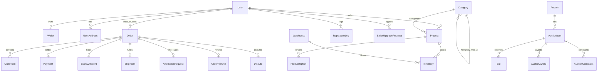

# Database Architecture (PostgreSQL 17 + Prisma 7)

Project Nexus defines its complete relational data model in `backend/prisma/schema.prisma`, comprising **44 models** and **27 enums** mapped to PostgreSQL `snake_case` tables and columns (`@map` / `@@map`).

## 1. Entity Relationship Diagram (Core Overview)

## 2. Detailed Breakdown of 44 Models

### Group 1: Identity, RBAC & Reputation

| Model                  | Primary Role                                                       | Key Constraints / Defaults                                                                            |
| :--------------------- | :----------------------------------------------------------------- | :---------------------------------------------------------------------------------------------------- |
| `User`                 | Unified user account (`BUYER`, `SELLER`, `SUPPORT_STAFF`, `ADMIN`) | `reputationScore @default(50)`, `trustLevel @default(PROBATION)`, `isSellerActive`, `isShopSuspended` |
| `UserAddress`          | Shipping/return address book with GHN Province/District/Ward IDs   | `isDefault` flag per user                                                                             |
| `RefreshToken`         | Persisted refresh tokens supporting rotation & revocation          | Linked to `userId` with `revokedAt` & `expiresAt`                                                     |
| `SellerUpgradeRequest` | Buyer-to-Seller onboarding application                             | `PENDING` → `APPROVED` / `REJECTED` with proof attachments                                            |
| `StaffInvitation`      | Activation invite for `SUPPORT_STAFF` (`@staff.com`)               | Token + OTP dispatched to `personalEmail`                                                             |
| `ReputationLog`        | Immutable audit trail of reputation score changes                  | Records `delta`, `penaltyType`, reason, and `referenceId`                                             |

### Group 2: Internal Wallet, Escrow & Finance

| Model               | Primary Role                                          | Key Constraints / Defaults                                                                    |
| :------------------ | :---------------------------------------------------- | :-------------------------------------------------------------------------------------------- |
| `Wallet`            | `NEXUS Pay` wallet per user and platform Admin wallet | Separates `balance` (available) from `lockedBalance` (pending withdrawal/refund)              |
| `WalletTransaction` | Immutable wallet ledger                               | `WalletTransactionType` (deposit, order pay, escrow release, refund, auction deposit/forfeit) |
| `WithdrawalRequest` | Bank withdrawal request                               | Max 3 `PENDING` requests; funds move to `lockedBalance` on creation                           |
| `EscrowRecord`      | 1-to-1 Escrow ledger per `Order`                      | `HELD` → `DISBURSED` / `REFUNDED`; stores `platformFee` (`7%`) & `sellerPayout`               |
| `OrderRefund`       | Refund accounting record                              | `PENDING` (awaits Admin `externalReference` for PayOS) or `SUCCESS`                           |

### Group 3: Catalog, Multi-Warehouse Inventory & Banners

| Model                                      | Primary Role                                         | Key Constraints / Defaults                                            |
| :----------------------------------------- | :--------------------------------------------------- | :-------------------------------------------------------------------- |
| `Category`                                 | Hierarchical category tree                           | Enforces **max depth of 3 levels** (`level` 1–3) and cycle prevention |
| `Product`, `ProductImage`, `ProductOption` | Products, image/3D assets, and variants              | Supports time-boxed `salePrice` (`saleStartsAt`, `saleEndsAt`)        |
| `Warehouse`, `Inventory`                   | Seller warehouses & stock quantities                 | Separates `availableQty` and `reservedQty`                            |
| `InventoryReservation`, `InventoryLedger`  | Checkout stock reservations & immutable stock ledger | Every stock mutation writes an `InventoryLedger` entry                |
| `EventBanner`, `BannerDisableHistory`      | Homepage promotional banners & toggle audit          | Created by `ADMIN` or `SUPPORT_STAFF`                                 |

### Group 4: Commerce, After-Sales & Reviews

| Model                                       | Primary Role                                         | Key Constraints / Defaults                        |
| :------------------------------------------ | :--------------------------------------------------- | :------------------------------------------------ |
| `Cart`, `CartItem`                          | Persistent shopping cart (7-day TTL)                 | Supports guest cart merge upon Buyer/Seller login |
| `Order`, `OrderItem`, `Payment`             | Shop-split orders & payment records                  | `PaymentProvider`: `PAYOS`, `WALLET`, `COD`       |
| `AfterSalesRequest`, `Dispute`              | Cancellation & 3-day return requests + disputes      | Freezes `EscrowRecord` (`DISPUTED`) when opened   |
| `Review`, `ProductReview`, `CustomerReview` | Verified product reviews (1–5 stars) & buyer reviews | Enforces verified purchase eligibility            |

### Group 5: 3D Multi-Lot Auctions

| Model              | Primary Role                                                 | Key Constraints / Defaults                                        |
| :----------------- | :----------------------------------------------------------- | :---------------------------------------------------------------- |
| `Auction`          | Auction session containing multiple lots                     | `DRAFT` → `SCHEDULED` → `ACTIVE`/`EXTENDED` → `ENDED` → `SETTLED` |
| `AuctionItem`      | Individual auction lot with `.glb` 3D model & appraisal cert | Consignment review `PENDING_REVIEW` → `APPROVED` / `REJECTED`     |
| `Bid`              | Bid history per `AuctionItem`                                | Protected by PostgreSQL row lock + Redis lock                     |
| `AuctionAward`     | Winner award record                                          | `PRIMARY_WINNER` or `SECOND_CHANCE`                               |
| `AuctionComplaint` | Post-auction item/outcome complaint                          | Mediated by Staff/Admin                                           |

### Group 6: Logistics, Chat, Notifications & Shop Governance

- **Logistics**: `SellerGhnAccount` (per-environment GHN credentials), `Shipment` (forward & return `NX-RETURN-*` tracking).
- **Chat**: `ChatConversation` (Buyer–Seller & Staff Support Queue), `ChatMessage`, `ChatAutoReply`.
- **Notifications & Audit**: `Notification`, `NotificationPreference`, `EventLog`, `ShopActionLog`, `ShopViolation`.
