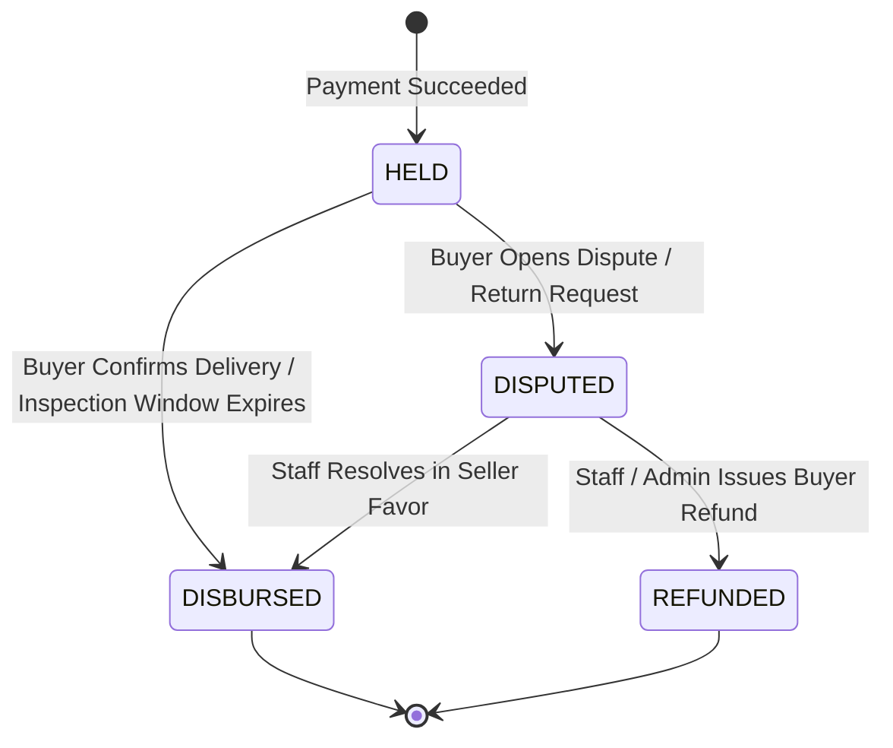

# State Machines (Orders, Escrow, After-Sales & Auctions)

## 1. Escrow Lifecycle

## 2. Cancellations, Returns & Refunds (`AfterSalesRequest` & `OrderRefund`)

- **Scope**: Whole-order cancellation before carrier pickup, and whole-order return requests within the 3-day post-delivery inspection window.
- **Refund Amount**: 100% of verified payment total (including outbound shipping), with zero arbitrary deductions.
- **GHN Behavior**:
  - Pre-pickup cancellation calls `POST /v2/switch-status/cancel`; on GHN timeout, the request remains durably pending for reconciliation without prematurely releasing funds or stock.
  - Post-delivery returns bind a separate reverse shipment (`NX-RETURN-<orderUUID>`) and require verified physical receipt before refunding or restocking (`restock: true/false`; damaged items are never returned to saleable inventory).
- **Refund Accounting (`OrderRefund`)**:
  - `WALLET` payments refund automatically to the buyer's wallet.
  - External payments (`PAYOS`) create a `PENDING` `OrderRefund` (moving funds from platform `balance` to `lockedBalance`), transitioning to `SUCCESS` only after Admin records `externalReference` (unless buyer consents to wallet refund).

## 3. Multi-Lot Auction Lifecycle (`Auction` → `AuctionItem` → `AuctionAward`)

- `Auction` session states: `DRAFT` → `SCHEDULED` → `ACTIVE` / `EXTENDED` → `ENDED` → `SETTLED` / `CANCELLED` / `FAILED`.
- `AuctionItem` consignment review: `PENDING_REVIEW` → `APPROVED` / `REJECTED`.
- `AuctionAward` settlement: `PRIMARY_WINNER` (`AWAITING_CHECKOUT` / `AWAITING_DEPOSIT` → `PAID`), cascading to `SECOND_CHANCE` or `PAYMENT_DEFAULT` upon expiry, decline, or withdrawal.
