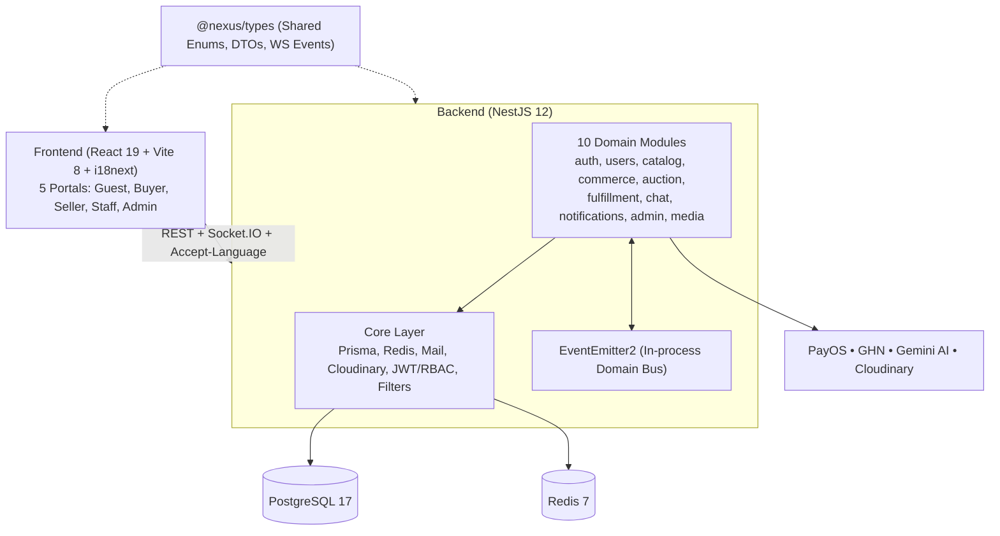

# System Architecture (Modular Monolith)

Project Nexus follows a **Level 1.5 Modular Monolith** architecture inside an `npm workspaces` + `Turborepo` monorepo:

## Module Isolation Rules

- Each domain module owns its Prisma tables and communicates via public services or `EventEmitter2`.
- Financial and inventory-sensitive workflows execute inside `prisma.$transaction()` with `SELECT ... FOR UPDATE` or Redis locks.
