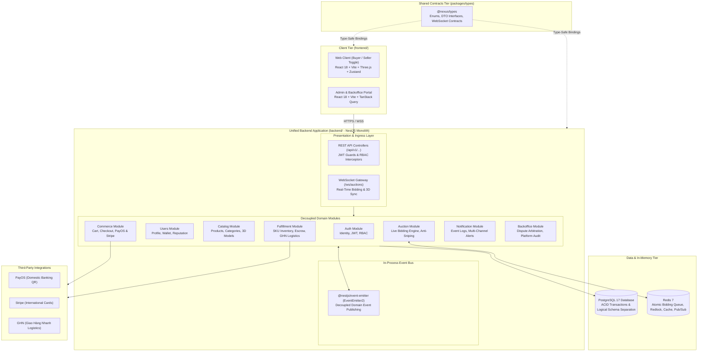

# Project Nexus - System Architecture Document

## 1. Executive Summary

Project Nexus is an e-commerce platform that seamlessly integrates traditional online retail with real-time 3D live auctions (WebGL / Three.js). The platform is architected as an Enterprise Modular Monolith within a Type-Safe Monorepo, employing a Feature-Driven / Modular Architecture on the client side and Decoupled Domain Modules within a unified NestJS backend runtime.

By adopting this architecture, Project Nexus achieves:

- High Operational Simplicity: Single unified deployment artifact, eliminating distributed network latency, cross-service serialization overhead, and multi-service orchestration complexity.
- Strong Transactional Consistency: Complex multi-step operations (e.g., checkout and escrow fund locking) execute within native PostgreSQL ACID transactions, eliminating distributed Saga orchestration or Two-Phase Commit (2PC).
- Domain Independence & Bounded Contexts: Clear logical module boundaries maintained via explicit module interfaces, logical schema separation, and in-process event emission (`@nestjs/event-emitter`).
- Zero Schema Drift: A dedicated shared library (`packages/types`) serves as the single source of truth for DTOs, Enums, and WebSocket contracts across Backend and Client applications.

---

## 2. System Context & High-Level Architecture

The platform consists of four primary tiers: Shared Contracts, Client Applications, Unified Modular Monolith Backend, and Persistence/Caching Infrastructure.



---

## 3. Communication Paradigms

Project Nexus strictly defines communication boundaries:

### 3.1. Client-to-Backend Communication

- RESTful HTTP APIs: Standard request-response operations (browsing catalogs, submitting orders, managing wallet balances) communicate over HTTPS with standard JSON payloads prefixed with `/api/v1/...`.
- WebSocket (Socket.IO): Bi-directional, low-latency communication for live auction rooms via `/ws/auctions`:
  - Broadcasts new highest bids (`auction:bid:placed`).
  - Broadcasts clock updates and anti-sniping extension events (`auction:timer:sync`, `auction:time_extended`).
  - Synchronizes 3D WebGL rotation and lighting parameters across connected room participants (`auction:3d:sync`).

### 3.2. Inter-Module In-Process Communication

Within the monolithic backend, modules communicate without network serialization:

- Direct Service Injection (Synchronous Reads): When immediate strongly-typed query data is needed across module boundaries (e.g., `CommerceModule` checking product availability via `CatalogService`).
- Domain Event Bus (Asynchronous / Decoupled Writes): To keep modules loosely coupled, state changes trigger domain events via `@nestjs/event-emitter`:
  - `OrderCreatedEvent`: Published by `CommerceModule` $\rightarrow$ Handled by `FulfillmentModule` (to lock funds into Escrow) and `UsersModule` (to deduct balance).
  - `AuctionEndedEvent`: Published by `AuctionModule` $\rightarrow$ Handled by `CommerceModule` (to create winner's order) and `FulfillmentModule` (to commit winning inventory).
  - `DisputeResolvedEvent`: Published by `BackofficeModule` $\rightarrow$ Handled by `FulfillmentModule` (to release or refund escrow).
  - `*All Domain Events*`: Captured automatically by `NotificationModule` to persist immutable audit records into `event_logs` and dispatch user alerts.

---

## 4. Internal Module Architecture & Boundary Rules

Every domain module in `backend/src/modules/<module-name>/` follows a clean, layered structure:

```text
backend/src/modules/<module-name>/
├── controllers/                 # HTTP REST endpoints & route handlers
├── dtos/                        # Request validation & response schemas
├── entities/                    # Business entities & Prisma data mappers
├── events/                      # Domain event definitions (e.g., OrderCreatedEvent.ts)
├── listeners/                   # Event listeners handling domain events from other modules
├── services/                    # Business logic & transaction orchestration
└── <module-name>.module.ts      # NestJS Module definition with explicit exports
```

### 4.1. Logical Schema Separation (Addressing SRS 4.1 in Monolith)

To fulfill the requirement that services must not share database tables or access foreign data stores, Project Nexus implements Logical Schema Separation:

1. Module Ownership: Each domain module exclusively owns its respective tables (e.g., `Commerce` owns `orders`, `order_items`; `Fulfillment` owns `inventories`, `escrow_records`).
2. Encapsulation: Direct cross-module database queries via Prisma are strictly forbidden. A module needing foreign data must inject the owning module's public service or subscribe to its domain events.
3. Transactional Integrity: When an operation spans multiple modules and requires ACID atomicity (e.g., placing an order and locking escrow), it is coordinated via `prisma.$transaction()` within a unified Unit of Work while keeping repository methods isolated.

### 4.2. Circular Dependency Prevention

- Forward references (`forwardRef()`) are strictly disallowed. Cross-module notifications must flow through in-process domain events.

---

## 5. Persistence & In-Memory Architecture

### 5.1. PostgreSQL 17 (Prisma ORM)

A single PostgreSQL 17 database serves as the unified persistence store.

- Relational Integrity: Foreign key constraints guarantee strict integrity between Users, Orders, Products, Escrow Records, and Auction Items.
- Transaction Safety: Financial transactions (wallet deposits, withdrawals, escrow holds, and platform fee deductions) run with serializable or read-committed isolation levels to eliminate phantom reads and race conditions.

### 5.2. Redis 7

Redis is utilized for high-throughput, sub-10ms latency operations:

- Atomic Bidding Queue & Distributed Locks: During high-concurrency auctions, Redis locks (`Redlock`) serialize bids down to the millisecond, preventing double-spend and race conditions before writing to PostgreSQL.
- Real-Time Cache: Caches hot catalog items, active auction countdown states, and user session data.
- Socket.IO Redis Adapter: Enables horizontal scaling of WebSocket gateways across multiple instances if traffic scales up.

---

## 6. Frontend Architecture (`frontend/web` & `frontend/admin`)

Both frontend applications are built with React 18 + Vite + TypeScript + Tailwind CSS, organized using a Feature-Driven Architecture:

### Three.js WebGL Lifecycle Rules in React

1. Lifecycle Isolation: Three.js canvas instances are isolated within dedicated manager classes (`AuctionSceneManager.ts`) outside React's render loop to avoid performance degradation.
2. Memory Cleanup: On component unmount, all geometries, textures, and renderers are systematically disposed (`geometry.dispose()`, `material.dispose()`, `renderer.dispose()`) to eliminate browser memory leaks.
3. Fallback Display: If client hardware lacks WebGL acceleration or an auction item does not match any of the 15 hardcoded 3D models, the system seamlessly falls back to a 3D generic pedestal featuring the seller's uploaded 2D product images as textures.
