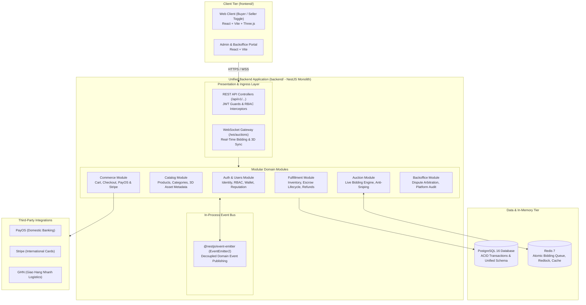

# Project Nexus - System Architecture Document

## 1. Executive Summary

Project Nexus is an e-commerce platform that seamlessly integrates traditional online retail with real-time 3D live auctions (WebGL / Three.js). The platform is architected as a Modular Monolith, employing a Feature-Driven / Modular Architecture on the client side and a Decoupled Domain-Driven Module Structure within a single NestJS backend runtime.

By adopting a Modular Monolith, Project Nexus achieves:

- High Operational Simplicity: Single deployment artifact, eliminating distributed network latency, cross-service serialization overhead, and multi-service orchestration complexity.
- Strong Transactional Consistency: Complex multi-step operations (e.g., checkout and escrow fund locking) are executed within native PostgreSQL ACID transactions, removing the need for distributed Saga orchestration or Two-Phase Commit (2PC).
- Domain Independence: Clear logical module boundaries maintained via explicit module interfaces and in-process event emission (`@nestjs/event-emitter`).

---

## 2. System Context & High-Level Architecture

The platform consists of three primary tiers: Client Applications, Unified Modular Monolith Backend, and Persistence/Caching Infrastructure.



---

## 3. Communication Paradigms

Project Nexus strictly defines communication boundaries:

### 3.1. Client-to-Backend Communication

- RESTful HTTP APIs: Standard request-response operations (browsing catalogs, submitting orders, managing wallet balances) communicate over HTTPS with standard JSON payloads.
- WebSocket (Socket.IO): Bi-directional, low-latency communication for live auction rooms:
  - Broadcasts new highest bids (`auction:bid:placed`).
  - Broadcasts clock updates and anti-sniping extension events (`auction:timer:sync`).
  - Synchronizes 3D WebGL rotation and lighting parameters across connected participants.

### 3.2. Inter-Module In-Process Communication

Within the monolithic backend, modules communicate without network serialization:

- Direct Service Injection (Synchronous): When immediate strongly-typed query data is needed across module boundaries (e.g., `CommerceModule` checking product availability via `CatalogService`).
- Domain Event Bus (Asynchronous / Decoupled): To keep modules loosely coupled, state changes trigger domain events via `@nestjs/event-emitter`:
  - `OrderCreatedEvent`: Published by `CommerceModule` $\rightarrow$ Handled by `FulfillmentModule` (to lock funds into Escrow) and `UsersModule` (to deduct balance).
  - `AuctionEndedEvent`: Published by `AuctionModule` $\rightarrow$ Handled by `CommerceModule` (to create winner's order) and `FulfillmentModule` (to lock winning escrow).
  - `DisputeResolvedEvent`: Published by `BackofficeModule` $\rightarrow$ Handled by `FulfillmentModule` (to release or refund escrow).

---

## 4. Internal Module Architecture

Every domain module in `backend/src/modules/` follows a clean, layered structure:

```text
backend/src/modules/<module-name>/
├── controllers/
├── dtos/
├── entities/
├── events/
├── listeners/
├── services/
└── <module-name>.module.ts
```

### Module Boundary Rules

1. Encapsulation: Modules must only expose public methods via their declared `@Injectable()` service providers in `exports`. Internal helpers and repository implementations remain private to the module.
2. ACID Transaction Boundaries: Cross-module database writes that must succeed or fail together are wrapped in native PostgreSQL transactions using `prisma.$transaction()`, guaranteeing data integrity without distributed rollbacks.
3. No Circular Dependencies: Forward references (`forwardRef()`) are strictly discouraged. Cross-module notifications must flow through in-process domain events.

---

## 5. Persistence & In-Memory Architecture

### 5.1. PostgreSQL (Prisma ORM)

A single PostgreSQL 16 database serves as the unified persistence store.

- Relational Integrity: Foreign key constraints ensure strict relational integrity between Users, Orders, Products, Escrow Records, and Auction Items.
- Transaction Safety: Financial transactions (wallet deposits, withdrawals, escrow holds, and platform fee deductions) run with serializable or read-committed isolation levels to eliminate phantom reads.

### 5.2. Redis 7

Redis is utilized for high-throughput, low-latency operations:

- Atomic Bidding Queue & Distributed Locks: During high-concurrency auctions, Redis locks (`Redlock`) serialize bids down to the millisecond, preventing double-spend and race conditions.
- Real-Time Cache: Caches hot catalog items, user reputation scores, and session data.
- Socket.IO Adapter: Enables horizontal scaling of the WebSocket gateway across multiple instances if needed in the future.

---

## 6. Frontend Architecture (`frontend/web` & `frontend/admin`)

Both frontend applications are built with React 18 + Vite + TypeScript + Tailwind CSS:

### Three.js WebGL Lifecycle Rules in React

1. Lifecycle Isolation: Three.js canvas instances are isolated within dedicated components (`useEffect` or `@react-three/fiber`).
2. Memory Cleanup: On component unmount, all geometries, textures, and renderers are systematically disposed (`geometry.dispose()`, `material.dispose()`) to eliminate browser memory leaks.
3. Fallback Display: If client hardware lacks WebGL acceleration or an auction item does not match any of the 15 hardcoded 3D models, the system seamlessly falls back to a 3D generic pedestal featuring the seller's uploaded 2D product images as textures.
