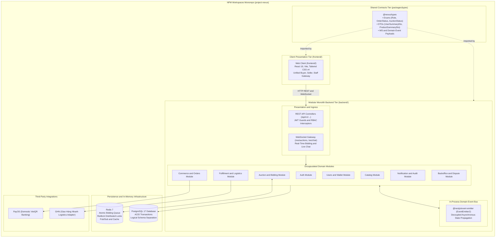

# Project Nexus - Architecture and Data Model Specification

This document provides a comprehensive technical specification of the system architecture, component topology, bounded contexts, and the complete data model for Project Nexus. It serves as an authoritative guide for onboarding engineers and architectural reference.

---

## 1. System Architecture and Component Topology

Project Nexus integrates conventional e-commerce retail with real-time 3D live auctions. It is architected as an Enterprise Modular Monolith inside a type-safe NPM Workspaces monorepo.



---

## 2. Monorepo Structure and Package Contracts

The repository is structured to maximize code reuse and eliminate schema drift:

```text
project-nexus/
├── packages/
│   ├── types/                     # Shared TypeScript contracts (@nexus/types)
│   │   ├── src/
│   │   │   ├── enums/             # Role, OrderStatus, AuctionStatus, EscrowStatus
│   │   │   ├── events/            # WS_AUCTION_EVENTS, Domain Event Payloads
│   │   │   ├── models/            # ApiResponse<T>, PaginatedResponse<T>, DTOs
│   │   │   └── index.ts           # Public Barrel Export
│   │   └── package.json
│   └── config/                    # Shared tsconfig base settings
├── backend/                       # NestJS Modular Monolith application
│   ├── prisma/                    # schema.prisma, migrations, seeders
│   └── src/                       # Domain modules, filters, guards, core services
├── frontend/                      # React 19 and Vite buyer, seller, staff portal
├── docs/                          # Comprehensive technical documentation portal
└── infra/                         # Docker compose and deployment configurations
```

---

## 3. Logical Schema Separation and Domain Boundaries

To enforce high cohesion and low coupling without distributed microservice latency:

- Module Ownership: Each domain module strictly owns its respective database entities.
- Encapsulation: Direct cross-module table joins via Prisma are strictly forbidden in application code. When `CommerceModule` needs product details, it queries `CatalogService` or listens to `ProductUpdatedEvent`.
- Transactional Boundary: Multi-step atomic operations across modules execute within `prisma.$transaction()` Units of Work.

---

## 4. Complete Relational Data Model (Prisma Schema)

### 4.1 Entity Relationship Diagram (ERD)

```mermaid
erDiagram
    User ||--o| Wallet : has
    User ||--o{ UserAddress : has
    User ||--o{ RefreshToken : issues
    User ||--o{ Product : sells
    User ||--o{ Order : buys
    User ||--o{ Order : sells
    User ||--o{ Auction : creates
    User ||--o{ Bid : places
    User ||--o| Cart : owns
    User ||--o{ ReputationLog : tracks
    User ||--o{ Notification : receives
    User ||--o{ NotificationPreference : configures
    User ||--o{ Review : gives
    User ||--o{ Review : receives
    User ||--o{ Dispute : opens
    User ||--o{ Dispute : resolves
    User ||--o{ SellerUpgradeRequest : requests

    Category ||--o{ Category : parent_child
    Category ||--o{ Product : categorizes

    Product ||--o{ ProductImage : contains
    Product ||--o{ Inventory : stocks
    Product ||--o{ CartItem : in_cart
    Product ||--o{ OrderItem : in_order
    Product ||--o{ Auction : featured_in

    Warehouse ||--o{ Inventory : located_at
    Inventory ||--o{ InventoryReservation : reserves
    Inventory ||--o{ InventoryLedger : tracks_movement

    Cart ||--o{ CartItem : contains

    Order ||--o{ OrderItem : items
    Order ||--o{ Payment : payments
    Order ||--o| EscrowRecord : escrow
    Order ||--o| Shipment : shipment
    Order ||--o| Dispute : dispute
    Order ||--o| Review : review

    Auction ||--o{ Bid : receives
    Wallet ||--o{ WalletTransaction : logs
```



### 4.2 Data Dictionaries

#### 1. users

Represents platform identity across all system actors.

| Column              | Type                 | Nullable |   Default   | Description                                                         |
| :------------------ | :------------------- | :------: | :---------: | :------------------------------------------------------------------ |
| `id`                | UUID                 |    No    |  `uuid()`   | Primary Key                                                         |
| `email`             | VARCHAR(255)         |    No    |      -      | Unique login email                                                  |
| `password_hash`     | VARCHAR(255)         |    No    |      -      | Bcrypt hashed password                                              |
| `full_name`         | VARCHAR(255)         |    No    |      -      | Full user name                                                      |
| `phone_number`      | VARCHAR(50)          |   Yes    |      -      | Contact phone                                                       |
| `avatar_url`        | TEXT                 |   Yes    |      -      | Profile avatar URL                                                  |
| `role`              | Role                 |    No    |   `BUYER`   | Primary role (`ADMIN`, `SUPPORT_STAFF`, `SELLER`, `BUYER`, `GUEST`) |
| `is_seller_active`  | BOOLEAN              |    No    |   `false`   | True when approved and toggled into Seller mode                     |
| `reputation_score`  | INT                  |    No    |    `100`    | Current reputation score                                            |
| `trust_level`       | ReputationTrustLevel |    No    | `EXCELLENT` | `EXCELLENT`, `GOOD`, `STANDARD`, `PROBATION`, `SUSPENDED`           |
| `is_verified`       | BOOLEAN              |    No    |   `false`   | Email verification flag                                             |
| `verification_code` | VARCHAR(255)         |   Yes    |      -      | OTP or email token                                                  |
| `personal_email`    | VARCHAR(255)         |   Yes    |      -      | Original personal email for invited staff                           |
| `platform_email`    | VARCHAR(255)         |   Yes    |      -      | Assigned work email                                                 |
| `created_at`        | TIMESTAMP            |    No    |   `now()`   | Registration timestamp                                              |
| `updated_at`        | TIMESTAMP            |    No    |   `auto`    | Last update timestamp                                               |

#### 2. wallets and wallet_transactions

Tracks in-platform financial balances and transaction logs.

| Column           | Type          | Nullable | Default  | Description                                       |
| :--------------- | :------------ | :------: | :------: | :------------------------------------------------ |
| `id`             | UUID          |    No    | `uuid()` | Primary Key                                       |
| `user_id`        | UUID          |    No    |    -     | Foreign Key to `users.id` (1-to-1)                |
| `balance`        | DECIMAL(14,2) |    No    |  `0.00`  | Liquid balance available for bidding and checkout |
| `locked_balance` | DECIMAL(14,2) |    No    |  `0.00`  | Balance locked in escrow or active highest bids   |
| `currency`       | VARCHAR(10)   |    No    | `'VND'`  | Account currency                                  |

#### 3. categories and products

Catalog hierarchy and item specifications.

- `categories`: Supports hierarchical classification up to 3 levels deep via self-referential `parent_id`.
- `products`: Contains `base_price`, dimensions (`weight_grams`, `length_cm`, `width_cm`, `height_cm`), and `three_model_key` linking to 3D WebGL assets.

#### 4. inventories, inventory_reservations, inventory_ledgers

SKU-level stock tracking across physical warehouses.

- `inventories`: Tracks `total_qty`, `available_qty`, and `reserved_qty` per `(warehouse_id, product_id)`.
- `inventory_reservations`: Atomic stock locks during 15-minute checkout windows or active auction scheduling.
- `inventory_ledgers`: Append-only immutable log for all stock movements with `change_qty`, `balance_after`, and `reason`.

#### 5. orders, order_items, payments

E-commerce purchase records and payment gateway integration.

- `orders`: `buyer_id`, `seller_id`, `subtotal`, `shipping_fee`, `total_amount`, `status`, `idempotency_key`, and `shipping_address_snapshot`.
- `payments`: Tracks provider (`PAYOS`, `WALLET`, `COD`), transaction code, status (`PENDING`, `SUCCESS`, `FAILED`), and webhook metadata.

#### 6. auctions and bids

High-concurrency live auction engine records.

- `auctions`: `starting_price`, `reserve_price`, `current_highest_bid`, `current_highest_bidder_id`, `bid_increment`, `start_time`, `end_time`, `original_end_time`, `is_extended`, and `total_bids_count`.
- `bids`: Atomic bid log (`bidder_id`, `bid_amount`, `status`, `placed_at`).

#### 7. escrow_records, shipments, disputes

Marketplace protection and logistics fulfillment.

- `escrow_records`: Locks buyer payment upon order placement. Contains `total_amount`, `platform_fee` (7%), `seller_payout` (93%), and status (`HELD`, `DISBURSED`, `REFUNDED`, `DISPUTED`).
- `shipments`: Integrates logistics adapter (GHN), tracking code, waybill, and delivery statuses.
- `disputes`: Arbitration records opened by buyers, containing evidence attachments, resolution notes, and arbitrator staff identifier.

#### 8. reputation_logs, event_logs, notifications, staff_invitations

Audit trails, operational logs, and staff provisioning.

- `reputation_logs`: Immutable tracking of point changes (+2 on completed order, -10 on default or cancellation).
- `event_logs`: Structured audit table of all published domain events.
- `staff_invitations`: Admin invitation tokens and OTPs for onboarding support personnel.
