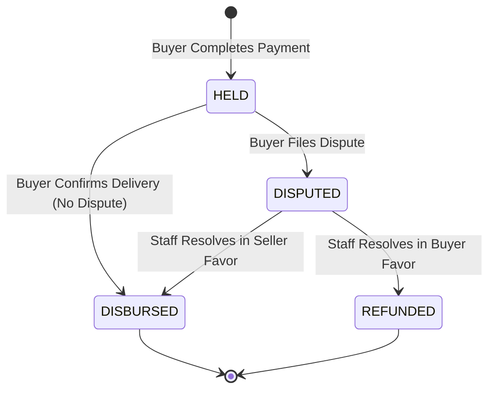

# Project Nexus - Business Rules Specification

This document details all business logic, operational constraints, threshold constants, and automated workflows governing **Project Nexus**. All backend services and frontend interfaces must strictly enforce these rules.

---

## 1. System Configuration Constants

The following parameters represent platform-wide invariants:

| Configuration Parameter          | Value  | Functional Purpose                                                |
| :------------------------------- | :----- | :---------------------------------------------------------------- |
| `ACCESS_TOKEN_EXPIRY_MINUTES`    | `60`   | JWT Access Token lifetime                                         |
| `REFRESH_TOKEN_EXPIRY_DAYS`      | `30`   | Refresh Token retention                                           |
| `MAX_LOGIN_ATTEMPTS`             | `5`    | Maximum failed logins before temporary lockout                    |
| `INITIAL_REPUTATION_SCORE`       | `100`  | Baseline score assigned to newly registered users                 |
| `MIN_REPUTATION_TO_BID`          | `40`   | Minimum score required to participate in live auctions            |
| `MIN_REPUTATION_TO_SELL`         | `50`   | Minimum score required to create product & auction listings       |
| `PLATFORM_FEE_PERCENTAGE`        | `7.0%` | Escrow commission deducted from seller payout upon completion     |
| `CHECKOUT_TIMEOUT_MINUTES`       | `15`   | Temporary inventory reservation window during order checkout      |
| `CART_EXPIRATION_DAYS`           | `7`    | Inactive shopping cart time-to-live                               |
| `AUCTION_MIN_DURATION_MINUTES`   | `60`   | Minimum duration for scheduled auctions                           |
| `AUCTION_MAX_DURATION_DAYS`      | `7`    | Maximum allowed duration for auctions                             |
| `ANTI_SNIPING_TRIGGER_MINUTES`   | `2`    | Final countdown threshold triggering anti-sniping extension       |
| `ANTI_SNIPING_EXTEND_MINUTES`    | `5`    | Minutes added to auction clock when anti-sniping triggers         |
| `AUCTION_PAYMENT_DEADLINE_HOURS` | `24`   | Winner checkout window before payment default is triggered        |
| `PAYMENT_TIMEOUT_PENALTY_SCORE`  | `10`   | Reputation points deducted on payment default / cancellation      |
| `COMPLETED_ORDER_BONUS_SCORE`    | `2`    | Reputation points awarded to buyer and seller on successful order |

---

## 2. Identity, Role Toggle & Staff Onboarding Rules

### 2.1 Unified Identity & Role Toggle

- Every user registers by default as a **Buyer**.
- Any user who applies and receives Admin approval for Seller status can toggle between **Buyer Mode** and **Seller Mode** in real time (`/api/v1/users/toggle-seller`) without logging out or re-authenticating.
- Switching modes changes client UI capabilities (e.g. accessing Seller Dashboard, adding inventory, managing shipments) while maintaining a single wallet and unified identity.

### 2.2 Staff Provisioning & Account Activation

1. **Admin Invitation:** An Administrator invites staff by providing their full name, personal email, phone number, and department.
2. **Platform Email Assignment:** The system generates a dedicated corporate email with the domain `@staff.com` (e.g. `john.doe@staff.com`).
3. **Invitation Verification:** An invitation link containing a secure token and OTP is sent to the staff member's personal email.
4. **Activation Flow:** The staff member confirms their personal information, sets a strong password, and completes activation.
5. **Role Assignment:** Upon activation, the account is assigned the `SUPPORT_STAFF` role, granting access to the Staff Dashboard and dispute arbitration tools.

---

## 3. Dynamic User Reputation & Trust Levels

Every user maintains a dynamic reputation score that dictates platform privileges.

### 3.1 Trust Level Thresholds

- **EXCELLENT ($\ge 120$ points):** Premium seller badge, reduced dispute review latency, unrestricted bidding limits.
- **GOOD ($100 - 119$ points):** Standard verified platform privileges.
- **STANDARD ($80 - 99$ points):** Full platform access under standard automated monitoring.
- **PROBATION ($40 - 79$ points):** Disallowed from creating auction listings; strictly monitored order volumes.
- **SUSPENDED ($< 40$ points):** Bidding locked, selling revoked, account flagged for administrative review.

### 3.2 Automated Score Adjustment Rules

- **Successful Order Completion:** $+2$ points awarded to both buyer and seller upon confirmation without dispute.
- **High CSAT 5-Star Review:** $+1$ point per positive transaction rating.
- **Order Cancellation (Seller Fault):** $-10$ points if seller cancels order due to stockout or negligence.
- **Auction Payment Default (Buyer Fault):** $-10$ points if auction winner fails to pay within 24 hours.
- **Fraud / Counterfeit Misrepresentation:** $-50$ points and immediate account suspension.

---

## 4. Platform Escrow & Financial Settlement

To eliminate buyer risk and guarantee seller payout, Project Nexus operates an automated Escrow engine:

### 4.1 Fee Calculation & Escrow Allocation

Upon successful payment:
$$\text{Total Paid} = \text{Subtotal} + \text{Shipping Fee}$$
$$\text{Platform Fee} = \text{Subtotal} \times 7.0\%$$
$$\text{Seller Payout} = \text{Subtotal} - \text{Platform Fee} + \text{Shipping Fee (if applicable)}$$

- All funds are locked in the `escrow_records` table with status `HELD`.
- Neither buyer nor seller can withdraw held funds during this period.

### 4.2 Automated Release & Dispute Freezing

- When carrier marks shipment as `DELIVERED`, buyer has a 3-day inspection window to inspect the goods.
- If buyer clicks **Confirm Delivery**, or if the 3-day window lapses with no dispute, escrow automatically transitions to `DISBURSED`, crediting `seller_payout` directly to the seller's wallet.
- If buyer opens a **Dispute**, automated disbursement is immediately frozen (`DISPUTED`) until support staff reviews evidence and issues an arbitration verdict.

### 4.3 Wallet Withdrawal & Payout Workflow

1. **Submission & Bank Details Priority**:
   - Minimum withdrawal amount: `50,000 VND`. Maximum pending requests per account: `3`.
   - **Bank Account Resolution**: System prioritizes beneficiaries' bank details saved in the User Profile (`bankName`, `accountNumber`, `accountHolderName`). If not configured in Profile, user manually enters the beneficiary information.
2. **Escrow Locking & Confirmation Notification**:
   - Upon submitting a withdrawal request, the withdrawal amount is atomically deducted from available `balance` and transferred to `lockedBalance`.
   - System immediately sends an In-App notification confirming receipt of request:
     > _"Yêu cầu rút tiền đã được tiếp nhận. Hệ thống sẽ thẩm định và giải ngân trong vòng 3-7 ngày làm việc."_
3. **Administrative Review & Notifications**:
   - **Approved / Completed**: Admin executes disbursement transfer. The `lockedBalance` is permanently debited, transaction status is marked `SUCCESS`, and user receives a congratulatory notification.
   - **Rejected**: Admin specifies a mandatory rejection reason (`rejectionReason`). The system automatically refunds 100% of the locked amount from `lockedBalance` back to available `balance`, updates transaction status to `FAILED`, and sends an alert notification explaining the rejection cause.

---

## 5. Real-Time 3D Live Auction & Anti-Sniping Engine

### 5.1 Atomic Bidding Workflow

1. Bidder enters WebSocket room (`/ws/auctions`) and submits bid amount.
2. The engine obtains a Redis distributed lock (`Redlock`) on `auction:{auctionId}` to eliminate race conditions.
3. System verifies:
   - Auction state is `ACTIVE` or `EXTENDED`.
   - Bidder reputation $\ge 40$.
   - Bidder wallet liquid balance $\ge$ bid amount.
   - Bid amount $\ge$ `current_highest_bid` $+$ `bid_increment`.
4. The engine atomically deducts the bid amount from the new bidder's wallet, updates `current_highest_bid`, and immediately refunds the previous highest bidder in full.
5. Emits `auction:bid:placed` via WebSocket to synchronize all connected clients in the room.

### 5.2 Anti-Sniping Mechanism

- **Trigger Condition:** A valid bid is placed when remaining time $\le 2\text{ minutes}$ (`ANTI_SNIPING_TRIGGER_MINUTES`).
- **Action:** System automatically extends `end_time` by $+5\text{ minutes}$ (`ANTI_SNIPING_EXTEND_MINUTES`) and sets `is_extended = true`.
- **Broadcast:** Emits `auction:time_extended` payload with new closing time to synchronize countdown timers across all clients.

### 5.3 Winner Settlement Window

- When auction ends, the winning bid is frozen and an order is automatically generated in `CommerceModule`.
- Winner must complete checkout (confirming delivery address and paying shipping fees) within **24 hours**.
- If unpaid after 24 hours: win is revoked, the second highest bidder is offered the item, and winner loses 10 reputation points.

---

## 6. Commerce, Cart & Payment Rules

### 6.1 Cart Inactivity & Price Revalidation

- Each user maintains at most **1 active cart** with a 7-day TTL (`CART_EXPIRATION_DAYS`).
- When user initiates checkout, the cart initiates **Price Revalidation**:
  - Re-checks live base price against catalog. If price has changed, user is notified to review.
  - Re-verifies live SKU availability in warehouse.
  - Locks reserved stock for 15 minutes (`CHECKOUT_TIMEOUT_MINUTES`).

### 6.2 Payment Idempotency & Gateways

- All payment requests require an `Idempotency-Key` header (UUID v4) to prevent double charging on network drops.
- **PayOS:** Generates VietQR domestic bank transfer code; relies on cryptographic signature verification on incoming webhooks.
- **Stripe:** Card payment via PaymentIntent; validated via Stripe webhook secret.
- **Wallet:** Deducts directly from user's internal liquid balance with zero processing delay.

### 6.3 Anti-Self-Purchase & Wash Trading Prevention

- **Constraint:** A user acting as a Buyer ($A$) is strictly prohibited from adding to cart or purchasing goods sold by their own Seller profile ($A'$), enforcing `product.sellerId !== buyer.id`.
- **Enforcement:** The backend API strictly rejects such requests with an HTTP `400 Bad Request` (`CANNOT_PURCHASE_OWN_PRODUCT`).
- **Rationale:** Protects platform financial integrity, prevents artificial order volume, eliminates fake review manipulation, and blocks fraudulent farming of completion reputation bonuses (+2 points per order).
- **Auction Parity:** Sellers are likewise forbidden from placing bids in their own live auction rooms (`auction.sellerId !== bidder.id`), rejecting any attempts with `AUCTION_BID_SELF_FORBIDDEN`.

---

## 7. 3D WebGL Exhibition & Asset Fallback

1. **Hardcoded Models:** Catalog items with recognized keys (`car`, `watch`, `painting`, etc.) dynamically stream high-fidelity `.glb` assets.
2. **Fallback Pedestal:** If an item lacks a 3D model or client hardware lacks WebGL support, the viewer renders a generic 3D exhibition pedestal (`fallback-pedestal.glb`) that dynamically binds the seller's uploaded 2D product photos as texture maps.
3. **Viewport Synchronization:** Room hosts or presenters can emit `auction:3d:sync` to broadcast model rotation (`x, y, z`) and camera zoom levels to all participants in real time.
