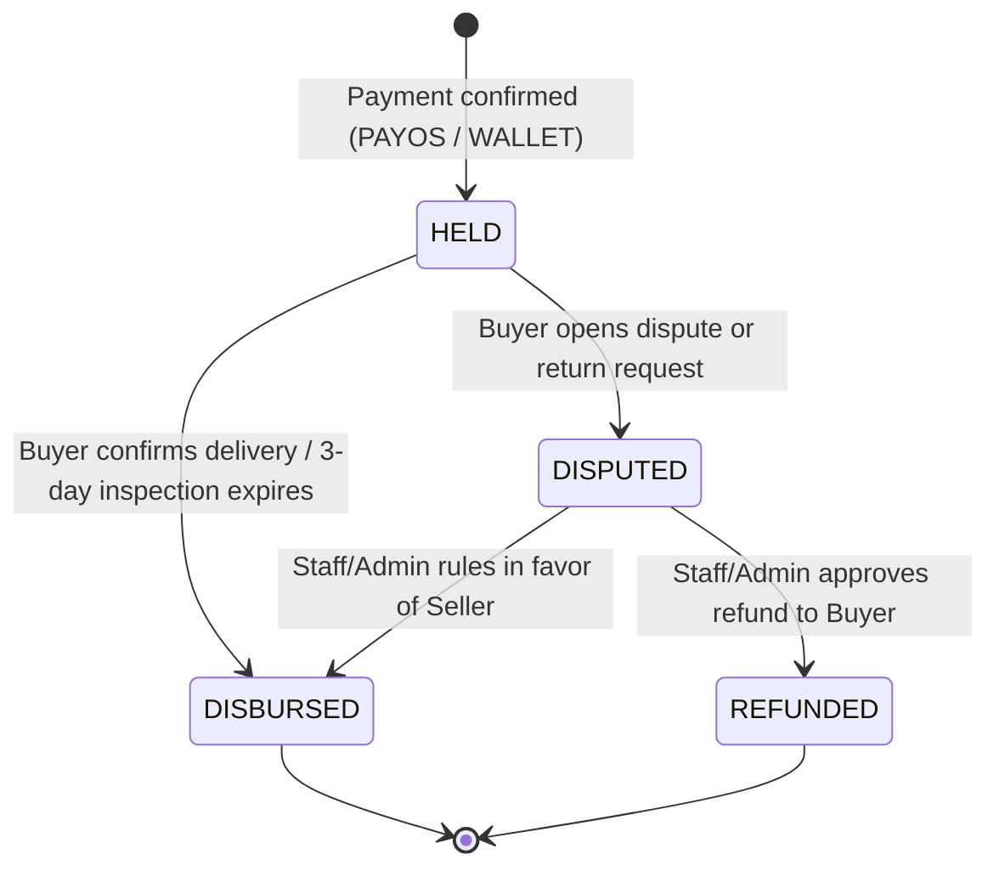
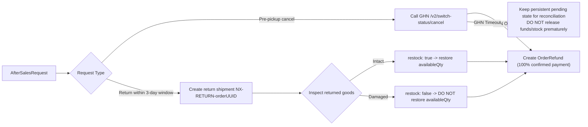
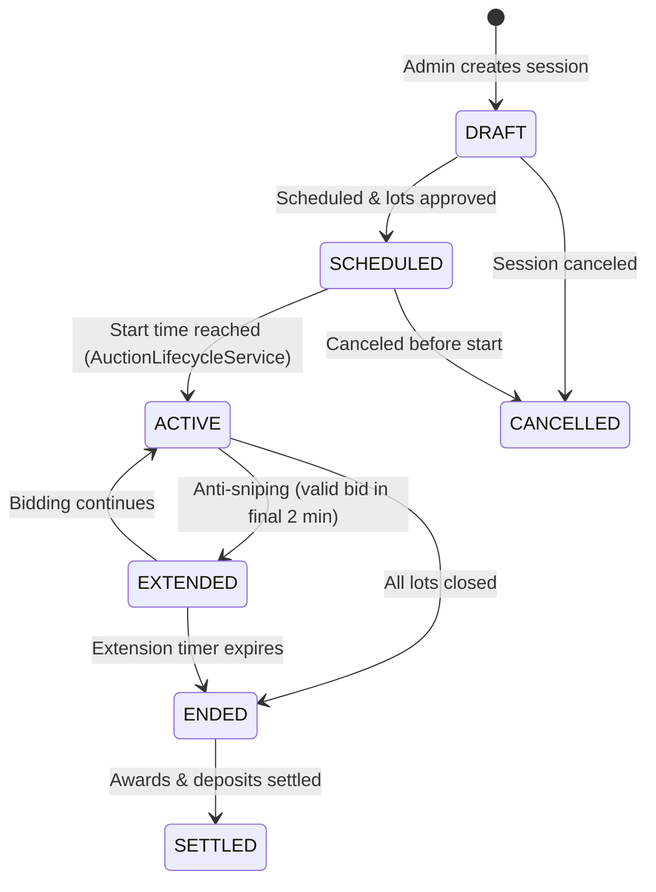

# State Machines (Orders, Escrow, After-Sales and Auctions)

This document details the state machines governing financial, fulfillment, and auction lifecycles in Project Nexus.

## 1. Escrow Lifecycle (`EscrowStatus`)

- On `DISBURSED`: Seller wallet receives `subtotal - platformFee (7%)`, and the Admin wallet records the platform fee.
- On `REFUNDED`: Full refund accounting executes via `RefundService` and `OrderRefund`.

## 2. Cancellation, Returns and Refunds (`AfterSalesRequest` and `OrderRefund`)

### Refund Accounting Rules (`OrderRefund`)

- Scope: Full-order cancellation prior to GHN pickup and full-order return within the 3-day post-delivery inspection window.
- Refund Amount: 100% of confirmed payment (including outbound shipping fee), with no arbitrary deductions.
- Channel Settlement:
  - `WALLET` orders: Instant automatic credit back to Buyer `Wallet.balance` (`OrderRefund.status = SUCCESS`).
  - `PAYOS` orders: Creates an `OrderRefund` in `PENDING` state (moving funds from Admin `balance` to `lockedBalance`), transitioning to `SUCCESS` only when Admin confirms the actual bank transfer `externalReference` (unless Buyer opts for internal wallet credit).

## 3. Multi-Lot Auction Lifecycle (`Auction` → `AuctionItem` → `AuctionAward`)

### Lot and Award Flow (`AuctionItem` and `AuctionAward`)

1. Consignment Review (`AuctionItemStatus`): Seller submits item + appraisal certificate → `PENDING_REVIEW` → Staff or Admin marks `APPROVED` or `REJECTED`.
2. Primary Award (`PRIMARY_WINNER`): Highest valid bidder receives `AuctionAward` (`AWAITING_CHECKOUT` / `AWAITING_DEPOSIT` → `PAID`).
3. Second Chance (`SECOND_CHANCE`) and Deposit Forfeit: If the primary winner declines (`DECLINED`), withdraws (`BUYER_WITHDRAWN`), or defaults (`PAYMENT_DEFAULT`), the system records `AUCTION_DEPOSIT_FORFEIT` / `AUCTION_DEPOSIT_COMPENSATION` and can issue a `SECOND_CHANCE` invitation to the next highest bidder.
