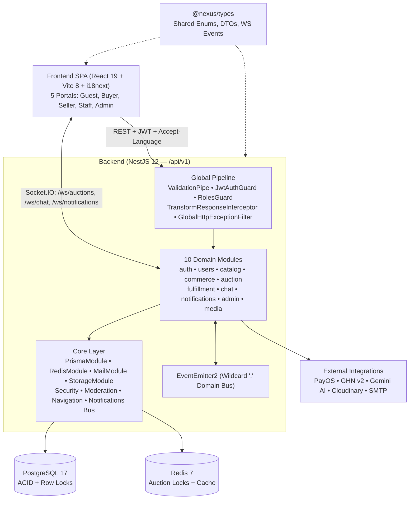

# System Architecture (Level 1.5 Modular Monolith)

Project Nexus is architected as a Level 1.5 Modular Monolith powered by NestJS 12 and Turborepo: all business capabilities run inside a single backend process to guarantee cross-table ACID transactions, while source code is partitioned into 10 isolated Domain Modules communicating via exported services or an in-process Event Bus (`EventEmitter2`).

## 1. Backend Layered Architecture (`backend/src`)

### Core Layer (`backend/src/core`)

- `prisma/`: `PrismaService` connects to PostgreSQL 17 via Prisma 7, providing `$transaction` and a delegate wrapper that emits real-time events whenever a `Notification` row is created.
- `redis/`: `RedisService` manages Redis 7 connections for distributed auction locks, inventory coordination, and short-lived caching.
- `mail/`: `MailService` dispatches OTP verification codes, password reset links, and Support Staff onboarding invites (`@staff.com`).
- `storage/`: Abstracts file persistence between Cloudinary (production) and local `/uploads` static serving.
- `filters/` and `interceptors/`: `GlobalHttpExceptionFilter` normalizes error payloads (`statusCode`, `errorCode`, `message`, `errors`); `TransformResponseInterceptor` wraps standard API responses.
- `moderation/` and `security/`: Content moderation utilities (`content-moderation.util.ts`) and document access security guards.

### Domain Layer (`backend/src/modules`)

Ten self-contained business modules: `auth`, `users`, `catalog`, `commerce`, `auction`, `fulfillment`, `chat`, `notifications`, `admin`, `media`. Each module encapsulates its own controllers, DTOs, services, and domain helpers, exposing only explicit public contracts.

## 2. Cross-Module Communication

| Mechanism                         | When Used                                                              | Real Example                                                                                                                         |
| :-------------------------------- | :--------------------------------------------------------------------- | :----------------------------------------------------------------------------------------------------------------------------------- |
| Injected Public Service           | Synchronous reads or participation in the same `prisma.$transaction()` | `CommerceModule` calls `InventoryService` (Catalog) to reserve stock; `FulfillmentModule` reads `ShopShippingProfileService` (Users) |
| EventEmitter2 (`@OnEvent`)        | Asynchronous side effects that decouple modules                        | Order payment/cancellation emits events consumed by `ReputationModule` and `NotificationsModule`                                     |
| Shared Contracts (`@nexus/types`) | Compile-time and runtime alignment between FE and BE                   | `Role`, `OrderStatus`, `AuctionStatus`, `AUCTION_EVENTS`, `CHAT_EVENTS`                                                              |

## 3. Concurrency and Consistency Strategy

- ACID Transactions (`prisma.$transaction`): Enforced for checkout, `EscrowRecord` holds, disbursements, `OrderRefund` accounting, `WithdrawalRequest` locking, and auction `Bid` placement.
- Pessimistic Row Locks (`SELECT ... FOR UPDATE`): Prevents race conditions on last-item inventory checkout and concurrent auction bids.
- Idempotency (`Idempotency-Key`): Prevents duplicate charges on checkout/payment retries.
- Webhook Verification: PayOS webhooks verify HMAC signatures (`PAYOS_CHECKSUM_KEY`); GHN webhooks validate `GHN_WEBHOOK_SECRET`.
