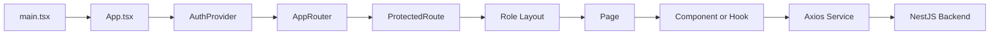

# Frontend File Guide

This guide maps the `frontend/src` directory by architectural layer and user role. Route guards in React Router control client navigation, while NestJS guards enforce all data access and write permissions on the backend.

## Application Entry and Core Infrastructure

- `frontend/src/main.tsx` initializes i18n, imports global styles, and mounts the React root inside `StrictMode`.
- `frontend/src/App.tsx` wraps `AppRouter` with `AuthProvider` and `CartProvider`.
- `frontend/src/routes/AppRouter.tsx` registers public, buyer, seller, support staff, and admin routes alongside role layouts.
- `frontend/src/routes/ProtectedRoute.tsx` checks authentication status and optional `allowedRoles` before rendering child routes.
- `frontend/src/contexts/AuthContext.tsx` manages JWT sessions, user profile hydration, cross-tab synchronization, and inflight `/users/me` deduplication.
- `frontend/src/contexts/CartContext.tsx` synchronizes cart state with backend commerce endpoints for authenticated buyers and local storage for guests.
- `frontend/src/i18n/index.ts` configures `i18next` and `react-i18next` with English (`en`) and Vietnamese (`vi`) translation bundles.

## Service Layer

All HTTP calls share the Axios instance in `frontend/src/services/api.ts`, which injects Bearer tokens, refreshes expired access tokens on HTTP `401` responses, and normalizes API errors.

- `frontend/src/services/auth.ts` handles login, registration, OTP verification, password reset, Google OAuth, and token refresh.
- `frontend/src/services/users.ts` manages `/users/me`, seller mode switching, and seller upgrade applications.
- `frontend/src/services/products.service.ts` queries public catalog listings, categories, and product details.
- `frontend/src/services/cart.ts` and `frontend/src/services/orders.ts` manage cart mutations, checkout, order tracking, and return requests.
- `frontend/src/services/auction.ts` connects auction listings, consignment submissions, escrow checkout, and bidding endpoints.
- `frontend/src/services/wallet.ts` handles wallet balances, top-ups, and withdrawal requests.
- `frontend/src/services/chat.ts` integrates buyer-seller messaging, support tickets, and chatbot requests.
- `frontend/src/services/sellerProducts.ts` manages seller inventory CRUD and media uploads.
- `frontend/src/services/admin.ts` and `frontend/src/services/staff.ts` cover moderation, user management, shop approval, finance controls, and staff ticket operations.

## Role Workspaces and Layouts

| Role Group         | Layout                          | Primary Route Prefix                        | Key Directories                                                               |
| ------------------ | ------------------------------- | ------------------------------------------- | ----------------------------------------------------------------------------- |
| Guest and Shopping | `GuestLayout`, `NonAdminLayout` | `/`, `/search`, `/product/:id`, `/auctions` | `pages/guest`, `components/home`, `components/products`, `components/auction` |
| Authentication     | `AuthLayout`                    | `/login`, `/register`, `/forgot-password`   | `pages/auth`                                                                  |
| Buyer              | `GuestLayout`                   | `/buyer/*`, `/cart`, `/checkout`            | `pages/buyer`, `components/cart`, `components/profile`                        |
| Seller             | `SellerLayout`                  | `/seller/*`                                 | `pages/seller`, `components/seller`                                           |
| Support Staff      | `StaffLayout`                   | `/staff/*`                                  | `pages/staff`, `components/staff`                                             |
| Administrator      | `AdminLayout`                   | `/admin/*`                                  | `pages/admin`, `components/admin`                                             |

## Authentication and Request Flow

