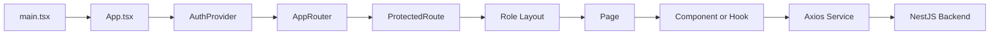

# Frontend File Guide

This guide maps the `frontend/src` directory by architectural layer and user role. Route guards in React Router control client navigation, while NestJS guards enforce all data access and write permissions on the backend.

## Application Entry and Core Infrastructure

- `frontend/src/main.tsx` initializes i18n, imports global styles, and mounts the React root inside `StrictMode`.
- `frontend/src/App.tsx` wraps `AppRouter` with `AuthProvider` and `CartProvider`.
- `frontend/src/routes/AppRouter.tsx` registers public, buyer, seller, support staff, and admin routes alongside role layouts.
- `frontend/src/routes/ProtectedRoute.tsx` checks authentication status and optional `allowedRoles` before rendering child routes.
- `frontend/src/contexts/AuthContext.tsx` manages JWT sessions, user profile hydration, cross-tab synchronization, and inflight `/users/me` deduplication.
- `frontend/src/contexts/CartContext.tsx` synchronizes cart state with backend commerce endpoints for authenticated buyers and local storage for guests.
- `frontend/src/i18n/index.ts` configures `i18next` and `react-i18next` with English (`en`) and Vietnamese (`vi`) translation bundles.

## Feature Slices

Services and the types they carry are grouped under `frontend/src/features/<feature>`,
one folder per piece of the product, each with a `services` folder and a
`types` folder, and each service's tests beside it:

```
frontend/src/features/
  account/   auction/   admin/     auth/      cart/
  catalog/   chat/      disputes/  notifications/
  orders/    reviews/   shipping/  staff/     wallet/   wishlist/
```

They used to be two flat directories — forty-three services and twenty-eight
type files — where nothing connected `cartSync.ts` to `cart.ts` or
`seller-finance.types.ts` to the wallet, and three naming conventions had
accumulated to stand in for folders (`admin.ts`, `adminChat.ts`,
`admin-returns.ts`).

Imports between features go through the `@/` alias, which maps to
`frontend/src`, rather than counting `../` out of a folder.

### What is not a feature

- `frontend/src/services/api.ts` is the Axios instance every feature's
  services call. It injects Bearer tokens, refreshes an expired access token on
  a `401` and normalizes API errors into `ApiRequestError`.
- `frontend/src/services/socketPool.ts` leases reference-counted Socket.IO
  connections, so the chat drawer and the notification bell share one
  connection per namespace instead of opening one each.
- `frontend/src/services/sellerResources.ts` de-duplicates concurrent reads
  within one authenticated session; the catalog, orders, wallet and disputes
  services all use it.
- `frontend/src/types/toast.types.ts` is shared, because every feature raises
  a toast.

There is no `src/types/index.ts`. It re-exported seven type files with
`export *`, so any file could reach any feature's types through a path that
named none of them; each of its seven call sites now imports from the module
that defines what it uses.

## Role Workspaces and Layouts

| Role Group         | Layout                          | Primary Route Prefix                        | Key Directories                                                               |
| ------------------ | ------------------------------- | ------------------------------------------- | ----------------------------------------------------------------------------- |
| Guest and Shopping | `GuestLayout`, `NonAdminLayout` | `/`, `/search`, `/product/:id`, `/auctions` | `pages/guest`, `components/home`, `components/products`, `components/auction` |
| Authentication     | `AuthLayout`                    | `/login`, `/register`                       | `pages/auth`                                                                  |
| Buyer              | `GuestLayout`                   | `/buyer/*`, `/cart`, `/checkout`            | `pages/buyer`, `components/cart`, `components/profile`                        |
| Seller             | `SellerLayout`                  | `/seller/*`                                 | `pages/seller`, `components/seller`                                           |
| Support Staff      | `StaffLayout`                   | `/staff/*`                                  | `pages/staff`, `components/staff`                                             |
| Administrator      | `AdminLayout`                   | `/admin/*`                                  | `pages/admin`, `components/admin`                                             |

## Authentication and Request Flow


