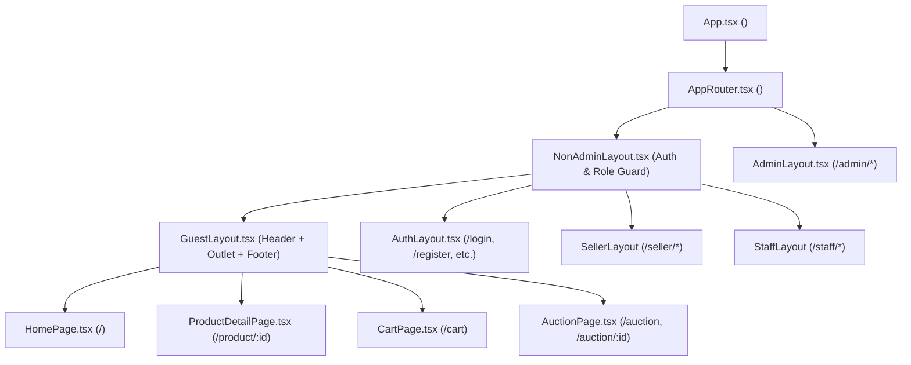

# Đặc Tả Kiến Trúc Giao Diện Người Dùng (UI Specification)

Tài liệu này xác định các tiêu chuẩn kiến trúc trình bày, hệ thống design tokens, cấu trúc layout phân tầng và phân rã component trên toàn bộ ứng dụng `frontend/`.

## 1. Hệ Thống Design Tokens Và Màu Sắc

Ứng dụng phía người dùng áp dụng React 19, Tailwind CSS v4, Lucide Icons và Ant Design Icons:

### Mã màu thương hiệu và giao diện

- Màu thương hiệu chính: `#1f5fe3` (Royal Blue) sử dụng cho nút hành động chính, chỉ báo điều hướng và liên kết nổi bật.
- Màu nhấn mạnh: `#f24e1e` / `#ff5722` (Orange Red) sử dụng cho nút kêu gọi hành động trong phòng đấu giá, huy hiệu, số lượng giỏ hàng và cảnh báo quan trọng.
- Bề mặt và nền:
  - Nền trang tổng thể: `#f8f7fc` (Soft Slate)
  - Thẻ chứa nội dung: `#ffffff` (Pure White) kết hợp đường viền `border border-slate-200`
  - Vùng lấp đầy phụ: `#f1f5f9` (Slate 100)
- Kiểu chữ và độ tương phản:
  - Tiêu đề và văn bản chính: `#0f172a` (Slate 900)
  - Văn bản nội dung: `#334155` (Slate 700)
  - Văn bản mờ và chú thích: `#64748b` (Slate 500)
  - Đường viền phân cách: `#e2e8f0` (Slate 200)

## 2. Cấu Trúc Phân Tầng Layout Và Cây Định Tuyến

Giao diện được điều phối thông qua các lớp Layout lồng nhau đảm bảo phân quyền chặt chẽ:

### Mô tả các tầng layout

1. `NonAdminLayout.tsx`: Lớp kiểm tra ngoại vi đầu tiên. Kiểm tra thông tin phiên từ `AuthContext`, nếu người dùng mang vai trò `ADMIN` sẽ chuyển hướng ngay về `/admin`.
2. `GuestLayout.tsx`: Bố cục mua sắm tiêu chuẩn chứa header, vùng nội dung `<Outlet />` và footer chân trang. Nếu nhân viên hỗ trợ `SUPPORT_STAFF` truy cập trang chủ, hệ thống sẽ tự động điều hướng về `/staff/inbox`.
3. `StaffLayout.tsx`: Lớp bảo vệ chuyên trách cho toàn bộ các tuyến đường `/staff/*`, xác thực quyền `SUPPORT_STAFF` hoặc `ADMIN` trước khi hiển thị dashboard làm việc.
4. `AdminLayout.tsx`: Bố cục chuyên biệt dành cho quản trị viên với thanh bên điều hướng cố định và các bảng quản trị hệ thống.

## 3. Kiến Trúc Phân Rã Component

Tuân thủ nguyên tắc mã nguồn sạch và phân tách trách nhiệm, các trang giao diện lớn được chia nhỏ thành các component độc lập:

### Nhóm xác thực tài khoản (`frontend/src/pages/auth/`)

- `Login.tsx`: Biểu mẫu đăng nhập chính, điều hướng theo vai trò và gửi yêu cầu xác thực.
- `AuthHeroSection.tsx`: Banner trình chiếu hình ảnh thương hiệu phía bên trái.
- `ForgotPasswordModal.tsx`: Hộp thoại độc lập xử lý xác thực mã OTP và đặt lại mật khẩu mới.

### Nhóm giỏ hàng và thanh toán (`frontend/src/pages/buyer/`)

- `CartPage.tsx`: Bảng danh sách sản phẩm trong giỏ, tăng giảm số lượng và xóa sản phẩm.
- `CartOrderSummary.tsx`: Thẻ tính toán tạm tính, ước tính phí vận chuyển và giảm giá.
- `CheckoutPage.tsx`: Trang thanh toán toàn diện với lựa chọn địa chỉ giao nhận GHN và cổng thanh toán (PayOS, Ví NEXUS Pay hoặc COD).

### Nhóm danh mục và chi tiết sản phẩm (`frontend/src/pages/guest/`)

- `ProductDetailPage.tsx`: Trang điều phối tải dữ liệu sản phẩm và đánh giá.
- `ProductImageGallery.tsx`: Dải ảnh thu nhỏ, kính lúp phóng to và kích hoạt xem mô hình.
- `ProductInfoTabs.tsx`: Bảng thông số kỹ thuật, hồ sơ người bán và đánh giá của khách hàng.

### Nhóm phòng đấu giá trực tuyến (`frontend/src/pages/guest/`, `frontend/src/components/auction/`)

- `AuctionPage.tsx`: Trang phòng đấu giá thời gian thực hỗ trợ cả route `/auction` và `/auction/:id`.
- `AuctionBidTerminal.tsx`: Bảng điều khiển trả giá tương tác, hiển thị đồng hồ đếm ngược và mức giá dẫn đầu.
- `AuctionGallery.tsx`: Trưng bày hình ảnh vật phẩm đấu giá.
- `AuctionDetailTabs.tsx`: Thông số kỹ thuật, chứng thư kiểm định và lịch sử trả giá công khai.

## 4. Phản Hồi Người Dùng Và Trạng Thái Tải Dữ Liệu

- Thông báo Toast: Hiển thị nổi góc trên bên phải hoặc dưới bên phải, tự động đóng sau 3.0 đến 4.5 giây.
- Hộp thoại Modal: Hỗ trợ phím Escape hoặc nhấp vùng nền mờ để đóng; tự động khóa thanh cuộn trang chính khi mở.
- Trạng thái chờ: Sử dụng khung xương hiệu ứng tải dữ liệu (skeleton loader) nhằm tránh giật bố cục màn hình (CLS).
