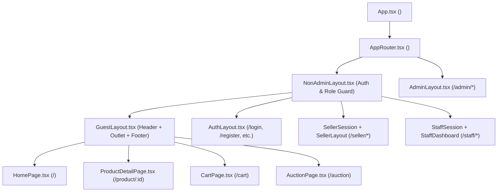

# Project Nexus - User Interface Specification

This document defines the presentation architecture, design tokens, layout hierarchy, component decomposition structure, and interactive behaviors across the **Project Nexus Web Portal** (`frontend/web`).

---

## 1. Design Tokens & Styling Architecture

The client application leverages **React 19 + Tailwind CSS v4 + Lucide Icons**:

### 1.1 Color Tokens & Theming

- **Primary Brand Color:** `#1f5fe3` (Royal Blue) — Primary action buttons, active navigation indicators, links.
- **Accent Brand Color:** `#f24e1e` / `#ff5722` (Orange Red) — Auction calls to action, badges, cart counts, critical highlights.
- **Surface & Backgrounds:**
  - Page Background: `#f8f7fc` (Soft Slate)
  - Card & Container Surface: `#ffffff` (Pure White) with `border border-slate-200`
  - Subtle Fill: `#f1f5f9` (Slate 100)
- **Text & Contrast:**
  - Heading & Primary Text: `#0f172a` (Slate 900)
  - Body Text: `#334155` (Slate 700)
  - Muted / Placeholder Text: `#64748b` (Slate 500)
  - Border Lines: `#e2e8f0` (Slate 200)

---

## 2. Layout Hierarchy & Route Architecture

The user interface is governed by nested layout wrappers:

### 2.1 Layout Descriptions

1. **`NonAdminLayout.tsx`:** First-line perimeter check. Reads `token`, `isLoading`, and `isAdmin` from `AuthContext`. If user has role `ADMIN`, redirects immediately to `/admin`.
2. **`GuestLayout.tsx`:** Standard shopping layout containing [`HomeHeader.tsx`](../frontend/web/src/components/headers/HomeHeader.tsx), content `<Outlet />`, and `Footer`. If an authenticated user with `SUPPORT_STAFF` role navigates to `/`, automatically redirects them to `/staff/inbox`.
3. **`StaffSidebar.tsx` & `StaffDashboard.tsx`:** Split-screen staff portal with responsive drawer for mobile devices (`< 760px`) and desktop sticky sidebar (`280px`).

---

## 3. Component Decomposition Architecture (< 300 Lines Rule)

In strict compliance with Clean Code standards, major views have been decomposed into isolated child components:

### 3.1 Authentication Group (`frontend/web/src/pages/auth/`)

- [`Login.tsx`](../frontend/web/src/pages/auth/Login.tsx) (239 lines): Main login form, role routing, submit handling.
- [`AuthHeroSection.tsx`](../frontend/web/src/pages/auth/AuthHeroSection.tsx) (149 lines): Left-hand visual showcase banner.
- [`ForgotPasswordModal.tsx`](../frontend/web/src/pages/auth/ForgotPasswordModal.tsx) (272 lines): Self-contained modal with step-by-step OTP verification and password reset.

### 3.2 Shopping Cart & Checkout (`frontend/web/src/pages/buyer/`)

- [`CartPage.tsx`](../frontend/web/src/pages/buyer/CartPage.tsx) (264 lines): Cart item table, quantity increment/decrement, item deletion.
- [`CartOrderSummary.tsx`](../frontend/web/src/components/cart/CartOrderSummary.tsx) (152 lines): Subtotal, estimated shipping, discount calculation card.
- [`CheckoutModal.tsx`](../frontend/web/src/components/cart/CheckoutModal.tsx): Address selection, payment method selection, order placement.

### 3.3 Product Catalog & Details (`frontend/web/src/pages/guest/`)

- [`ProductDetailPage.tsx`](../frontend/web/src/pages/guest/ProductDetailPage.tsx) (274 lines): Orchestrator page loading product data.
- [`ProductImageGallery.tsx`](../frontend/web/src/components/productDetail/ProductImageGallery.tsx) (138 lines): Thumbnail strip, zoom magnifier, 3D WebGL trigger.
- [`ProductInfoTabs.tsx`](../frontend/web/src/components/productDetail/ProductInfoTabs.tsx) (190 lines): Specifications, seller profile, customer reviews.
- [`RelatedProductsSection.tsx`](../frontend/web/src/components/productDetail/RelatedProductsSection.tsx) (45 lines): Recommendation grid.

### 3.4 Staff Support Center (`frontend/web/src/pages/staff/`)

- [`StaffDashboard.tsx`](../frontend/web/src/pages/staff/StaffDashboard.tsx) (151 lines): Main dashboard controller.
- [`staffNavigationData.ts`](../frontend/web/src/pages/staff/staffNavigationData.ts) (79 lines): Centralized navigation metadata, icons, and route paths.
- [`StaffSidebar.tsx`](../frontend/web/src/pages/staff/StaffSidebar.tsx) (87 lines): Desktop & mobile responsive navigation menu.
- [`StaffHeader.tsx`](../frontend/web/src/pages/staff/StaffHeader.tsx) (192 lines): Breadcrumbs, search input, quick action buttons.
- [`StaffTeamManagementPanel.tsx`](../frontend/web/src/pages/staff/StaffTeamManagementPanel.tsx) (230 lines): Admin staff invitation and table view.
- [`StaffTicketChatPanel.tsx`](../frontend/web/src/pages/staff/StaffTicketChatPanel.tsx) (193 lines): Live customer conversation list.
- [`StaffTicketConversationView.tsx`](../frontend/web/src/pages/staff/StaffTicketConversationView.tsx) (165 lines): Chat message timeline and reply input.
- [`StaffMetricCards.tsx`](../frontend/web/src/pages/staff/StaffMetricCards.tsx) (97 lines): CSAT and resolution rate KPI cards.

---

## 4. 3D WebGL Viewer & Asset Display Specification

1. **Rendering Canvas:** Embedded Three.js canvas featuring OrbitControls for user rotation, panning, and zooming.
2. **Lighting Setup:** Multi-point studio lighting (ambient light + 2 directional key lights) providing soft shadows.
3. **Asset Resolution:**
   - Recognized `threeModelKey` $\rightarrow$ Streams corresponding `.glb` model from `/models-3d/`.
   - Missing or unassigned key $\rightarrow$ Loads `fallback-pedestal.glb` and projects 2D product photos onto dynamic texture coordinates.
4. **Lifecycle Disposal:** When modal or viewer unmounts, calls `dispose()` to release WebGL context and GPU memory.

---

## 5. User Feedback & Notifications

- **Toast Notifications:** Ephemeral toast alerts appear at top-right or bottom-right, auto-dismissing after 2.8 to 3.0 seconds.
- **Modal Dialogs:** Esc key or clicking overlay backdrop closes modals; background body scroll is locked (`overflow: hidden`).
- **Loading States:** Skeleton loaders or spinner overlays display during network latency, preventing layout shift (CLS).
