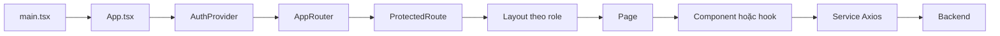
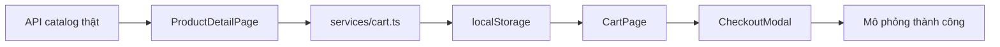
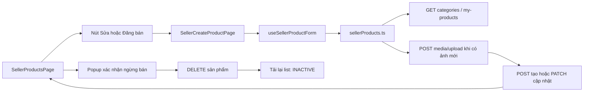

# Bản đồ từng file Frontend theo vai trò

Ngày đối chiếu: 21/10/2026. Mốc code: `c8c40e2`.

Phạm vi: **175 file mã nguồn và cấu hình** trong `frontend/web`, khoảng 20.153 dòng. Không tính `node_modules`, `dist`, tài nguyên ảnh/font/mô hình trong `public`, lockfile hay file cache do công cụ sinh ra. Đây là phân tích từ code, router, import, service và trạng thái lưu trữ; không phải kết quả kiểm thử tất cả màn hình trên trình duyệt.

## 1. Cách đọc tài liệu

| Nhãn          | Ý nghĩa                                                                                                         |
| ------------- | --------------------------------------------------------------------------------------------------------------- |
| API thật      | Code gọi backend; vẫn cần kiểm thử với tài khoản và database thực tế. Không đồng nghĩa mọi API luôn thành công. |
| Dữ liệu mẫu   | Giá trị cố định, mock hoặc state minh họa. Reload thường đưa về dữ liệu ban đầu.                                |
| Lưu cục bộ    | Ghi `localStorage`/`sessionStorage`; chưa lưu nghiệp vụ vào database.                                           |
| Trang chờ     | Chỉ hiện khung và mô tả chức năng; chưa triển khai luồng nghiệp vụ.                                             |
| UI            | Component nhận props/state rồi hiển thị; trạng thái thật/mẫu phụ thuộc nơi cấp dữ liệu.                         |
| Kiểu/cấu hình | Khai báo TypeScript, export hoặc cấu hình công cụ; không tự chạy nghiệp vụ.                                     |

**Thư mục không tự quyết định quyền.** Quyền truy cập do router và guard quyết định; quyền thao tác dữ liệu cuối cùng vẫn do BE kiểm tra. Ví dụ `BuyerProfilePage.tsx` còn được dùng cho `/seller/profile`, không phải chỉ Buyer.

## 2. Router và quyền hiện tại

| Nhóm                | URL chính                                                                   | Điều kiện FE hiện tại                                                                                                     | Phần đã có nghiệp vụ thật                                                                                         |
| ------------------- | --------------------------------------------------------------------------- | ------------------------------------------------------------------------------------------------------------------------- | ----------------------------------------------------------------------------------------------------------------- |
| Guest / khu mua sắm | `/`, `/search`, `/product/:id`, `/auction`, `/categories`                   | Không cần đăng nhập để xem các route công khai. `NonAdminLayout` chuyển Admin sang `/admin`.                              | Chi tiết sản phẩm và sản phẩm khác gọi API thật; trang chủ/tìm kiếm/đấu giá chủ yếu dùng mẫu.                     |
| Auth                | `/login`, `/register`, `/forgot-password`, `/reset-password`, `/verify-otp` | Nằm trong `NonAdminLayout` và `AuthLayout`.                                                                               | Đăng nhập, đăng ký/xác thực OTP trong form đăng ký, quên mật khẩu trong popup. Một số URL riêng vẫn là trang chờ. |
| Buyer               | `/buyer/*`, `/cart`, `/checkout`                                            | `/cart` công khai; các route Buyer còn lại dùng `ProtectedRoute` chỉ yêu cầu đăng nhập, chưa giới hạn riêng `Role.BUYER`. | Hồ sơ cá nhân. Giỏ hàng đang lưu cục bộ.                                                                          |
| Seller              | `/seller/*`                                                                 | `ProtectedRoute` yêu cầu `SELLER`, sau đó `SellerSession` xác minh hồ sơ từ AuthContext.                                  | Hồ sơ, chuyển chế độ, tên shop từ hồ sơ đã duyệt, CRUD sản phẩm và tồn kho.                                       |
| Staff               | `/staff/*`                                                                  | Router yêu cầu `SUPPORT_STAFF`; `/staff/activate` không cần đăng nhập.                                                    | Kích hoạt Staff. Hộp thư có service nhưng còn mock/fallback; gửi tin nhắn chưa nối.                               |
| Admin               | `/admin/*`                                                                  | Router yêu cầu `ADMIN`; `AdminLayout` kiểm tra lại bằng AuthContext.                                                      | Mời Staff, xem và duyệt/từ chối hồ sơ Seller. Các bảng điều hành khác còn nhiều dữ liệu mẫu.                      |

### Luồng xác thực

`AuthContext` gộp các request `/users/me` đang chạy theo token và bỏ phản hồi của phiên cũ. `StrictMode` ở môi trường phát triển có thể chạy lại effect; không phải mọi effect trong FE đều đã được gộp request như AuthContext.

## 3. File nền tảng và dùng chung

### 3.1. Cấu hình — dùng cho tất cả role

Các đường dẫn trong tài liệu tính từ `frontend/web`.

| File                                   | Tác dụng thực tế                                                                                                                                                                                                                |
| -------------------------------------- | ------------------------------------------------------------------------------------------------------------------------------------------------------------------------------------------------------------------------------- |
| [package.json](package.json)           | Khai báo dependency của FE và lệnh `dev`, `build`, `preview`. Có React, Axios, Tailwind, Ant Design Icons, Lucide, Three.js, React Query, Zustand; thư viện được cài không có nghĩa mọi thư viện đã được dùng trong luồng chạy. |
| [index.html](index.html)               | Trang HTML gốc, phần tử `root` để React gắn ứng dụng và tham chiếu entry point.                                                                                                                                                 |
| [vite.config.ts](vite.config.ts)       | Bật React và Tailwind cho Vite; alias `@` trỏ vào `src`, `@nexus/types` trỏ vào source của package dùng chung.                                                                                                                  |
| [postcss.config.js](postcss.config.js) | Cấu hình Autoprefixer khi xử lý CSS; Tailwind được tích hợp qua plugin Vite.                                                                                                                                                    |
| [tsconfig.json](tsconfig.json)         | Cấu hình TypeScript cấp project, tham chiếu `tsconfig.app.json`.                                                                                                                                                                |
| [tsconfig.app.json](tsconfig.app.json) | Bật kiểm tra TypeScript nghiêm ngặt, JSX React, module resolution cho bundler, alias và kiểm tra biến/tham số không dùng.                                                                                                       |
| [components.json](components.json)     | Cấu hình sinh UI theo cấu trúc shadcn: alias component, file CSS nền, kiểu giao diện và biến màu. Không phải file dữ liệu nghiệp vụ.                                                                                            |

### 3.2. Khởi động, router, context và layout

| File                                                         | Vai trò và tác dụng                                                                                                                                                                                            |
| ------------------------------------------------------------ | -------------------------------------------------------------------------------------------------------------------------------------------------------------------------------------------------------------- |
| [main.tsx](src/main.tsx)                                     | Entry point: gọi `createRoot`, import CSS toàn cục, bọc ứng dụng trong `StrictMode`.                                                                                                                           |
| [App.tsx](src/App.tsx)                                       | Bọc router trong `AuthProvider` để các màn hình cùng đọc một trạng thái xác thực.                                                                                                                              |
| [vite-env.d.ts](src/vite-env.d.ts)                           | Khai báo kiểu môi trường Vite cho TypeScript.                                                                                                                                                                  |
| [index.css](src/index.css)                                   | Import Tailwind, định nghĩa theme, font, màu nền, animation và các style toàn cục. Đây là CSS nền hiện có của dự án.                                                                                           |
| [lib/utils.ts](src/lib/utils.ts)                             | Hàm `cn` ghép class bằng `clsx`/`tailwind-merge`, dùng khi class Tailwind thay đổi theo state.                                                                                                                 |
| [routes/AppRouter.tsx](src/routes/AppRouter.tsx)             | Khai báo URL, layout và guard của mọi role. `/seller/products/new` và `/seller/products/:id/edit` dùng cùng form; `/seller/inventory` dùng lại trang sản phẩm.                                                 |
| [routes/ProtectedRoute.tsx](src/routes/ProtectedRoute.tsx)   | Chưa có token thì chuyển login; đang tải thì chờ; nếu có `allowedRoles` thì kiểm tra role. Guard này không tự gọi API và không thay thế guard BE.                                                              |
| [contexts/AuthContext.tsx](src/contexts/AuthContext.tsx)     | Giữ token, user, profile và cờ role; đăng xuất, refresh profile, đồng bộ auth giữa các tab, gộp request đang chạy, chặn phản hồi cũ ghi đè phiên mới.                                                          |
| [contexts/index.ts](src/contexts/index.ts)                   | Export lại AuthContext để import từ một chỗ.                                                                                                                                                                   |
| [layouts/NonAdminLayout.tsx](src/layouts/NonAdminLayout.tsx) | Cho người chưa đăng nhập và người không phải Admin đi tiếp; tài khoản Admin được chuyển về khu quản trị.                                                                                                       |
| [layouts/GuestLayout.tsx](src/layouts/GuestLayout.tsx)       | Ghép HomeHeader, nội dung route và Footer cho khu mua sắm. Staff vào đúng `/` được chuyển về hộp thư. Không phải lớp bảo vệ toàn bộ chức năng Buyer.                                                           |
| [layouts/AuthLayout.tsx](src/layouts/AuthLayout.tsx)         | Khung header/footer cho màn hình đăng nhập, đăng ký và các trang xác thực.                                                                                                                                     |
| [layouts/SellerLayout.tsx](src/layouts/SellerLayout.tsx)     | Khung sidebar, topbar, tìm kiếm, menu tài khoản/thông báo, Outlet của Seller. Gọi chuyển Buyer mode bằng API; cấp SellerWorkspace; lưu bản nháp đấu giá theo user trên trình duyệt; có chế độ xem dữ liệu mẫu. |
| [layouts/AdminLayout.tsx](src/layouts/AdminLayout.tsx)       | Xác minh Admin, cấp provider hồ sơ Seller, ghép header/sidebar/Outlet. Phần duyệt Seller lấy API; các action hoàn tiền, duyệt đấu giá, khóa tài khoản khác còn thao tác lên state demo.                        |
| [pages/index.ts](src/pages/index.ts)                         | Export tập trung các page để router import. File này không tạo URL và không cấp quyền.                                                                                                                         |
| [products.ts](src/products.ts)                               | Export tập trung kiểu sản phẩm và các hàm đọc sản phẩm thật. Không còn export catalog mock qua đường dẫn này.                                                                                                  |
| [components/products.ts](src/components/products.ts)         | Export tiếp từ `src/products.ts` để giữ đường import tương thích cho các component/page hiện có.                                                                                                               |

### 3.3. Service — lớp gọi API và lưu trữ

| File                                                             | Role sử dụng                       | Tác dụng và nguồn dữ liệu                                                                                                                                                                                                             |
| ---------------------------------------------------------------- | ---------------------------------- | ------------------------------------------------------------------------------------------------------------------------------------------------------------------------------------------------------------------------------------- |
| [services/api.ts](src/services/api.ts)                           | Tất cả role                        | Axios client chung, base URL, Bearer token, timeout, refresh token khi 401, hàng đợi request chờ refresh; `apiRequest<T>` bóc envelope `data`, chuẩn hóa lỗi.                                                                         |
| [services/auth.ts](src/services/auth.ts)                         | Auth, tất cả role                  | Đăng nhập/đăng ký/xác thực email/quên mật khẩu/reset/refresh qua API; khởi động Google OAuth; lưu và xóa phiên; xử lý callback OAuth; gửi yêu cầu thu hồi refresh token khi logout.                                                   |
| [services/users.ts](src/services/users.ts)                       | Buyer, Seller, phần dùng chung     | API `/users/me`, bật/tắt Seller mode, gửi hồ sơ nâng cấp Seller và lấy lịch sử hồ sơ. Không có API sửa shop ở đây.                                                                                                                    |
| [services/profile.ts](src/services/profile.ts)                   | Buyer và Seller                    | Chỉ cho Buyer/Seller lưu tên, điện thoại và avatar qua `/buyer/profile`. Seller phải xác minh mật khẩu bằng login trước; kiểm tra phiên còn khớp, thu hồi refresh token tạm sau xác minh. Đây là kiểm tra được ghép ở FE.             |
| [services/products.service.ts](src/services/products.service.ts) | Guest, Buyer, Seller ở khu mua sắm | Gọi `/catalog/products`, `/catalog/products/:id`; hỗ trợ query/phân trang, map dữ liệu BE sang `ProductDetail`, gộp request đang chạy. Không fallback mock. Hàm danh sách trả một trang, không tự tải toàn bộ catalog.                |
| [services/sellerProducts.ts](src/services/sellerProducts.ts)     | Seller                             | API danh mục, sản phẩm của shop, upload ảnh, POST tạo, PATCH sửa, DELETE ngừng bán. Validate dữ liệu, tối đa 5 ảnh, giữ URL ảnh cũ, tái dùng ảnh đã upload nếu thử lại; không gửi điều chỉnh tồn kho nếu số lượng không đổi.          |
| [services/cart.ts](src/services/cart.ts)                         | Guest, Buyer, Seller khi mua hàng  | Giỏ hàng **lưu cục bộ**, không gọi `/commerce/cart`. Thêm/sửa/xóa/chọn món/tính tổng qua storage; tự thêm hai món mẫu khi chưa có khóa giỏ hàng. Khóa lưu hiện dùng chung theo trình duyệt.                                           |
| [services/admin.ts](src/services/admin.ts)                       | Admin; panel quản lý Staff         | Axios cho mời/tạo/list Staff và list/chi tiết/duyệt/từ chối hồ sơ Seller. Có kiểm tra token và bóc envelope. Chưa có hàm FE gọi danh sách/khóa/mở khóa/đổi role người dùng mới của BE.                                                |
| [services/staff.ts](src/services/staff.ts)                       | Staff và người nhận lời mời        | API thật lấy thông tin lời mời và kích hoạt Staff. `getSupportTickets` dùng mock theo cấu hình; khi tắt mock thì thử `/staff/tickets` nhưng vẫn fallback mock nếu lỗi.                                                                |
| [services/seller.ts](src/services/seller.ts)                     | Seller, mã hỗ trợ phiên cũ         | `getSellerSession` đọc `/users/me` và kiểm tra role, chuẩn hóa lỗi phiên Seller. Luồng Seller hiện đi qua `SellerSession` + AuthContext; chưa thấy nơi gọi hàm này trong source FE hiện tại. Không nên hiểu là guard chính đang chạy. |

### 3.4. Kiểu dữ liệu

| File                                                 | Tác dụng                                                                                                                                            |
| ---------------------------------------------------- | --------------------------------------------------------------------------------------------------------------------------------------------------- |
| [types/user.types.ts](src/types/user.types.ts)       | Kiểu user đăng nhập, profile, wallet, hồ sơ nâng cấp Seller và kết quả chuyển mode; dùng chung Auth/Buyer/Seller/Admin/Staff.                       |
| [types/product.types.ts](src/types/product.types.ts) | Kiểu chi tiết sản phẩm, thông tin shop, card tìm kiếm và bộ lọc. Trường rating/review/sold được để optional vì BE catalog chưa trả các số liệu này. |
| [types/cart.types.ts](src/types/cart.types.ts)       | Cấu trúc món hàng trên giỏ FE: giá, số lượng, ảnh, shop và trạng thái được chọn. Chưa phải toàn bộ response giỏ hàng BE.                            |
| [types/auction.types.ts](src/types/auction.types.ts) | Kiểu viewer/tab đấu giá và vật phẩm liên quan phục vụ giao diện đấu giá.                                                                            |
| [types/index.ts](src/types/index.ts)                 | Gom export các kiểu FE; export lại enum/DTO từ `@nexus/types` và khai báo item thông báo. Không truy vấn dữ liệu.                                   |

### 3.5. Component dùng chung

| File                                                                 | Tác dụng và nơi dùng                                                                                                                                                                                     |
| -------------------------------------------------------------------- | -------------------------------------------------------------------------------------------------------------------------------------------------------------------------------------------------------- |
| [components/Header.tsx](src/components/Header.tsx)                   | Header gọn của trang Auth: logo, điều hướng về trang chủ và thông tin hỗ trợ. Khác HomeHeader của khu mua sắm.                                                                                           |
| [components/footer.tsx](src/components/footer.tsx)                   | Footer thông tin nền tảng, hỗ trợ, liên kết và thông tin thanh toán/vận chuyển; được ghép trong các layout tương ứng. UI tĩnh.                                                                           |
| [components/Popup.tsx](src/components/Popup.tsx)                     | Popup dùng chung bằng portal; khóa cuộn nền, giữ focus, xử lý Escape/overlay, tiêu đề/nội dung/footer và kích thước. Seller ngừng bán, Admin duyệt hồ sơ, Staff mời nhân viên và các form khác dùng lại. |
| [components/PagePlaceholder.tsx](src/components/PagePlaceholder.tsx) | Khung thông báo trang đang phát triển. Có tên/chức năng mô tả không có nghĩa đã có API hay nghiệp vụ.                                                                                                    |
| [components/ui/button.tsx](src/components/ui/button.tsx)             | Button UI tái sử dụng, biến thể màu/kích thước và truyền thuộc tính HTML; không tự xử lý nghiệp vụ.                                                                                                      |
| [components/ui/card.tsx](src/components/ui/card.tsx)                 | Các khối Card/Header/Title/Description/Content/Footer để ghép giao diện.                                                                                                                                 |
| [components/ui/input.tsx](src/components/ui/input.tsx)               | Input dùng chung với class và ref, hỗ trợ thuộc tính HTML.                                                                                                                                               |

### 3.6. Mock và dữ liệu mẫu

| File                                                 | Tác dụng và lưu ý                                                                                                                                        |
| ---------------------------------------------------- | -------------------------------------------------------------------------------------------------------------------------------------------------------- |
| [mocks/config.ts](src/mocks/config.ts)               | Đọc `VITE_USE_MOCK`; chỉ chuỗi `'false'` tắt mock, còn lại mặc định bật. Có `mockDelay`. Cờ này không điều khiển các trang import dữ liệu mẫu trực tiếp. |
| [mocks/home.mock.ts](src/mocks/home.mock.ts)         | Banner, danh mục và các nhóm sản phẩm minh họa của trang chủ.                                                                                            |
| [mocks/products.mock.ts](src/mocks/products.mock.ts) | Catalog mẫu cũ gồm thông tin chi tiết sản phẩm. Service sản phẩm mới không dùng file này nữa; file vẫn được export qua mocks index.                      |
| [mocks/tickets.mock.ts](src/mocks/tickets.mock.ts)   | Ticket, khách hàng và hội thoại mẫu cho hộp thư Staff.                                                                                                   |
| [mocks/index.ts](src/mocks/index.ts)                 | Export tập trung các mock/config. Không tự bật mock cho tất cả service.                                                                                  |

## 4. Guest, Auth và giao diện mua sắm

### 4.1. Xác thực và đăng ký

| File                                                                         | Tác dụng thực tế                                                                                                                                                 | Trạng thái                                            |
| ---------------------------------------------------------------------------- | ---------------------------------------------------------------------------------------------------------------------------------------------------------------- | ----------------------------------------------------- |
| [pages/auth/Login.tsx](src/pages/auth/Login.tsx)                             | Form email/mật khẩu, khóa gửi lặp, lưu phiên thành công và điều hướng theo role: Admin/Staff/Seller hoặc trang chủ. Mở popup quên mật khẩu, hỗ trợ Google login. | API thật.                                             |
| [pages/auth/RegisterPage.tsx](src/pages/auth/RegisterPage.tsx)               | Form đăng ký, gửi thông tin tới BE, nhập OTP ngay trong trang, gửi lại mã/countdown và chuyển về đăng nhập sau xác thực.                                         | API thật; khác trang `/verify-otp` chờ.               |
| [pages/auth/ForgotPasswordModal.tsx](src/pages/auth/ForgotPasswordModal.tsx) | Popup khôi phục mật khẩu theo hai bước: gửi mã về email, rồi mã xác minh + mật khẩu mới.                                                                         | API thật qua service auth.                            |
| [pages/auth/AuthHeroSection.tsx](src/pages/auth/AuthHeroSection.tsx)         | Khối nội dung quảng bá bên cạnh form đăng nhập, ảnh/vật phẩm/ưu điểm nền tảng.                                                                                   | UI và số liệu minh họa.                               |
| [pages/auth/ForgotPasswordPage.tsx](src/pages/auth/ForgotPasswordPage.tsx)   | Route riêng `/forgot-password`, chỉ hiện PagePlaceholder.                                                                                                        | Trang chờ; luồng hoạt động nằm trong popup.           |
| [pages/auth/ResetPasswordPage.tsx](src/pages/auth/ResetPasswordPage.tsx)     | Route riêng `/reset-password`, chỉ mô tả chức năng.                                                                                                              | Trang chờ.                                            |
| [pages/auth/VerifyOtpPage.tsx](src/pages/auth/VerifyOtpPage.tsx)             | Route riêng `/verify-otp`, chỉ mô tả nhập mã.                                                                                                                    | Trang chờ; đăng ký xác thực trực tiếp ở RegisterPage. |

### 4.2. Header khu mua sắm — Guest/Buyer/Seller ở Buyer mode

| File                                                                                           | Tác dụng thực tế                                                                                                                                                                                                                                 |
| ---------------------------------------------------------------------------------------------- | ------------------------------------------------------------------------------------------------------------------------------------------------------------------------------------------------------------------------------------------------ |
| [components/headers/HomeHeader.tsx](src/components/headers/HomeHeader.tsx)                     | Thanh tìm kiếm, chọn sàn/ngôn ngữ, tài khoản, thông báo, giỏ hàng và kênh người bán. Đọc user từ AuthContext, đồng bộ giỏ local, mở form nâng cấp Seller và gọi API chuyển Seller mode. Đây là component lớn, chứa cả UI và điều phối nghiệp vụ. |
| [components/headers/UserDropdownMenu.tsx](src/components/headers/UserDropdownMenu.tsx)         | Menu tài khoản và link hồ sơ/đơn hàng/ví theo thông tin role, hỗ trợ đăng xuất. Việc có link chưa chứng minh trang đích đã hoàn thiện.                                                                                                           |
| [components/headers/CartDropdownPanel.tsx](src/components/headers/CartDropdownPanel.tsx)       | Hiện danh sách món hàng/tổng tiền khi mở giỏ ở header. Dữ liệu props hiện lấy từ giỏ cục bộ.                                                                                                                                                     |
| [components/headers/NotificationDropdown.tsx](src/components/headers/NotificationDropdown.tsx) | Hiện danh sách thông báo được truyền vào và trạng thái rỗng; chưa tự gọi notification API.                                                                                                                                                       |
| [components/headers/UpgradeSellerModal.tsx](src/components/headers/UpgradeSellerModal.tsx)     | Popup gửi tên shop, mô tả, liên hệ, định danh và tài liệu để xin quyền Seller; hiển thị hồ sơ pending/approved/rejected và tải lại trạng thái sau gửi. API thật nhưng cần đối chiếu payload với BE mới.                                          |
| [components/headers/index.ts](src/components/headers/index.ts)                                 | Export HomeHeader và props để các layout import gọn.                                                                                                                                                                                             |

### 4.3. Các trang công khai

| File                                                                       | URL / tác dụng                                                                                                                                                        | Trạng thái                                                        |
| -------------------------------------------------------------------------- | --------------------------------------------------------------------------------------------------------------------------------------------------------------------- | ----------------------------------------------------------------- |
| [pages/guest/HomePage.tsx](src/pages/guest/HomePage.tsx)                   | `/`: ghép banner, ưu đãi, sản phẩm gợi ý và đấu giá; lấy dữ liệu từ `home.mock.ts`.                                                                                   | Dữ liệu mẫu.                                                      |
| [pages/guest/SearchPage.tsx](src/pages/guest/SearchPage.tsx)               | `/search`: bộ lọc, sắp xếp, dạng lưới/danh sách, phân trang và preview; sản phẩm lấy từ `components/search/mockData.ts`.                                              | Chưa nối service catalog thật; số đếm và bộ lọc còn minh họa.     |
| [pages/guest/ProductDetailPage.tsx](src/pages/guest/ProductDetailPage.tsx) | `/product/:id`: tải chi tiết thật, kiểm tra stock, ảnh, giá, tên người bán; trạng thái tải/lỗi/thử lại và sản phẩm khác. Nút thêm giỏ/mua ngay gọi service giỏ local. | Chi tiết API thật; mua hàng chưa phải luồng đặt đơn thật.         |
| [pages/guest/AuctionPage.tsx](src/pages/guest/AuctionPage.tsx)             | `/auction`: giao diện một phòng đấu giá mẫu, timer, giá dẫn đầu, lựa chọn viewer và phản hồi đặt giá trong state.                                                     | Mô phỏng; không thấy gọi API đặt giá hoặc socket đấu giá tại đây. |
| [pages/guest/AuctionDetailPage.tsx](src/pages/guest/AuctionDetailPage.tsx) | `/auction/:id`: khung cho phòng đấu giá theo mã.                                                                                                                      | Trang chờ; khác `/auction` mẫu.                                   |
| [pages/guest/CategoryPage.tsx](src/pages/guest/CategoryPage.tsx)           | `/categories`: mô tả khám phá danh mục.                                                                                                                               | Trang chờ; API danh mục thật hiện đang phục vụ form Seller.       |
| [pages/guest/AboutPage.tsx](src/pages/guest/AboutPage.tsx)                 | `/about`: giới thiệu nền tảng.                                                                                                                                        | Trang chờ.                                                        |
| [pages/guest/ContactPage.tsx](src/pages/guest/ContactPage.tsx)             | `/contact`: mô tả liên hệ/hỗ trợ.                                                                                                                                     | Trang chờ; không có form gửi hỗ trợ thật.                         |
| [pages/guest/TermsPage.tsx](src/pages/guest/TermsPage.tsx)                 | `/terms`: mô tả điều khoản và quy chế.                                                                                                                                | Trang chờ, chưa phải nội dung điều khoản đầy đủ.                  |
| [pages/guest/PrivacyPage.tsx](src/pages/guest/PrivacyPage.tsx)             | `/privacy`: mô tả chính sách bảo mật.                                                                                                                                 | Trang chờ.                                                        |
| [pages/guest/NotFoundPage.tsx](src/pages/guest/NotFoundPage.tsx)           | Màn hình 404 và điều hướng về trang chủ khi không khớp URL.                                                                                                           | UI hoạt động; không liên quan lỗi HTTP của API sản phẩm.          |

### 4.4. Component trang chủ

| File                                                                                         | Tác dụng                                                                                   |
| -------------------------------------------------------------------------------------------- | ------------------------------------------------------------------------------------------ |
| [components/home/HomeHeroBanner.tsx](src/components/home/HomeHeroBanner.tsx)                 | Hiển thị slide quảng bá và điều khiển chuyển slide từ dữ liệu được truyền vào.             |
| [components/home/HomeBenefit.tsx](src/components/home/HomeBenefit.tsx)                       | Thẻ ưu điểm gồm icon, tiêu đề, mô tả.                                                      |
| [components/home/HomeCountdown.tsx](src/components/home/HomeCountdown.tsx)                   | Ô hiển thị phần giờ/phút/giây từ props; không xác minh thời gian kết thúc phiên từ server. |
| [components/home/HomeFlashSaleCard.tsx](src/components/home/HomeFlashSaleCard.tsx)           | Card flash sale: ảnh, giá, tiến độ và link sản phẩm. Dữ liệu từ HomePage.                  |
| [components/home/HomeAuctionCard.tsx](src/components/home/HomeAuctionCard.tsx)               | Card vật phẩm đấu giá ở trang chủ; hiển thị giá và metadata được truyền vào.               |
| [components/home/HomeLiveAuction.tsx](src/components/home/HomeLiveAuction.tsx)               | Ghép sản phẩm đấu giá nổi bật, countdown và các card nhỏ. Không tự mở phòng live thật.     |
| [components/home/HomeRecommendationCard.tsx](src/components/home/HomeRecommendationCard.tsx) | Card gợi ý sản phẩm, link chi tiết và thao tác thêm vào giỏ local.                         |
| [components/home/home.types.ts](src/components/home/home.types.ts)                           | Kiểu sản phẩm, danh mục, slide và props thẻ ưu điểm dùng riêng cho trang chủ.              |
| [components/home/index.ts](src/components/home/index.ts)                                     | Export tập trung các component và kiểu của trang chủ.                                      |

### 4.5. Component tìm kiếm và chi tiết sản phẩm

| File                                                                                                           | Tác dụng và nguồn dữ liệu                                                                                                                                                            |
| -------------------------------------------------------------------------------------------------------------- | ------------------------------------------------------------------------------------------------------------------------------------------------------------------------------------ |
| [components/search/SearchFilterSidebar.tsx](src/components/search/SearchFilterSidebar.tsx)                     | UI checkbox loại giao dịch, tình trạng, thương hiệu, vận chuyển, giá và đóng/mở nhóm lọc. Các setter đổi state của SearchPage, chưa tự gọi BE.                                       |
| [components/search/SearchResultCard.tsx](src/components/search/SearchResultCard.tsx)                           | Card kết quả có badge, giá, ảnh, yêu thích, preview và link `/product/:id`. Render theo `ProductItem` do trang tìm kiếm cấp.                                                         |
| [components/search/SearchPreviewModal.tsx](src/components/search/SearchPreviewModal.tsx)                       | Preview ảnh/vật phẩm với hiệu ứng hiển thị; không phải trình xem mô hình 3D thật chỉ vì nhãn 3D xuất hiện.                                                                           |
| [components/search/mockData.ts](src/components/search/mockData.ts)                                             | Từ khóa gợi ý và `getInitialProducts` sinh danh sách card mẫu, có giá/countdown và metadata minh họa.                                                                                |
| [components/search/types.ts](src/components/search/types.ts)                                                   | Export lại kiểu sản phẩm/bộ lọc cho các component tìm kiếm.                                                                                                                          |
| [components/productDetail/ProductImageGallery.tsx](src/components/productDetail/ProductImageGallery.tsx)       | Hiện ảnh thật từ BE, đổi thumbnail, trạng thái chưa có ảnh; không tự gọi API.                                                                                                        |
| [components/productDetail/ProductInfoTabs.tsx](src/components/productDetail/ProductInfoTabs.tsx)               | Tab mô tả/thông số từ dữ liệu thật; phần đánh giá hiển thị chưa có dữ liệu, không dựng nhận xét mẫu.                                                                                 |
| [components/productDetail/RelatedProductsSection.tsx](src/components/productDetail/RelatedProductsSection.tsx) | Lấy một trang catalog thật, loại sản phẩm hiện tại và hiện tối đa bốn sản phẩm khác; có tải/lỗi/thử lại/rỗng. Đây chưa phải thuật toán gợi ý cá nhân hóa hoặc lọc cùng danh mục.     |
| [components/productDetail/useProductResource.ts](src/components/productDetail/useProductResource.ts)           | Hook quản lý dữ liệu/loading/error/retry, bỏ phản hồi khi component đã đóng hoặc loader đổi; tránh hiển thị chi tiết cũ khi URL đã đổi. Việc gộp request nằm trong service sản phẩm. |

### 4.6. Component đấu giá công khai

| File                                                                                               | Tác dụng và giới hạn                                                                                                       |
| -------------------------------------------------------------------------------------------------- | -------------------------------------------------------------------------------------------------------------------------- |
| [components/auction/AuctionGallery.tsx](src/components/auction/AuctionGallery.tsx)                 | Chọn ảnh và chế độ photo/3D/LiDAR, xoay ảnh bằng transform; hiện là mô phỏng ảnh 2D, không tải GLB hay dựng WebGL thực sự. |
| [components/auction/AuctionBidTerminal.tsx](src/components/auction/AuctionBidTerminal.tsx)         | Khung giá hiện tại, bước giá, nhập giá và nút đặt giá; gọi callback của trang cha, không tự gửi giao dịch đấu giá thật.    |
| [components/auction/AuctionDetailTabs.tsx](src/components/auction/AuctionDetailTabs.tsx)           | Các tab thông tin, chứng từ, lịch sử và nội dung liên quan tới phiên mẫu.                                                  |
| [components/auction/SimilarAuctionsSection.tsx](src/components/auction/SimilarAuctionsSection.tsx) | Danh sách vật phẩm đấu giá tương tự với thao tác yêu thích theo state cha.                                                 |
| [components/auction/mockData.ts](src/components/auction/mockData.ts)                               | Ảnh thumbnail và vật phẩm đấu giá tương tự mẫu.                                                                            |
| [components/auction/types.ts](src/components/auction/types.ts)                                     | Export lại kiểu đấu giá từ thư mục `types`.                                                                                |

## 5. Buyer

### 5.1. Page của Buyer

| File                                                                             | URL / tác dụng                                                                                                                  | Trạng thái                                                        |
| -------------------------------------------------------------------------------- | ------------------------------------------------------------------------------------------------------------------------------- | ----------------------------------------------------------------- |
| [pages/buyer/BuyerDashboardPage.tsx](src/pages/buyer/BuyerDashboardPage.tsx)     | `/buyer`: tổng quan tài khoản.                                                                                                  | Trang chờ.                                                        |
| [pages/buyer/BuyerProfilePage.tsx](src/pages/buyer/BuyerProfilePage.tsx)         | `/buyer/profile` và `/seller/profile`: đọc AuthContext, xử lý tải/lỗi phiên và render ProfileEditor theo user.                  | API thật qua AuthContext/editor; dùng cho hai role.               |
| [pages/buyer/CartPage.tsx](src/pages/buyer/CartPage.tsx)                         | `/cart`: hiển thị món theo shop, đổi số lượng, chọn món, xóa, tổng tiền/voucher và mở popup checkout; đồng bộ sự kiện giỏ hàng. | Giỏ local và voucher minh họa; chưa gọi giỏ BE.                   |
| [pages/buyer/CheckoutPage.tsx](src/pages/buyer/CheckoutPage.tsx)                 | `/checkout`: mô tả trang thanh toán.                                                                                            | Trang chờ; popup checkout là luồng UI khác.                       |
| [pages/buyer/BuyerAddressesPage.tsx](src/pages/buyer/BuyerAddressesPage.tsx)     | `/buyer/addresses`: mô tả sổ địa chỉ nhận hàng.                                                                                 | Trang chờ; chưa nối các API địa chỉ BE.                           |
| [pages/buyer/BuyerOrdersPage.tsx](src/pages/buyer/BuyerOrdersPage.tsx)           | `/buyer/orders`: đơn hàng của người mua.                                                                                        | Trang chờ.                                                        |
| [pages/buyer/BuyerOrderDetailPage.tsx](src/pages/buyer/BuyerOrderDetailPage.tsx) | `/buyer/orders/:id`: dự kiến theo dõi giao hàng và xác nhận nhận hàng.                                                          | Trang chờ.                                                        |
| [pages/buyer/BuyerWishlistPage.tsx](src/pages/buyer/BuyerWishlistPage.tsx)       | `/buyer/wishlist`: sản phẩm yêu thích.                                                                                          | Trang chờ; trạng thái tim ở các card không tạo danh sách backend. |
| [pages/buyer/BuyerWalletPage.tsx](src/pages/buyer/BuyerWalletPage.tsx)           | `/buyer/wallet`: dự kiến quản lý ví và lịch sử tiền.                                                                            | Trang chờ; khác số dư ví đang có trong profile.                   |
| [pages/buyer/BuyerBidsPage.tsx](src/pages/buyer/BuyerBidsPage.tsx)               | `/buyer/bids`: phiên tham gia/thắng và lịch sử bid.                                                                             | Trang chờ.                                                        |
| [pages/buyer/BuyerDisputesPage.tsx](src/pages/buyer/BuyerDisputesPage.tsx)       | `/buyer/disputes`: theo dõi khiếu nại/hoàn tiền.                                                                                | Trang chờ.                                                        |

### 5.2. Component hồ sơ và giỏ hàng

| File                                                                             | Tác dụng thực tế                                                                                                                                                                                                             |
| -------------------------------------------------------------------------------- | ---------------------------------------------------------------------------------------------------------------------------------------------------------------------------------------------------------------------------- |
| [components/profile/ProfileEditor.tsx](src/components/profile/ProfileEditor.tsx) | Form sửa tên, điện thoại, avatar, hiển thị email/role chỉ đọc. Chỉ Buyer/Seller được sửa; Seller phải nhập mật khẩu xác minh. Validate form, chặn bấm lặp, gọi service và cập nhật/refresh AuthContext sau thành công.       |
| [components/cart/CartOrderSummary.tsx](src/components/cart/CartOrderSummary.tsx) | Tổng tiền các món được chọn, thông tin ưu đãi/phí và nút thanh toán; tính trên dữ liệu giỏ FE, không gọi API báo phí hoặc thanh toán.                                                                                        |
| [components/cart/CheckoutModal.tsx](src/components/cart/CheckoutModal.tsx)       | Popup thông tin giao hàng và chọn PayOS/Stripe/Wallet; lưu địa chỉ local. Xác nhận dùng `setTimeout` để mô phỏng thành công và xóa giỏ local; chưa tạo đơn, thu tiền hay giữ Escrow thật. Có thông tin địa chỉ mặc định mẫu. |

### Luồng mua hàng hiện tại

Do đó có thể đọc sản phẩm thật nhưng **chưa thể coi việc bấm Mua ngay/Thanh toán là đã có đơn hàng thật**.

## 6. Seller

### 6.1. Page của Seller

| File                                                                                     | URL / tác dụng                                                                                                                                                                                                   | Trạng thái                                                                         |
| ---------------------------------------------------------------------------------------- | ---------------------------------------------------------------------------------------------------------------------------------------------------------------------------------------------------------------- | ---------------------------------------------------------------------------------- |
| [pages/seller/SellerDashboardPage.tsx](src/pages/seller/SellerDashboardPage.tsx)         | `/seller` và `/seller/overview`: ghép danh tính shop, các lối tắt, thống kê, doanh thu, đơn hàng/đấu giá và ví. Prop `home` đổi cách bố trí.                                                                     | Tên/profile/wallet thật; nhiều số liệu khác chờ API hoặc chỉ hiện khi bật preview. |
| [pages/seller/SellerProductsPage.tsx](src/pages/seller/SellerProductsPage.tsx)           | `/seller/products` và `/seller/inventory`: list sản phẩm của chính shop, tổng tồn/khả dụng, lọc tên/trạng thái ở FE, sửa và Popup ngừng bán.                                                                     | API thật.                                                                          |
| [pages/seller/SellerCreateProductPage.tsx](src/pages/seller/SellerCreateProductPage.tsx) | `/seller/products/new` và `/seller/products/:id/edit`: một form cho tạo/sửa; chọn danh mục, tên/mô tả/giá/ảnh/tồn kho/kích thước. Đổi `id` tạo state form mới.                                                   | API thật qua hook/service.                                                         |
| [pages/seller/SellerOrdersPage.tsx](src/pages/seller/SellerOrdersPage.tsx)               | `/seller/orders`: bảng đơn hàng, bộ lọc, chọn đơn, popup chi tiết/kho, hướng dẫn giao hàng và xuất CSV.                                                                                                          | Dữ liệu preview; chưa tạo vận đơn/in phiếu GHN thật.                               |
| [pages/seller/SellerOrderDetailPage.tsx](src/pages/seller/SellerOrderDetailPage.tsx)     | `/seller/orders/:id`: tìm đơn trong `previewOrders`, chỉ hiện nếu preview bật; ghép khối chi tiết và hướng dẫn giao hàng.                                                                                        | Dữ liệu mẫu hoặc rỗng, chưa gọi order API.                                         |
| [pages/seller/SellerAuctionsPage.tsx](src/pages/seller/SellerAuctionsPage.tsx)           | `/seller/auctions`: lọc phiên mẫu, xem vật phẩm trong popup và quản lý bản nháp đấu giá của thiết bị.                                                                                                            | Preview/local, chưa mở phiên đấu giá thật.                                         |
| [pages/seller/SellerDraftPage.tsx](src/pages/seller/SellerDraftPage.tsx)                 | Router hiện dùng tại `/seller/auctions/new` với prop `auction`. Form lưu bản nháp vào SellerWorkspace/storage. Nhánh sản phẩm trong code còn tồn tại nhưng route tạo sản phẩm thật dùng SellerCreateProductPage. | Lưu cục bộ; không đăng bán/đăng phiên thật.                                        |
| [pages/seller/SellerFinancePage.tsx](src/pages/seller/SellerFinancePage.tsx)             | `/seller/finance`: số dư khả dụng/khóa từ wallet trong user; mô tả bảo chứng và vùng lịch sử giao dịch.                                                                                                          | Số dư thật; lịch sử/giải ngân/rút tiền chưa có luồng API ở trang này.              |
| [pages/seller/SellerReviewsPage.tsx](src/pages/seller/SellerReviewsPage.tsx)             | `/seller/reviews`: hiển thị uy tín từ profile, bộ lọc và trạng thái chờ đánh giá khách hàng.                                                                                                                     | Profile thật, chưa có danh sách review thật.                                       |
| [pages/seller/SellerDisputesPage.tsx](src/pages/seller/SellerDisputesPage.tsx)           | `/seller/disputes`: nhóm trạng thái, khung khiếu nại rỗng và hướng dẫn chuẩn bị hồ sơ hỗ trợ.                                                                                                                    | UI chờ API.                                                                        |
| [pages/seller/SellerSettingsPage.tsx](src/pages/seller/SellerSettingsPage.tsx)           | `/seller/settings`: tab hồ sơ shop, bảo mật, địa chỉ lấy hàng, thông báo. Điền thông tin ban đầu từ user/store; lưu vào khóa settings theo user.                                                                 | Lưu bản nháp cục bộ; chưa cập nhật thông tin shop lên BE.                          |

### 6.2. Component, context và hook của Seller

| File                                                                                         | Tác dụng thực tế                                                                                                                                                                                  |
| -------------------------------------------------------------------------------------------- | ------------------------------------------------------------------------------------------------------------------------------------------------------------------------------------------------- |
| [components/seller/SellerSession.tsx](src/components/seller/SellerSession.tsx)               | Guard/profile context riêng cho khu Seller, đọc AuthContext thay vì gọi thêm `/me`; chỉ nhận role `SELLER`, có retry profile khi tải lỗi. Các component dùng `useSellerSession` để đọc user thật. |
| [components/seller/SellerWorkspace.tsx](src/components/seller/SellerWorkspace.tsx)           | Định nghĩa context trạng thái giao diện Seller: preview, tìm kiếm, tên shop, bản nháp và các callback. Dữ liệu được SellerLayout cấp; không phải một trang có route riêng.                        |
| [components/seller/SellerUI.tsx](src/components/seller/SellerUI.tsx)                         | Button, link, badge, panel, breadcrumb/tiêu đề, thống kê, empty state và thẻ chính sách. `ModuleNotice` bật/tắt preview; `exportCsv` tạo file CSV phía trình duyệt.                               |
| [components/seller/SellerOverviewPanels.tsx](src/components/seller/SellerOverviewPanels.tsx) | Các khối StoreIdentity, SellerStats, RevenuePanels, OrdersPreview, AuctionsPreview, WalletPanel cho dashboard. Phân biệt dữ liệu profile/wallet thật với preview; không có API doanh thu riêng.   |
| [components/seller/SellerOrderPanels.tsx](src/components/seller/SellerOrderPanels.tsx)       | Khối chi tiết đơn và quy trình đóng gói/giao hàng, dùng bởi danh sách và trang chi tiết đơn. Render props mẫu hiện tại, không gọi GHN.                                                            |
| [components/seller/SellerProductImages.tsx](src/components/seller/SellerProductImages.tsx)   | Chọn ảnh mới, preview bằng object URL và thu hồi URL khi đổi/unmount; giữ/bỏ ảnh đã lưu khi sửa. Validate tổng tối đa 5 ảnh, JPG/PNG/WEBP, 25 MB/ảnh. Không tự upload ngay lúc chọn.              |
| [components/seller/useSellerProductForm.ts](src/components/seller/useSellerProductForm.ts)   | Điều phối tạo/sửa: tải danh mục, lấy sản phẩm thuộc shop khi edit, giữ form/ảnh/loading/error, reset, khóa gửi lặp, gọi lưu rồi về danh sách với thông báo thành công.                            |
| [components/seller/useSellerProducts.ts](src/components/seller/useSellerProducts.ts)         | Tải list sản phẩm theo phiên, làm mới, quản lý sản phẩm đang chọn trong Popup, hủy/xác nhận ngừng bán, khóa bấm lặp; chỉ đóng popup khi API thành công.                                           |
| [components/seller/useSellerStore.ts](src/components/seller/useSellerStore.ts)               | Gọi lịch sử yêu cầu Seller và lấy `storeName` từ hồ sơ `APPROVED`; bỏ phản hồi cũ khi đổi user/token, gộp request đang chạy. Đây là cách lấy tên hiện tại, chưa phải API quản lý shop riêng.      |
| [components/seller/sellerData.ts](src/components/seller/sellerData.ts)                       | Kiểu đơn/phiên/bản nháp, nhãn trạng thái, hàm định dạng tiền/uy tín và mảng `previewOrders`, `previewAuctions`. Các mảng này là minh họa, không đồng bộ với database.                             |

### Luồng quản lý sản phẩm Seller

`DELETE` hiện là ẩn/ngừng bán, không xóa bản ghi. Cập nhật số lượng dùng **tổng tồn kho**, không nhầm với số lượng khả dụng. FE không gửi điều chỉnh tồn khi người dùng chưa đổi số lượng và có kiểm tra không giảm dưới lượng đang được giữ dựa trên dữ liệu đã tải; BE vẫn phải kiểm tra trạng thái mới nhất khi ghi.

## 7. Staff

Một số component nằm trong `pages/staff` nhưng thực chất là phần của dashboard. Folder này đang trộn page theo route và component con.

| File                                                                                           | Tác dụng thực tế                                                                                                                                                                  | Trạng thái                                                                                                       |
| ---------------------------------------------------------------------------------------------- | --------------------------------------------------------------------------------------------------------------------------------------------------------------------------------- | ---------------------------------------------------------------------------------------------------------------- |
| [pages/staff/StaffActivationPage.tsx](src/pages/staff/StaffActivationPage.tsx)                 | `/staff/activate?token=...`: tải lời mời, hiển thị thông tin/email công tác, nhập mật khẩu và gọi kích hoạt.                                                                      | API thật; endpoint public trước khi có tài khoản.                                                                |
| [pages/staff/StaffDashboard.tsx](src/pages/staff/StaffDashboard.tsx)                           | Khung Staff gồm sidebar/header, tìm kiếm, toast và nội dung theo `initialSection`. Inbox mở panel ticket; mục khác hiện mô tả/phạm vi theo dõi; quản lý nhân viên kiểm tra Admin. | Khung hoạt động; dữ liệu tùy panel.                                                                              |
| [pages/staff/StaffInboxPage.tsx](src/pages/staff/StaffInboxPage.tsx)                           | `/staff/inbox`: mở StaffDashboard ở mục hộp thư.                                                                                                                                  | Page bọc dashboard, không tự gọi API.                                                                            |
| [pages/staff/StaffDisputesPage.tsx](src/pages/staff/StaffDisputesPage.tsx)                     | `/staff/disputes`: mở dashboard ở mục tranh chấp.                                                                                                                                 | Nội dung chờ dữ liệu, chưa có luồng xử lý tranh chấp thật.                                                       |
| [pages/staff/StaffAuctionSupportPage.tsx](src/pages/staff/StaffAuctionSupportPage.tsx)         | `/staff/auction-support`: mở mục hỗ trợ đấu giá.                                                                                                                                  | Nội dung chờ dữ liệu.                                                                                            |
| [pages/staff/StaffFaqPage.tsx](src/pages/staff/StaffFaqPage.tsx)                               | `/staff/faq`: mở hướng dẫn và các chủ đề quy trình hỗ trợ.                                                                                                                        | Nội dung tĩnh.                                                                                                   |
| [pages/staff/StaffHistoryPage.tsx](src/pages/staff/StaffHistoryPage.tsx)                       | `/staff/history`: mở lịch sử/CSAT.                                                                                                                                                | Chưa có dữ liệu lịch sử thật.                                                                                    |
| [pages/staff/StaffPerformancePage.tsx](src/pages/staff/StaffPerformancePage.tsx)               | `/staff/performance`: mở hiệu suất cá nhân.                                                                                                                                       | Chưa có API thống kê trong trang.                                                                                |
| [pages/staff/StaffManagementPage.tsx](src/pages/staff/StaffManagementPage.tsx)                 | `/staff/team`: yêu cầu dashboard mở mục quản lý nhân viên.                                                                                                                        | Có xung đột quyền hiện tại: route cho Staff, nội dung chỉ cho Admin.                                             |
| [pages/staff/StaffSellerApprovalPage.tsx](src/pages/staff/StaffSellerApprovalPage.tsx)         | Route cũ `/staff/seller-approvals` chuyển sang `/admin/sellers`.                                                                                                                  | Chuyển hướng; Staff không được cấp quyền Admin vì có link này.                                                   |
| [pages/staff/StaffHeader.tsx](src/pages/staff/StaffHeader.tsx)                                 | Topbar Staff: tìm kiếm, thông báo/menu tài khoản, mobile menu, về trang chủ và đăng xuất.                                                                                         | UI, danh tính từ phiên; không có API thông báo riêng trong header.                                               |
| [pages/staff/StaffSidebar.tsx](src/pages/staff/StaffSidebar.tsx)                               | Menu trái/mobile, điều hướng URL theo nhãn, xử lý hiển thị quyền quản lý nhân viên.                                                                                               | UI điều hướng.                                                                                                   |
| [pages/staff/staffNavigationData.ts](src/pages/staff/staffNavigationData.ts)                   | Danh sách mục menu, map nhãn sang URL và nội dung giới thiệu/phạm vi từng mục.                                                                                                    | Cấu hình tĩnh, không tự cấp quyền.                                                                               |
| [pages/staff/StaffMetricCards.tsx](src/pages/staff/StaffMetricCards.tsx)                       | Thẻ số lượng chat/chờ từ ticket props; các chỉ số chưa có dữ liệu để trống.                                                                                                       | UI, không tự tính doanh thu hay tải báo cáo.                                                                     |
| [pages/staff/StaffTicketChatPanel.tsx](src/pages/staff/StaffTicketChatPanel.tsx)               | Tải ticket qua service, lọc theo trạng thái/từ khóa, chọn hội thoại, giữ nội dung trả lời và ghép metric/conversation.                                                            | Ticket có mock/fallback; nút gửi chỉ thông báo chưa nối API.                                                     |
| [pages/staff/StaffTicketConversationView.tsx](src/pages/staff/StaffTicketConversationView.tsx) | Kiểu SupportTicket, hiển thị nội dung hội thoại và ô soạn, Enter/callback gửi, các thao tác trợ giúp.                                                                             | UI nhận dữ liệu; không tự gửi tin lên server.                                                                    |
| [pages/staff/StaffTeamManagementPanel.tsx](src/pages/staff/StaffTeamManagementPanel.tsx)       | Lấy `/admin/staff`, tìm kiếm nhân viên, mở Popup mời và gọi `/admin/staff/invite`.                                                                                                | Service thật nhưng panel hiện bị giới hạn bởi luồng quyền nêu trên; không đồng nghĩa đã có trang `/admin/staff`. |

## 8. Admin

### 8.1. Page của Admin

| File                                                                           | URL / tác dụng                                                                                        | Trạng thái                                                                |
| ------------------------------------------------------------------------------ | ----------------------------------------------------------------------------------------------------- | ------------------------------------------------------------------------- |
| [pages/admin/AdminDashboardPage.tsx](src/pages/admin/AdminDashboardPage.tsx)   | `/admin/overview`: ghép thẻ điều hành, biểu đồ, phiên đấu giá, hồ sơ Seller, hoàn tiền và người dùng. | Hồ sơ Seller thật; phần lớn số liệu khác là mẫu.                          |
| [pages/admin/AdminSellersPage.tsx](src/pages/admin/AdminSellersPage.tsx)       | `/admin/sellers`: render panel list/chi tiết/duyệt/từ chối hồ sơ Seller.                              | API thật.                                                                 |
| [pages/admin/AdminUsersPage.tsx](src/pages/admin/AdminUsersPage.tsx)           | `/admin/users`: form mời Staff và khối UserSecurity.                                                  | Mời Staff thật; list/khóa tài khoản trong khối bên cạnh vẫn là state mẫu. |
| [pages/admin/AdminCategoriesPage.tsx](src/pages/admin/AdminCategoriesPage.tsx) | `/admin/categories`: card mô tả quản lý cây danh mục.                                                 | Trang chờ; khác API GET danh mục phục vụ form Seller.                     |
| [pages/admin/AdminAuctionsPage.tsx](src/pages/admin/AdminAuctionsPage.tsx)     | `/admin/auctions`: dùng AuctionsPanel và data/actions từ layout.                                      | Dữ liệu mẫu, thao tác duyệt đổi state tại FE.                             |
| [pages/admin/AdminRefundsPage.tsx](src/pages/admin/AdminRefundsPage.tsx)       | `/admin/refunds`: dùng panel yêu cầu hoàn tiền và hộp xác nhận từ layout.                             | Demo; không hoàn tiền thật.                                               |
| [pages/admin/AdminFinancePage.tsx](src/pages/admin/AdminFinancePage.tsx)       | `/admin/finance`: báo cáo doanh thu/phí và giao dịch mẫu.                                             | Dữ liệu mẫu.                                                              |
| [pages/admin/AdminStudioPage.tsx](src/pages/admin/AdminStudioPage.tsx)         | `/admin/studio`: chọn phiên, bố trí thiết lập/kiểm tra phát sóng, thao tác trong state.               | UI minh họa, chưa điều khiển live stream thật.                            |
| [pages/admin/AdminSystemPage.tsx](src/pages/admin/AdminSystemPage.tsx)         | `/admin/system`: trạng thái WebSocket/WebGL/uptime, logistics và event log.                           | Số liệu tĩnh/minh họa, chưa đo từ hạ tầng.                                |
| [pages/admin/AdminSettingsPage.tsx](src/pages/admin/AdminSettingsPage.tsx)     | `/admin/settings`: cấu hình sàn/đấu giá và kiểm duyệt; lưu bằng thông báo demo.                       | Chưa cập nhật cấu hình BE.                                                |

### 8.2. Component, dữ liệu và hook Admin

| File                                                                                                               | Tác dụng thực tế                                                                                                                                                                        |
| ------------------------------------------------------------------------------------------------------------------ | --------------------------------------------------------------------------------------------------------------------------------------------------------------------------------------- |
| [components/adminDashboard/AdminHeader.tsx](src/components/adminDashboard/AdminHeader.tsx)                         | Header tài khoản Admin, menu mobile, số việc chờ/thông báo và logout. Số đếm nhận từ layout; không tự truy vấn tất cả công việc.                                                        |
| [components/adminDashboard/Sidebar.tsx](src/components/adminDashboard/Sidebar.tsx)                                 | Cấu hình và render menu Admin, badge số hồ sơ/hoàn tiền, menu mobile và link khu mua sắm.                                                                                               |
| [components/adminDashboard/AdminUI.tsx](src/components/adminDashboard/AdminUI.tsx)                                 | Panel, Button, Badge, SearchInput, EmptyState đặc thù dashboard, bọc lại primitive UI chung.                                                                                            |
| [components/adminDashboard/useAdminContext.ts](src/components/adminDashboard/useAdminContext.ts)                   | Đọc `Outlet context` do AdminLayout cấp, gồm `data` và `actions`. Không tự tạo dữ liệu hoặc gọi API.                                                                                    |
| [components/adminDashboard/AdminSellerRequests.tsx](src/components/adminDashboard/AdminSellerRequests.tsx)         | Provider/hook list hồ sơ Seller dùng chung cho panel/sidebar/tổng quan. Filter/phân trang, đếm pending, refresh sau xử lý; gộp request theo token/bộ lọc/trang, bỏ phản hồi cũ.         |
| [components/adminDashboard/SellerApplicationsPanel.tsx](src/components/adminDashboard/SellerApplicationsPanel.tsx) | Danh sách hồ sơ, xem chi tiết và tài liệu, Popup xác nhận duyệt/từ chối, lý do từ chối, tải lại danh sách sau xử lý. API thật qua `admin.ts`.                                           |
| [components/adminDashboard/UserManagement.tsx](src/components/adminDashboard/UserManagement.tsx)                   | `StaffInvite` gọi API mời thật, hiển thị email công tác; `UserSecurity` lọc dữ liệu user từ layout và gọi action khóa/mở khóa demo. Hai khối có mức hoàn thiện khác nhau dù chung file. |
| [components/adminDashboard/AuctionsPanel.tsx](src/components/adminDashboard/AuctionsPanel.tsx)                     | Lọc/tìm phiên đấu giá, chi tiết và nút duyệt qua actions. Data và action hiện lấy từ layout demo.                                                                                       |
| [components/adminDashboard/RefundRequestsPanel.tsx](src/components/adminDashboard/RefundRequestsPanel.tsx)         | Hiện yêu cầu hoàn tiền, lý do/evidence và quyết định thông qua actions của layout. Chưa gọi thanh toán/hoàn tiền thật.                                                                  |
| [components/adminDashboard/RevenueChart.tsx](src/components/adminDashboard/RevenueChart.tsx)                       | Vẽ biểu đồ doanh thu và tỷ trọng từ chuỗi số liệu minh họa, đổi khoảng thời gian ở UI. Không phải số liệu từ API analytics.                                                             |
| [components/adminDashboard/ModerationCard.tsx](src/components/adminDashboard/ModerationCard.tsx)                   | Danh sách/tùy chỉnh từ khóa kiểm duyệt và action thông báo; mới cập nhật demo.                                                                                                          |
| [components/adminDashboard/SystemCards.tsx](src/components/adminDashboard/SystemCards.tsx)                         | Card logistics và event log mẫu; thao tác xuất dữ liệu/log phía FE, không đồng bộ GHN hay event log server.                                                                             |
| [components/adminDashboard/adminData.ts](src/components/adminDashboard/adminData.ts)                               | `initialAdminData`, số liệu/list mẫu của dashboard và hàm định dạng tiền. Nguồn dữ liệu user/auction/refund demo của AdminLayout.                                                       |
| [components/adminDashboard/adminTypes.ts](src/components/adminDashboard/adminTypes.ts)                             | Kiểu tab, user, phiên, hoàn tiền, data/action chung và props panel. Không phải khai báo quyền backend.                                                                                  |

## 9. Các điểm cần chú ý khi chia việc

### 9.1. Phần có thể coi là đã nối API trong FE

- Auth cơ bản; kích hoạt Staff; hồ sơ cá nhân Buyer/Seller.
- Hồ sơ xin quyền Seller: gửi/xem và Admin duyệt/từ chối, nhưng cần kiểm thử lại contract với BE mới.
- Seller tạo/sửa/ngừng bán sản phẩm, upload ảnh, danh mục, list sản phẩm và số lượng kho.
- Chi tiết sản phẩm và danh sách sản phẩm khác; chưa bao gồm toàn bộ trang chủ/tìm kiếm.
- Mời Staff ở Admin; các service tạo/list Staff đã có nhưng panel list hiện có vấn đề truy cập.

### 9.2. Các điểm chưa khớp hoặc dễ hiểu nhầm

1. **AdminUsers không phải danh sách người dùng thật.** BE đã có API user management mới nhưng `UserSecurity` vẫn lấy `initialAdminData.users`; nút khóa/mở khóa đổi state demo. Comment ghi dữ liệu thật không phản ánh đúng luồng chạy.
2. **Quản lý nhân viên đang bị chặn ở hai phía khác nhau.** `/staff/team` chỉ cho `SUPPORT_STAFF`, nhưng StaffDashboard yêu cầu `isAdmin` để mở panel. Admin lại bị NonAdminLayout chuyển về `/admin`. Cần thiết kế lại vị trí trang/route; không có URL FE `/admin/staff` trong router hiện tại.
3. **Guard Buyer chưa giới hạn role Buyer.** `ProtectedRoute` tại nhóm Buyer không truyền `allowedRoles`; người dùng có phiên hợp lệ và không bị layout ngoài chuyển hướng có thể vào. Đây là hành vi code hiện tại, chưa kết luận có trái nghiệp vụ hay không.
4. **ProtectedRoute có trường hợp user chưa tải được.** Nếu token còn nhưng `user` null và `isLoading` false, kiểm tra `allowedRoles && user` không từ chối ngay. SellerSession/AdminLayout có kiểm tra bổ sung; cần xem lại các nhóm không có guard bổ sung khi muốn chặn lỗi tải profile.
5. **BE mới mở một số quyền cho Staff nhưng FE chưa theo kịp.** Seller route, SellerSession, nút chuyển Seller ở HomeHeader và service sửa profile vẫn giới hạn theo các role cũ tương ứng. Không nên chỉ thêm role vào một chỗ rồi coi toàn bộ luồng đã hỗ trợ.
6. **Form xin Seller chưa có trường địa chỉ/tọa độ.** BE mới có luồng nâng cấp kèm địa chỉ; cần đối chiếu endpoint FE đang dùng `/users/seller-request` với DTO hiện tại trước khi tuyên bố luồng mới đã nối đầy đủ.
7. **Giỏ local dùng chung trên trình duyệt.** `nexus:cart-items` không gắn user; logout không tự biến nó thành giỏ riêng theo tài khoản. Khi nối BE cần xử lý Guest cart, đăng nhập/đăng xuất và merge rõ ràng.
8. **Tắt `VITE_USE_MOCK` không xóa toàn bộ dữ liệu mẫu.** Home/Search import mock trực tiếp; Staff còn fallback khi API lỗi; Admin có state demo riêng; Seller có công tắc preview riêng.
9. **Ảnh/nhãn 3D chưa chứng minh có WebGL live.** AuctionGallery hiện xoay ảnh bằng CSS; timer/giá mẫu thay đổi trong state không phải đấu giá realtime từ server.
10. **Các route Auth độc lập chưa hoàn thiện.** Popup quên mật khẩu và xác thực tại trang đăng ký hoạt động, nhưng `/forgot-password`, `/reset-password`, `/verify-otp` vẫn là trang chờ.
11. **Có thể còn request lặp ngoài AuthContext.** Các effect của StaffTicketChatPanel, StaffTeamManagementPanel và StaffActivationPage chưa có cơ chế gộp như phần Seller/Admin hồ sơ. UpgradeSellerModal vừa tải lại sau gửi vừa phụ thuộc profile có thể tải thêm khi profile đổi. Cần kiểm tra Network thay vì chỉ đếm tên ngắn `me`.
12. **Thư viện icon chưa thống nhất toàn FE.** Phần Seller mới dùng Ant Design Icons, nhưng nhiều file Guest/Admin/Staff cũ vẫn import Lucide. Tài liệu này chỉ ghi nhận, không tự thay icon hoặc refactor.

### 9.3. Khi sửa một chức năng nên đọc các file nào trước?

| Công việc                          | Chuỗi file nên đọc                                                                                                                                                      |
| ---------------------------------- | ----------------------------------------------------------------------------------------------------------------------------------------------------------------------- |
| Login/logout, redirect theo role   | `Login.tsx` → `services/auth.ts` → `AuthContext.tsx` → `AppRouter.tsx` → `ProtectedRoute.tsx` và layout của role.                                                       |
| Profile Buyer/Seller               | `BuyerProfilePage.tsx` → `ProfileEditor.tsx` → `services/profile.ts` → `services/users.ts`/`auth.ts`.                                                                   |
| Đăng/sửa/ngừng bán sản phẩm        | `SellerProductsPage.tsx` → `SellerCreateProductPage.tsx` → `useSellerProductForm.ts`/`useSellerProducts.ts` → `SellerProductImages.tsx` → `services/sellerProducts.ts`. |
| Thông tin shop và dashboard Seller | `SellerLayout.tsx` → `SellerWorkspace.tsx`/`useSellerStore.ts` → `SellerSettingsPage.tsx` hoặc `SellerOverviewPanels.tsx`.                                              |
| Buyer mua hàng                     | `HomePage.tsx`/`SearchPage.tsx` → `ProductDetailPage.tsx` → `services/products.service.ts` → `services/cart.ts` → `CartPage.tsx` → `CheckoutModal.tsx`.                 |
| Admin duyệt Seller                 | `AdminLayout.tsx` → `AdminSellerRequests.tsx` → `AdminSellersPage.tsx` → `SellerApplicationsPanel.tsx` → `services/admin.ts`.                                           |
| Admin mời Staff / Staff kích hoạt  | `UserManagement.tsx` → `services/admin.ts` → email BE → `StaffActivationPage.tsx` → `services/staff.ts`.                                                                |
| Staff hộp thư                      | `StaffInboxPage.tsx` → `StaffDashboard.tsx` → `StaffTicketChatPanel.tsx` → `services/staff.ts` → `StaffTicketConversationView.tsx`.                                     |

## 10. Phạm vi thay đổi trong lượt phân tích này

Chỉ thêm tài liệu này trong FE. Không thay đổi router, component, service, database, BE hay package/lockfile. Danh sách chức năng phía trên mô tả code tại mốc ghi đầu tài liệu; cần đọc lại khi pull code mới.
