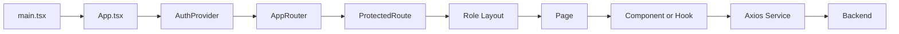
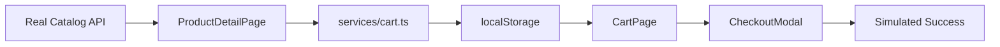
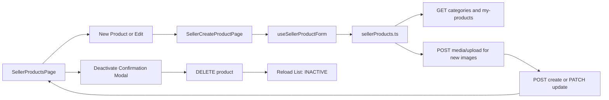

# Frontend File Map by Role

Baseline audit date: October 21, 2026. Code milestone: `c8c40e2`.

Scope: 175 source and configuration files in `frontend`, approximately 20,153 lines of code. Excludes `node_modules`, `dist`, asset files (images, fonts, 3D models) in `public`, lockfiles, and generated cache files. This document analyzes application structure, routing, imports, services, and state storage; it is not a complete runtime test matrix across all browser environments.

## 1. Document Reading Guide

| Label           | Meaning                                                                                                                              |
| --------------- | ------------------------------------------------------------------------------------------------------------------------------------ |
| Real API        | Code sends requests to the backend. Requires validation against a real account and database; does not guarantee operational success. |
| Mock Data       | Static values, mock objects, or sample state. Page reloads reset state to baseline values.                                           |
| Local Storage   | Writes to `localStorage` or `sessionStorage`. Business records are not persisted to the database.                                    |
| Placeholder     | Renders wireframes and functional descriptions; business workflows are not implemented.                                              |
| UI Component    | Receives props and state for rendering. Real versus mock status depends on data source.                                              |
| Types or Config | TypeScript declarations, exports, or toolchain configuration; executes no business logic.                                            |

Directory structure does not enforce permissions. Access permissions are governed by the router and route guards; data mutation permissions are validated by the backend. For example, `BuyerProfilePage.tsx` also serves `/seller/profile`.

## 2. Router and Current Permissions

| Role Group            | Primary Routes                                                              | Current Frontend Condition                                                                                        | Real Business Logic Status                                                                                             |
| --------------------- | --------------------------------------------------------------------------- | ----------------------------------------------------------------------------------------------------------------- | ---------------------------------------------------------------------------------------------------------------------- |
| Guest / Shopping Area | `/`, `/search`, `/product/:id`, `/auction`, `/categories`                   | Unauthenticated users can view public routes. `NonAdminLayout` redirects Admin users to `/admin`.                 | Product details and related items consume real APIs. The home page, search page, and auction showcase use sample data. |
| Auth                  | `/login`, `/register`, `/forgot-password`, `/reset-password`, `/verify-otp` | Wrapped in `NonAdminLayout` and `AuthLayout`.                                                                     | Login, registration, and OTP verification execute real API requests. Dedicated recovery URLs remain placeholders.      |
| Buyer                 | `/buyer/*`, `/cart`, `/checkout`                                            | `/cart` is public. Other Buyer routes require authentication via `ProtectedRoute` without enforcing `Role.BUYER`. | User profile is integrated. The shopping cart operates entirely in local storage.                                      |
| Seller                | `/seller/*`                                                                 | `ProtectedRoute` requires `Role.SELLER`, followed by `SellerSession` profile verification from AuthContext.       | Profile management, mode switching, approved store identity, and product inventory management use real APIs.           |
| Staff                 | `/staff/*`                                                                  | Router requires `Role.SUPPORT_STAFF`; `/staff/activate` is unauthenticated.                                       | Staff activation uses a real API. Ticket inbox uses mock fallback; outgoing message endpoints are not connected.       |
| Admin                 | `/admin/*`                                                                  | Router requires `Role.ADMIN`; `AdminLayout` verifies session against AuthContext.                                 | Staff invitations and seller application review use real APIs. Other operational panels use sample state.              |

### Authentication Workflow

`AuthContext` deduplicates concurrent `/users/me` requests by token and discards stale session responses. React `StrictMode` in development may invoke effects twice; not all child effects implement the deduplication pattern found in `AuthContext`.

## 3. Core and Shared Files

### 3.1. Tooling and Configuration

All paths are relative to the `frontend` directory.

| File                                   | Practical Purpose                                                                                                                                                                   |
| -------------------------------------- | ----------------------------------------------------------------------------------------------------------------------------------------------------------------------------------- |
| [package.json](package.json)           | Declares dependencies and scripts for development, build, and preview workflows. Includes React, Axios, Tailwind CSS, Ant Design Icons, Lucide, Three.js, React Query, and Zustand. |
| [index.html](index.html)               | Root HTML document containing the `root` mounting element and application entry point script reference.                                                                             |
| [vite.config.ts](vite.config.ts)       | Configures Vite plugins for React and Tailwind CSS; sets path aliases `@` to `src` and `@nexus/types` to shared types package.                                                      |
| [postcss.config.js](postcss.config.js) | Configures Autoprefixer for CSS processing.                                                                                                                                         |
| [tsconfig.json](tsconfig.json)         | Root TypeScript configuration referencing `tsconfig.app.json`.                                                                                                                      |
| [tsconfig.app.json](tsconfig.app.json) | Enables strict type checks, React JSX parsing, bundler module resolution, path aliases, and unused variable checks.                                                                 |
| [components.json](components.json)     | UI scaffolding configuration for shadcn primitives, mapping component aliases and design tokens.                                                                                    |

### 3.2. Bootstrap, Router, Context, and Layouts

| File                                                         | Role and Responsibility                                                                                                                                |
| ------------------------------------------------------------ | ------------------------------------------------------------------------------------------------------------------------------------------------------ |
| [main.tsx](src/main.tsx)                                     | Application entry point: calls `createRoot`, imports global CSS, and mounts application inside `StrictMode`.                                           |
| [App.tsx](src/App.tsx)                                       | Wraps router in `AuthProvider` to expose unified session state across all route components.                                                            |
| [vite-env.d.ts](src/vite-env.d.ts)                           | Type definitions for Vite client environment variables.                                                                                                |
| [index.css](src/index.css)                                   | Imports Tailwind layers, theme variables, custom fonts, color schemes, and global keyframe animations.                                                 |
| [lib/utils.ts](src/lib/utils.ts)                             | Exports `cn` utility function combining `clsx` and `tailwind-merge` for conditional class names.                                                       |
| [routes/AppRouter.tsx](src/routes/AppRouter.tsx)             | Defines application routing table, layouts, and guard configurations. `/seller/products/new` and `/seller/products/:id/edit` share the editor form.    |
| [routes/ProtectedRoute.tsx](src/routes/ProtectedRoute.tsx)   | Redirects unauthenticated users to `/login`. Evaluates `allowedRoles` when present. Does not execute backend authentication checks.                    |
| [contexts/AuthContext.tsx](src/contexts/AuthContext.tsx)     | Manages authentication tokens, user entity, profile, and role flags; coordinates cross-tab session synchronization and inflight request deduplication. |
| [contexts/index.ts](src/contexts/index.ts)                   | Central export point for authentication context definitions.                                                                                           |
| [layouts/NonAdminLayout.tsx](src/layouts/NonAdminLayout.tsx) | Permits access for unauthenticated users and non-admin roles; redirects administrative accounts to `/admin`.                                           |
| [layouts/GuestLayout.tsx](src/layouts/GuestLayout.tsx)       | Mounts header, shopping routes, and footer. Staff accessing `/` are redirected to the staff inbox.                                                     |
| [layouts/AuthLayout.tsx](src/layouts/AuthLayout.tsx)         | Standard layout container with dedicated header and footer for authentication screens.                                                                 |
| [layouts/SellerLayout.tsx](src/layouts/SellerLayout.tsx)     | Navigation shell for sellers, including sidebar, top navigation, search, and workspace provider with preview data toggle.                              |
| [layouts/AdminLayout.tsx](src/layouts/AdminLayout.tsx)       | Administrative workspace layout verifying admin credentials, providing seller application contexts, and rendering administration navigation.           |
| [pages/index.ts](src/pages/index.ts)                         | Central export registry for route page components.                                                                                                     |
| [products.ts](src/products.ts)                               | Central export barrel for product domain types and real product query functions.                                                                       |
| [components/products.ts](src/components/products.ts)         | Backward compatibility re-export barrel pointing to `src/products.ts`.                                                                                 |

### 3.3. Services: API and Storage Layer

| File                                                             | Target Roles          | Functional Purpose and Data Origin                                                                                                           |
| ---------------------------------------------------------------- | --------------------- | -------------------------------------------------------------------------------------------------------------------------------------------- |
| [services/api.ts](src/services/api.ts)                           | All Roles             | Shared Axios instance, base configuration, Bearer token injection, automatic refresh token flow on 401 status, and error payload unwrapping. |
| [services/auth.ts](src/services/auth.ts)                         | Auth / All Roles      | Authentication flows for login, registration, email verification, password reset, Google OAuth initiation, and token refresh.                |
| [services/users.ts](src/services/users.ts)                       | Buyer, Seller, Shared | User endpoint `/users/me`, seller mode toggle, seller upgrade application submissions, and upgrade history retrieval.                        |
| [services/profile.ts](src/services/profile.ts)                   | Buyer, Seller         | Updates name, phone number, and avatar via `/buyer/profile`. Requires seller password re-authentication before sensitive modifications.      |
| [services/products.service.ts](src/services/products.service.ts) | Public, Shopping      | Queries `/catalog/products` and `/catalog/products/:id` with pagination, parameter mapping, and request deduplication.                       |
| [services/sellerProducts.ts](src/services/sellerProducts.ts)     | Seller                | Store inventory CRUD endpoints, category lookups, multi-image upload orchestration, and inventory quantity delta management.                 |
| [services/cart.ts](src/services/cart.ts)                         | Public, Shopping      | Manages cart state in browser local storage. Does not communicate with backend `/commerce/cart` endpoints.                                   |
| [services/admin.ts](src/services/admin.ts)                       | Admin                 | Administrative API calls for staff invitations, staff member listings, and seller application approval or rejection.                         |
| [services/staff.ts](src/services/staff.ts)                       | Staff                 | Staff invitation verification and password activation. Ticket operations fall back to mock data when network requests fail.                  |
| [services/seller.ts](src/services/seller.ts)                     | Seller                | Legacy session verification helper reading `/users/me`. Active seller workflows now utilize `SellerSession` and `AuthContext`.               |

### 3.4. Data Types

| File                                                 | Purpose                                                                                                     |
| ---------------------------------------------------- | ----------------------------------------------------------------------------------------------------------- |
| [types/user.types.ts](src/types/user.types.ts)       | Type definitions for user accounts, profiles, wallets, seller onboarding applications, and session state.   |
| [types/product.types.ts](src/types/product.types.ts) | Domain interfaces for product details, store metadata, search result cards, and catalog filter structures.  |
| [types/cart.types.ts](src/types/cart.types.ts)       | Frontend shopping cart item structure containing prices, quantities, image references, and selection flags. |
| [types/auction.types.ts](src/types/auction.types.ts) | Data interfaces for auction rooms, bidding participants, and item appraisal records.                        |
| [types/index.ts](src/types/index.ts)                 | Central export barrel re-exporting shared domain types and enum contracts from `@nexus/types`.              |

### 3.5. Shared UI Components

| File                                                                 | Purpose and Usage                                                                                                       |
| -------------------------------------------------------------------- | ----------------------------------------------------------------------------------------------------------------------- |
| [components/Header.tsx](src/components/Header.tsx)                   | Minimalist navigation bar for authentication screens containing platform logo, support links, and home redirect.        |
| [components/footer.tsx](src/components/footer.tsx)                   | Informational footer with platform links, policy references, and payment badge assets.                                  |
| [components/Popup.tsx](src/components/Popup.tsx)                     | Portal-based dialog container managing scroll locking, focus trapping, escape key listeners, and custom action footers. |
| [components/PagePlaceholder.tsx](src/components/PagePlaceholder.tsx) | Placeholder component for under-construction routes displaying functional descriptions.                                 |
| [components/ui/button.tsx](src/components/ui/button.tsx)             | Modular button primitive supporting standard variants, loading spinners, and size attributes.                           |
| [components/ui/card.tsx](src/components/ui/card.tsx)                 | Compound card structure providing header, title, description, content, and footer sections.                             |
| [components/ui/input.tsx](src/components/ui/input.tsx)               | Accessible form input wrapper supporting custom refs and standard HTML attributes.                                      |

### 3.6. Mock and Sample Data

| File                                                 | Purpose and Behavior                                                                                                                      |
| ---------------------------------------------------- | ----------------------------------------------------------------------------------------------------------------------------------------- |
| [mocks/config.ts](src/mocks/config.ts)               | Evaluates `VITE_USE_MOCK`. Mock data defaults to enabled unless the variable strictly equals `'false'`. Includes simulated network delay. |
| [mocks/home.mock.ts](src/mocks/home.mock.ts)         | Sample banners, category cards, and product collections for home screen presentation.                                                     |
| [mocks/products.mock.ts](src/mocks/products.mock.ts) | Legacy mock product catalog records. Active product services use real API endpoints instead.                                              |
| [mocks/tickets.mock.ts](src/mocks/tickets.mock.ts)   | Sample support tickets, user profiles, and chat conversations for staff dashboard testing.                                                |
| [mocks/index.ts](src/mocks/index.ts)                 | Central export barrel for mock fixtures and runtime mock configuration flags.                                                             |

## 4. Guest, Auth, and Shopping Interfaces

### 4.1. Authentication and Registration

| File                                                                         | Functional Implementation                                                                                                              | Operational State |
| ---------------------------------------------------------------------------- | -------------------------------------------------------------------------------------------------------------------------------------- | ----------------- |
| [pages/auth/Login.tsx](src/pages/auth/Login.tsx)                             | Credential form with submission debounce, session persistence, role-based navigation, password recovery popup, and Google OAuth entry. | Real API          |
| [pages/auth/RegisterPage.tsx](src/pages/auth/RegisterPage.tsx)               | Registration form with inline OTP entry, countdown timer, resend trigger, and redirect to login upon completion.                       | Real API          |
| [pages/auth/ForgotPasswordModal.tsx](src/pages/auth/ForgotPasswordModal.tsx) | Two-step modal for email verification code dispatch and new password submission.                                                       | Real API          |
| [pages/auth/AuthHeroSection.tsx](src/pages/auth/AuthHeroSection.tsx)         | Promotional marketing banner displayed alongside authentication forms.                                                                 | Static UI         |
| [pages/auth/ForgotPasswordPage.tsx](src/pages/auth/ForgotPasswordPage.tsx)   | Standalone route `/forgot-password` rendering a placeholder. Functional recovery resides in modal.                                     | Placeholder       |
| [pages/auth/ResetPasswordPage.tsx](src/pages/auth/ResetPasswordPage.tsx)     | Dedicated route `/reset-password` displaying functional requirements.                                                                  | Placeholder       |
| [pages/auth/VerifyOtpPage.tsx](src/pages/auth/VerifyOtpPage.tsx)             | Dedicated route `/verify-otp` for standalone validation. Registration performs validation directly.                                    | Placeholder       |

### 4.2. Shopping Header Components

| File                                                                                           | Functional Implementation                                                                                                                                                           |
| ---------------------------------------------------------------------------------------------- | ----------------------------------------------------------------------------------------------------------------------------------------------------------------------------------- |
| [components/headers/HomeHeader.tsx](src/components/headers/HomeHeader.tsx)                     | Navigation bar with search input, language selection, user menu, notifications, cart button, and seller mode switch. Synchronizes local cart and coordinates seller upgrade dialog. |
| [components/headers/UserDropdownMenu.tsx](src/components/headers/UserDropdownMenu.tsx)         | User account popover displaying role-appropriate links to profile, order list, and wallet, alongside logout action.                                                                 |
| [components/headers/CartDropdownPanel.tsx](src/components/headers/CartDropdownPanel.tsx)       | Floating cart preview rendering item summaries and subtotal from local cart state.                                                                                                  |
| [components/headers/NotificationDropdown.tsx](src/components/headers/NotificationDropdown.tsx) | Notification list popover displaying provided notifications or an empty state indicator.                                                                                            |
| [components/headers/UpgradeSellerModal.tsx](src/components/headers/UpgradeSellerModal.tsx)     | Application modal collecting store name, business description, contact information, identity proofs, and tax documents.                                                             |
| [components/headers/index.ts](src/components/headers/index.ts)                                 | Central export barrel for shopping header components and related interface definitions.                                                                                             |

### 4.3. Public Pages

| File                                                                       | Route and Functionality                                                                                                                 | Operational State |
| -------------------------------------------------------------------------- | --------------------------------------------------------------------------------------------------------------------------------------- | ----------------- |
| [pages/guest/HomePage.tsx](src/pages/guest/HomePage.tsx)                   | Route `/`: combines hero banners, promotional sections, product recommendations, and live auction preview using `home.mock.ts`.         | Mock Data         |
| [pages/guest/SearchPage.tsx](src/pages/guest/SearchPage.tsx)               | Route `/search`: filter sidebar, sorting controls, grid or list view toggles, and item cards backed by `mockData.ts`.                   | Mock Data         |
| [pages/guest/ProductDetailPage.tsx](src/pages/guest/ProductDetailPage.tsx) | Route `/product/:id`: queries catalog endpoint, validates stock, displays image gallery, seller identity, and adds items to local cart. | Real API          |
| [pages/guest/AuctionPage.tsx](src/pages/guest/AuctionPage.tsx)             | Route `/auction`: simulated live auction room displaying countdown timer, current leading bid, view switcher, and local state bidding.  | Simulated UI      |
| [pages/guest/AuctionDetailPage.tsx](src/pages/guest/AuctionDetailPage.tsx) | Route `/auction/:id`: container frame for specified auction identifier.                                                                 | Placeholder       |
| [pages/guest/CategoryPage.tsx](src/pages/guest/CategoryPage.tsx)           | Route `/categories`: overview of product catalog taxonomy.                                                                              | Placeholder       |
| [pages/guest/AboutPage.tsx](src/pages/guest/AboutPage.tsx)                 | Route `/about`: platform background and company mission overview.                                                                       | Placeholder       |
| [pages/guest/ContactPage.tsx](src/pages/guest/ContactPage.tsx)             | Route `/contact`: support contact information and inquiry guidelines.                                                                   | Placeholder       |
| [pages/guest/TermsPage.tsx](src/pages/guest/TermsPage.tsx)                 | Route `/terms`: platform service terms and user conditions.                                                                             | Placeholder       |
| [pages/guest/PrivacyPage.tsx](src/pages/guest/PrivacyPage.tsx)             | Route `/privacy`: user privacy policy and data governance statement.                                                                    | Placeholder       |
| [pages/guest/NotFoundPage.tsx](src/pages/guest/NotFoundPage.tsx)           | Unmatched route fallback rendering 404 error graphic with home redirect link.                                                           | Functional UI     |

### 4.4. Home Screen Components

| File                                                                                         | Functional Implementation                                                                          |
| -------------------------------------------------------------------------------------------- | -------------------------------------------------------------------------------------------------- |
| [components/home/HomeHeroBanner.tsx](src/components/home/HomeHeroBanner.tsx)                 | Interactive hero carousel displaying promotional banners with manual slide controls.               |
| [components/home/HomeBenefit.tsx](src/components/home/HomeBenefit.tsx)                       | Value proposition card displaying feature icon, headline, and supporting description.              |
| [components/home/HomeCountdown.tsx](src/components/home/HomeCountdown.tsx)                   | Countdown timer rendering remaining hours, minutes, and seconds based on provided timestamp props. |
| [components/home/HomeFlashSaleCard.tsx](src/components/home/HomeFlashSaleCard.tsx)           | Flash sale product card displaying discount badge, sale price, progress bar, and catalog link.     |
| [components/home/HomeAuctionCard.tsx](src/components/home/HomeAuctionCard.tsx)               | Auction preview card presenting current bid amount, item title, and appraisal badge.               |
| [components/home/HomeLiveAuction.tsx](src/components/home/HomeLiveAuction.tsx)               | Composite live auction showcase featuring featured lot, countdown timer, and secondary bids.       |
| [components/home/HomeRecommendationCard.tsx](src/components/home/HomeRecommendationCard.tsx) | Recommended product card with price tags and immediate add-to-cart trigger.                        |
| [components/home/home.types.ts](src/components/home/home.types.ts)                           | Type definitions for home banner slides, promotional features, and product showcase structures.    |
| [components/home/index.ts](src/components/home/index.ts)                                     | Central export barrel for home screen component primitives.                                        |

### 4.5. Search and Product Detail Components

| File                                                                                                           | Purpose and Data Origin                                                                                                           |
| -------------------------------------------------------------------------------------------------------------- | --------------------------------------------------------------------------------------------------------------------------------- |
| [components/search/SearchFilterSidebar.tsx](src/components/search/SearchFilterSidebar.tsx)                     | Filter controls for transaction type, product condition, brand selection, shipping options, and price ranges. Updates page state. |
| [components/search/SearchResultCard.tsx](src/components/search/SearchResultCard.tsx)                           | Product search card rendering status badges, pricing, preview modal trigger, and link to `/product/:id`.                          |
| [components/search/SearchPreviewModal.tsx](src/components/search/SearchPreviewModal.tsx)                       | Quick preview modal displaying asset images and item specifications.                                                              |
| [components/search/mockData.ts](src/components/search/mockData.ts)                                             | Mock query suggestions and sample product generation fixtures.                                                                    |
| [components/search/types.ts](src/components/search/types.ts)                                                   | Type definitions for search filters, sorting options, and result item structures.                                                 |
| [components/productDetail/ProductImageGallery.tsx](src/components/productDetail/ProductImageGallery.tsx)       | Image gallery component handling thumbnail switching, active preview, and fallback placeholders.                                  |
| [components/productDetail/ProductInfoTabs.tsx](src/components/productDetail/ProductInfoTabs.tsx)               | Tabbed interface presenting description markdown, technical specifications, and review summaries.                                 |
| [components/productDetail/RelatedProductsSection.tsx](src/components/productDetail/RelatedProductsSection.tsx) | Fetches current catalog page, filters out the active item, and renders up to four related product cards.                          |
| [components/productDetail/useProductResource.ts](src/components/productDetail/useProductResource.ts)           | Hook managing resource loading states, error boundaries, retry triggers, and stale response cancellation across route changes.    |

### 4.6. Public Auction Components

| File                                                                                               | Purpose and Scope                                                                                                          |
| -------------------------------------------------------------------------------------------------- | -------------------------------------------------------------------------------------------------------------------------- |
| [components/auction/AuctionGallery.tsx](src/components/auction/AuctionGallery.tsx)                 | Asset viewer offering photo, 3D, and LiDAR view modes. 3D mode performs CSS rotations rather than executing WebGL shaders. |
| [components/auction/AuctionBidTerminal.tsx](src/components/auction/AuctionBidTerminal.tsx)         | Current bid display, minimum increment indicator, bid input field, and submission callback.                                |
| [components/auction/AuctionDetailTabs.tsx](src/components/auction/AuctionDetailTabs.tsx)           | Tab container presenting lot descriptions, provenance documentation, bid logs, and seller notes.                           |
| [components/auction/SimilarAuctionsSection.tsx](src/components/auction/SimilarAuctionsSection.tsx) | Showcase of related auction items supporting client-side bookmark state.                                                   |
| [components/auction/mockData.ts](src/components/auction/mockData.ts)                               | Fixture thumbnails and metadata for sample auction showcases.                                                              |
| [components/auction/types.ts](src/components/auction/types.ts)                                     | Re-exports auction domain interfaces and bid history records.                                                              |

## 5. Buyer Workflows

### 5.1. Buyer Pages

| File                                                                             | Route and Responsibility                                                                                                                    | Operational State |
| -------------------------------------------------------------------------------- | ------------------------------------------------------------------------------------------------------------------------------------------- | ----------------- |
| [pages/buyer/BuyerDashboardPage.tsx](src/pages/buyer/BuyerDashboardPage.tsx)     | Route `/buyer`: account overview dashboard.                                                                                                 | Placeholder       |
| [pages/buyer/BuyerProfilePage.tsx](src/pages/buyer/BuyerProfilePage.tsx)         | Routes `/buyer/profile` and `/seller/profile`: integrates AuthContext session and ProfileEditor form.                                       | Real API          |
| [pages/buyer/CartPage.tsx](src/pages/buyer/CartPage.tsx)                         | Route `/cart`: item grouping by store, quantity updates, item selection, price calculation, voucher simulation, and checkout modal trigger. | Local Storage     |
| [pages/buyer/CheckoutPage.tsx](src/pages/buyer/CheckoutPage.tsx)                 | Route `/checkout`: standalone payment and order placement placeholder.                                                                      | Placeholder       |
| [pages/buyer/BuyerAddressesPage.tsx](src/pages/buyer/BuyerAddressesPage.tsx)     | Route `/buyer/addresses`: delivery address management placeholder.                                                                          | Placeholder       |
| [pages/buyer/BuyerOrdersPage.tsx](src/pages/buyer/BuyerOrdersPage.tsx)           | Route `/buyer/orders`: order tracking and purchase history placeholder.                                                                     | Placeholder       |
| [pages/buyer/BuyerOrderDetailPage.tsx](src/pages/buyer/BuyerOrderDetailPage.tsx) | Route `/buyer/orders/:id`: order fulfillment details and delivery confirmation placeholder.                                                 | Placeholder       |
| [pages/buyer/BuyerWishlistPage.tsx](src/pages/buyer/BuyerWishlistPage.tsx)       | Route `/buyer/wishlist`: saved and bookmarked items placeholder.                                                                            | Placeholder       |
| [pages/buyer/BuyerWalletPage.tsx](src/pages/buyer/BuyerWalletPage.tsx)           | Route `/buyer/wallet`: platform balance and deposit transaction placeholder.                                                                | Placeholder       |
| [pages/buyer/BuyerBidsPage.tsx](src/pages/buyer/BuyerBidsPage.tsx)               | Route `/buyer/bids`: active auction participations and winning bids placeholder.                                                            | Placeholder       |
| [pages/buyer/BuyerDisputesPage.tsx](src/pages/buyer/BuyerDisputesPage.tsx)       | Route `/buyer/disputes`: return and refund arbitration claims placeholder.                                                                  | Placeholder       |

### 5.2. Profile and Cart Components

| File                                                                             | Functional Implementation                                                                                                                                  |
| -------------------------------------------------------------------------------- | ---------------------------------------------------------------------------------------------------------------------------------------------------------- |
| [components/profile/ProfileEditor.tsx](src/components/profile/ProfileEditor.tsx) | Form updating display name, phone number, and avatar image. Requires password confirmation for seller accounts. Dispatches profile updates to AuthContext. |
| [components/cart/CartOrderSummary.tsx](src/components/cart/CartOrderSummary.tsx) | Order summary card computing selected item subtotal, simulated voucher discounts, and estimated shipping fees from local state.                            |
| [components/cart/CheckoutModal.tsx](src/components/cart/CheckoutModal.tsx)       | Shipping address and payment method selector. Simulates payment success via timer and clears local cart storage. Does not generate backend orders.         |

### Cart and Checkout Workflow

Catalog products consume real backend data, but checkout and order creation remain client-side simulations. Real purchases require end-to-end commerce integration.

## 6. Seller Workflows

### 6.1. Seller Pages

| File                                                                                     | Route and Responsibility                                                                                                                                      | Operational State                     |
| ---------------------------------------------------------------------------------------- | ------------------------------------------------------------------------------------------------------------------------------------------------------------- | ------------------------------------- |
| [pages/seller/SellerDashboardPage.tsx](src/pages/seller/SellerDashboardPage.tsx)         | Routes `/seller` and `/seller/overview`: store metrics, revenue summary, recent orders, and balance overview.                                                 | Hybrid (Real Profile, Mock Analytics) |
| [pages/seller/SellerProductsPage.tsx](src/pages/seller/SellerProductsPage.tsx)           | Routes `/seller/products` and `/seller/inventory`: store product table, stock levels, status filters, edit navigation, and deactivation modal.                | Real API                              |
| [pages/seller/SellerCreateProductPage.tsx](src/pages/seller/SellerCreateProductPage.tsx) | Routes `/seller/products/new` and `/seller/products/:id/edit`: product creation and modification form managing title, price, category, stock, and dimensions. | Real API                              |
| [pages/seller/SellerOrdersPage.tsx](src/pages/seller/SellerOrdersPage.tsx)               | Route `/seller/orders`: order fulfillment table, filter controls, packaging guide, and CSV export.                                                            | Mock Data                             |
| [pages/seller/SellerOrderDetailPage.tsx](src/pages/seller/SellerOrderDetailPage.tsx)     | Route `/seller/orders/:id`: detailed order fulfillment view backed by preview data fixture.                                                                   | Mock Data                             |
| [pages/seller/SellerAuctionsPage.tsx](src/pages/seller/SellerAuctionsPage.tsx)           | Route `/seller/auctions`: auction lot management and local draft inspector.                                                                                   | Mock Data                             |
| [pages/seller/SellerDraftPage.tsx](src/pages/seller/SellerDraftPage.tsx)                 | Route `/seller/auctions/new`: saves auction drafts to local storage. Real product creation uses `SellerCreateProductPage`.                                    | Local Storage                         |
| [pages/seller/SellerFinancePage.tsx](src/pages/seller/SellerFinancePage.tsx)             | Route `/seller/finance`: displays wallet balance from session profile. Payout requests and transaction history use placeholder layouts.                       | Hybrid (Real Balance, Mock History)   |
| [pages/seller/SellerReviewsPage.tsx](src/pages/seller/SellerReviewsPage.tsx)             | Route `/seller/reviews`: displays store rating from profile. Customer feedback reviews table is a placeholder.                                                | Hybrid                                |
| [pages/seller/SellerDisputesPage.tsx](src/pages/seller/SellerDisputesPage.tsx)           | Route `/seller/disputes`: dispute claims management and dispute evidence guide.                                                                               | Placeholder                           |
| [pages/seller/SellerSettingsPage.tsx](src/pages/seller/SellerSettingsPage.tsx)           | Route `/seller/settings`: store preferences, security policies, pickup addresses, and notification settings stored locally.                                   | Local Storage                         |

### 6.2. Seller Components, Context, and Hooks

| File                                                                                         | Functional Implementation                                                                                                              |
| -------------------------------------------------------------------------------------------- | -------------------------------------------------------------------------------------------------------------------------------------- |
| [components/seller/SellerSession.tsx](src/components/seller/SellerSession.tsx)               | Context provider and route guard validating `SELLER` role from `AuthContext` without issuing redundant `/users/me` network requests.   |
| [components/seller/SellerWorkspace.tsx](src/components/seller/SellerWorkspace.tsx)           | State container for seller workspace parameters, managing preview modes, store name references, and local draft records.               |
| [components/seller/SellerUI.tsx](src/components/seller/SellerUI.tsx)                         | Seller-specific UI components including panels, badges, metric cards, empty states, and CSV generation utilities.                      |
| [components/seller/SellerOverviewPanels.tsx](src/components/seller/SellerOverviewPanels.tsx) | Dashboard cards rendering store identity, operational metrics, revenue estimates, order counters, and wallet summaries.                |
| [components/seller/SellerOrderPanels.tsx](src/components/seller/SellerOrderPanels.tsx)       | Order item lists, buyer details, and logistics handling instructions.                                                                  |
| [components/seller/SellerProductImages.tsx](src/components/seller/SellerProductImages.tsx)   | Image file selector supporting object URL previews, drag-and-drop ordering, and validation rules up to five images.                    |
| [components/seller/useSellerProductForm.ts](src/components/seller/useSellerProductForm.ts)   | Form controller coordinating category loading, existing product population, image uploads, submission debounce, and redirect handling. |
| [components/seller/useSellerProducts.ts](src/components/seller/useSellerProducts.ts)         | Hook managing inventory querying, pagination, refresh triggers, and product deactivation modal states.                                 |
| [components/seller/useSellerStore.ts](src/components/seller/useSellerStore.ts)               | Retrieves seller onboarding records to extract verified `storeName` attributes from approved applications.                             |
| [components/seller/sellerData.ts](src/components/seller/sellerData.ts)                       | Domain types, currency formatters, and mock fixtures for orders and auctions in seller preview mode.                                   |

### Seller Product Management Flow

Product deletion performs a soft deactivation (`INACTIVE`), retaining database records. Inventory count modifications send absolute stock counts rather than deltas.

## 7. Staff Workflows

The `pages/staff` directory contains both page routes and nested panel components.

| File                                                                                           | Route and Responsibility                                                                                                 | Operational State        |
| ---------------------------------------------------------------------------------------------- | ------------------------------------------------------------------------------------------------------------------------ | ------------------------ |
| [pages/staff/StaffActivationPage.tsx](src/pages/staff/StaffActivationPage.tsx)                 | Route `/staff/activate?token=...`: loads invitation details, displays assigned email, and collects new account password. | Real API                 |
| [pages/staff/StaffDashboard.tsx](src/pages/staff/StaffDashboard.tsx)                           | Staff shell component coordinating sidebar navigation, search input, notification toasts, and section panels.            | Functional Shell         |
| [pages/staff/StaffInboxPage.tsx](src/pages/staff/StaffInboxPage.tsx)                           | Route `/staff/inbox`: renders staff dashboard with inbox panel selected.                                                 | Real Shell, Mock Tickets |
| [pages/staff/StaffDisputesPage.tsx](src/pages/staff/StaffDisputesPage.tsx)                     | Route `/staff/disputes`: arbitration claims management view.                                                             | Placeholder              |
| [pages/staff/StaffAuctionSupportPage.tsx](src/pages/staff/StaffAuctionSupportPage.tsx)         | Route `/staff/auction-support`: auction moderation and dispute assistance view.                                          | Placeholder              |
| [pages/staff/StaffFaqPage.tsx](src/pages/staff/StaffFaqPage.tsx)                               | Route `/staff/faq`: staff operational runbooks and knowledge base articles.                                              | Static Content           |
| [pages/staff/StaffHistoryPage.tsx](src/pages/staff/StaffHistoryPage.tsx)                       | Route `/staff/history`: historical ticket resolution log and CSAT scores.                                                | Placeholder              |
| [pages/staff/StaffPerformancePage.tsx](src/pages/staff/StaffPerformancePage.tsx)               | Route `/staff/performance`: staff performance scorecard and resolution time metrics.                                     | Placeholder              |
| [pages/staff/StaffManagementPage.tsx](src/pages/staff/StaffManagementPage.tsx)                 | Route `/staff/team`: team management interface requiring administrative authorization.                                   | Permission Restricted    |
| [pages/staff/StaffSellerApprovalPage.tsx](src/pages/staff/StaffSellerApprovalPage.tsx)         | Route `/staff/seller-approvals`: redirects to `/admin/sellers`.                                                          | Redirect                 |
| [pages/staff/StaffHeader.tsx](src/pages/staff/StaffHeader.tsx)                                 | Top navigation bar with global search, account dropdown, and logout trigger.                                             | Functional UI            |
| [pages/staff/StaffSidebar.tsx](src/pages/staff/StaffSidebar.tsx)                               | Responsive navigation sidebar managing active routes and role visibility gates.                                          | Functional UI            |
| [pages/staff/staffNavigationData.ts](src/pages/staff/staffNavigationData.ts)                   | Static configuration array mapping route definitions, navigation badges, and section headings.                           | Static Config            |
| [pages/staff/StaffMetricCards.tsx](src/pages/staff/StaffMetricCards.tsx)                       | Metric cards displaying active ticket counts, waiting queues, and average response times.                                | Functional UI            |
| [pages/staff/StaffTicketChatPanel.tsx](src/pages/staff/StaffTicketChatPanel.tsx)               | Ticket management panel with status filters, search input, and conversation history view.                                | Mock Fallback            |
| [pages/staff/StaffTicketConversationView.tsx](src/pages/staff/StaffTicketConversationView.tsx) | Active support conversation thread with response input box and quick response macros.                                    | Functional UI            |
| [pages/staff/StaffTeamManagementPanel.tsx](src/pages/staff/StaffTeamManagementPanel.tsx)       | Staff member list queried from `/admin/staff` and invitation dispatch modal.                                             | Real API                 |

## 8. Admin Workflows

### 8.1. Admin Pages

| File                                                                           | Route and Responsibility                                                                                               | Operational State                     |
| ------------------------------------------------------------------------------ | ---------------------------------------------------------------------------------------------------------------------- | ------------------------------------- |
| [pages/admin/AdminDashboardPage.tsx](src/pages/admin/AdminDashboardPage.tsx)   | Route `/admin/overview`: metric cards, revenue trends, seller applications, refund requests, and user security list.   | Hybrid (Real Applications, Mock Data) |
| [pages/admin/AdminSellersPage.tsx](src/pages/admin/AdminSellersPage.tsx)       | Route `/admin/sellers`: seller upgrade application list, credential inspection modal, and approval/rejection triggers. | Real API                              |
| [pages/admin/AdminUsersPage.tsx](src/pages/admin/AdminUsersPage.tsx)           | Route `/admin/users`: staff invitation panel and user security moderation table.                                       | Hybrid (Real Invitations, Mock Users) |
| [pages/admin/AdminCategoriesPage.tsx](src/pages/admin/AdminCategoriesPage.tsx) | Route `/admin/categories`: catalog category taxonomy management placeholder.                                           | Placeholder                           |
| [pages/admin/AdminAuctionsPage.tsx](src/pages/admin/AdminAuctionsPage.tsx)     | Route `/admin/auctions`: auction lot approval and catalog audit panel.                                                 | Mock Data                             |
| [pages/admin/AdminRefundsPage.tsx](src/pages/admin/AdminRefundsPage.tsx)       | Route `/admin/refunds`: escrow refund claims and arbitration decision triggers.                                        | Mock Data                             |
| [pages/admin/AdminFinancePage.tsx](src/pages/admin/AdminFinancePage.tsx)       | Route `/admin/finance`: platform commission reports and settlement transaction tables.                                 | Mock Data                             |
| [pages/admin/AdminStudioPage.tsx](src/pages/admin/AdminStudioPage.tsx)         | Route `/admin/studio`: live auction broadcast controls and stream health monitors.                                     | Simulated UI                          |
| [pages/admin/AdminSystemPage.tsx](src/pages/admin/AdminSystemPage.tsx)         | Route `/admin/system`: WebSocket connection monitors, logistics bridge status, and system event logs.                  | Static UI                             |
| [pages/admin/AdminSettingsPage.tsx](src/pages/admin/AdminSettingsPage.tsx)     | Route `/admin/settings`: platform configuration values and moderation keyword lists.                                   | Simulated UI                          |

### 8.2. Admin Components, Data, and Hooks

| File                                                                                                               | Functional Implementation                                                                                        |
| ------------------------------------------------------------------------------------------------------------------ | ---------------------------------------------------------------------------------------------------------------- |
| [components/adminDashboard/AdminHeader.tsx](src/components/adminDashboard/AdminHeader.tsx)                         | Administrative top navigation bar displaying user profile, pending task badges, and session logout.              |
| [components/adminDashboard/Sidebar.tsx](src/components/adminDashboard/Sidebar.tsx)                                 | Navigation sidebar with section links, pending application counters, and storefront link.                        |
| [components/adminDashboard/AdminUI.tsx](src/components/adminDashboard/AdminUI.tsx)                                 | Reusable administrative UI components including dashboard panels, custom inputs, and status badges.              |
| [components/adminDashboard/useAdminContext.ts](src/components/adminDashboard/useAdminContext.ts)                   | Hook consuming Outlet context provided by `AdminLayout`, containing global admin state and mock handlers.        |
| [components/adminDashboard/AdminSellerRequests.tsx](src/components/adminDashboard/AdminSellerRequests.tsx)         | Shared provider and hook querying seller onboarding requests with pagination and deduplication.                  |
| [components/adminDashboard/SellerApplicationsPanel.tsx](src/components/adminDashboard/SellerApplicationsPanel.tsx) | Application review table with document inspection modal, rejection reason input, and decision mutation handlers. |
| [components/adminDashboard/UserManagement.tsx](src/components/adminDashboard/UserManagement.tsx)                   | `StaffInvite` calls real `/admin/staff/invite` endpoint; `UserSecurity` renders mock user management state.      |
| [components/adminDashboard/AuctionsPanel.tsx](src/components/adminDashboard/AuctionsPanel.tsx)                     | Auction lot review table with lot details and state mutation actions.                                            |
| [components/adminDashboard/RefundRequestsPanel.tsx](src/components/adminDashboard/RefundRequestsPanel.tsx)         | Escrow dispute panel displaying claim rationale, uploaded evidence, and simulated decision triggers.             |
| [components/adminDashboard/RevenueChart.tsx](src/components/adminDashboard/RevenueChart.tsx)                       | Interactive SVG chart rendering simulated platform gross volume and commission revenue trends.                   |
| [components/adminDashboard/ModerationCard.tsx](src/components/adminDashboard/ModerationCard.tsx)                   | Automated content moderation keyword blacklist management card.                                                  |
| [components/adminDashboard/SystemCards.tsx](src/components/adminDashboard/SystemCards.tsx)                         | Operational cards rendering logistics webhook health, Redis queue metrics, and client error logs.                |
| [components/adminDashboard/adminData.ts](src/components/adminDashboard/adminData.ts)                               | Seed fixtures providing initial mock state for users, auctions, and refund disputes in admin views.              |
| [components/adminDashboard/adminTypes.ts](src/components/adminDashboard/adminTypes.ts)                             | Domain types, action interfaces, and data models for administrative dashboard components.                        |

## 9. Architectural and Integration Considerations

### 9.1. Connected Backend APIs

- Fundamental authentication flows, staff activation, and buyer/seller profile synchronization.
- Seller onboarding application dispatch, administrative review, and status transitions.
- Seller product catalog management: category lookups, media uploads, creation, updates, and soft deletion.
- Real product catalog retrieval and related product discovery for guest and shopping routes.
- Administrative staff member invitation dispatch.

### 9.2. Discrepancies and Clarifications

1. Admin users table uses mock data: while backend APIs exist for user management, `UserSecurity` renders `initialAdminData.users` and modifies client-side state.
2. Staff team management permission conflict: `/staff/team` is guarded for `SUPPORT_STAFF`, but the underlying dashboard panel requires `isAdmin`.
3. Buyer route guards permit any authenticated user: `ProtectedRoute` under the buyer group does not enforce `allowedRoles: [Role.BUYER]`.
4. Profile hydration states: when an authentication token exists while profile state is hydrating, `allowedRoles` evaluation requires explicit null checks.
5. Role capability parity: recent backend permission changes enabling staff capabilities require corresponding UI updates in seller navigation bars and profile editing forms.
6. Seller application address attributes: backend onboarding endpoints accept structured pickup addresses, whereas the frontend submission form does not yet collect location coordinates.
7. Local cart persistence: the shopping cart key `nexus:cart-items` is bound to the browser instead of the user account.
8. Mock mode flags: setting `VITE_USE_MOCK=false` does not replace all fixtures because certain pages import mock data files directly.
9. 3D viewer implementation: the auction gallery renders 2D image assets with CSS transforms rather than WebGL geometry.
10. Standalone authentication routes: `/forgot-password`, `/reset-password`, and `/verify-otp` render placeholder pages while primary workflows operate within modals.
11. Concurrent network requests: effect hooks in `StaffTicketChatPanel` and `StaffActivationPage` do not implement the request deduplication pattern found in `AuthContext`.
12. Icon library consistency: newer seller components import Ant Design Icons, whereas older guest, admin, and staff components import Lucide icons.

### 9.3. Key Files by Workflow

| Task Scope                          | Recommended Reading Order                                                                                                                        |
| ----------------------------------- | ------------------------------------------------------------------------------------------------------------------------------------------------ |
| Authentication and Role Navigation  | `Login.tsx` → `services/auth.ts` → `AuthContext.tsx` → `AppRouter.tsx` → `ProtectedRoute.tsx` and role layout.                                   |
| Profile Management                  | `BuyerProfilePage.tsx` → `ProfileEditor.tsx` → `services/profile.ts` → `services/users.ts`.                                                      |
| Product Catalog Management          | `SellerProductsPage.tsx` → `SellerCreateProductPage.tsx` → `useSellerProductForm.ts` → `SellerProductImages.tsx` → `services/sellerProducts.ts`. |
| Store Settings and Seller Dashboard | `SellerLayout.tsx` → `SellerWorkspace.tsx` → `useSellerStore.ts` → `SellerSettingsPage.tsx` or `SellerOverviewPanels.tsx`.                       |
| Shopping and Checkout               | `HomePage.tsx` → `SearchPage.tsx` → `ProductDetailPage.tsx` → `services/products.service.ts` → `services/cart.ts` → `CartPage.tsx`.              |
| Seller Application Review           | `AdminLayout.tsx` → `AdminSellerRequests.tsx` → `AdminSellersPage.tsx` → `SellerApplicationsPanel.tsx` → `services/admin.ts`.                    |
| Staff Invitations and Activation    | `UserManagement.tsx` → `services/admin.ts` → `StaffActivationPage.tsx` → `services/staff.ts`.                                                    |
| Staff Support Inbox                 | `StaffInboxPage.tsx` → `StaffDashboard.tsx` → `StaffTicketChatPanel.tsx` → `services/staff.ts`.                                                  |

## 10. Audit Scope

This document details frontend architectural contracts and file responsibilities as of the baseline milestone. Runtime routing, component structures, API services, and dependencies are documented without modifying underlying application code.
