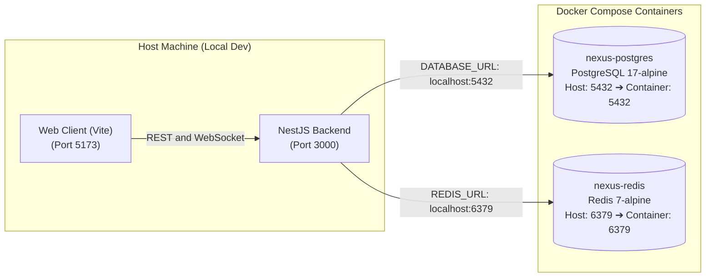

# Infrastructure and Docker Operations Guide

This guide establishes the standardized Docker operational procedures for engineers working on Project Nexus.

---

## 1. Local Infrastructure Architecture Overview

In local development, Docker orchestrates the persistence and caching backing services, while Backend (NestJS) and Frontend (React and Vite) run directly on the host workstation to leverage instant Hot Module Replacement (HMR).



### Container Port and Resource Mapping

| Container Name   | Service       | Image                | Host Port | Container Port | Purpose                                                                         |
| :--------------- | :------------ | :------------------- | :-------- | :------------- | :------------------------------------------------------------------------------ |
| `nexus-postgres` | PostgreSQL 17 | `postgres:17-alpine` | `5432`    | `5432`         | System ACID persistence, relational schema, logical separation                  |
| `nexus-redis`    | Redis 7       | `redis:7-alpine`     | `6379`    | `6379`         | Cache, Redlock distributed locking, atomic bidding queue, publish and subscribe |

---

## 2. Backend Developer Workflow

Backend engineers require the database and Redis instances to run migrations, build domain models, and test API endpoints.

### Step 1: Start Backing Services

From the repository root:

```bash
npm run docker:infra
```

Starts `nexus-postgres` and `nexus-redis` in detached mode (`-d`).

### Step 2: Apply Database Schema Migrations

Once the PostgreSQL container is healthy:

```bash
npm run db:migrate
```

Applies all pending migrations from `backend/prisma/migrations` to the `nexus_main` database.

### Step 3: Monitor Live Logs

```bash
npm run docker:logs
# Or monitor specific containers:
docker logs -f nexus-postgres
docker logs -f nexus-redis
```

### Step 4: Run Backend in Watch Mode

```bash
npm run dev:backend
```

- REST API: `http://localhost:3000/api/v1`
- Interactive Swagger UI: `http://localhost:3000/api/docs`

---

## 3. Frontend Developer Workflow

Frontend engineers run two commands to have a fully operational backend API and WebSocket server.

### Quick Startup Routine

```bash
# 1. Start database and Redis
npm run docker:infra

# 2. Start the Backend API and WebSocket server
npm run dev:backend

# 3. In a separate terminal, launch the Frontend client
npm run dev:frontend
```

Web Client address: `http://localhost:5173`

### Core API Endpoints for Frontend

- REST API Base URL: `http://localhost:3000/api/v1`
- WebSocket Auction Room: `ws://localhost:3000/ws/auctions`
- Swagger API Documentation: `http://localhost:3000/api/docs`

---

## 4. Teardown, Cleanup, and Reset Operations

### Scenario 1: Standard Teardown (Preserve Data)

At the end of a work session:

```bash
npm run docker:down
```

Stops the containers while retaining data in Docker volumes for subsequent runs.

### Scenario 2: Complete Reset (Wipe Volumes and Clean Slate)

When you need to completely wipe test products, auction records, and reset the database:

1. Stop containers and permanently delete volumes:

   ```bash
   npm run docker:clean
   # Equivalent to: docker compose -f infra/docker-compose.yml down -v
   ```

2. Spin up fresh containers:

   ```bash
   npm run docker:infra
   ```

3. Re-apply database migrations from scratch:

   ```bash
   npm run db:migrate
   ```

### Scenario 3: Fast Database Reset (Without Restarting Docker)

For backend developers iterating on schema changes:

```bash
cd backend
npx prisma migrate reset
```

Drops the database, applies all migrations, and runs seed scripts without restarting Docker.

---

## 5. Direct Container Shell Access

### Access PostgreSQL (`psql`)

```bash
docker exec -it nexus-postgres psql -U postgres -d nexus_main
```

Useful commands:

- `\dt`: List all tables.
- `SELECT * FROM users;`: View user accounts.
- `\q`: Exit psql.

### Access Redis (`redis-cli`)

```bash
docker exec -it nexus-redis redis-cli
```

Useful commands:

- `PING`: Test connectivity (responds `PONG`).
- `KEYS *`: Inspect cached keys.
- `FLUSHALL`: Flush all Redis data.
- `exit`: Exit redis-cli.

---

## 5b. Running the Whole Platform in Containers

Sections 1 to 4 describe the usual local setup: Postgres and Redis in Docker,
the applications on the host for hot reload. The compose file can also run
everything, which is what a reviewer or a deployment needs.

```bash
# Database, cache, migrations, backend and web client
npm run docker:full
# Equivalent to: docker compose -f infra/docker-compose.yml --profile full up --build
```

The `migrate` service runs first and completes before the backend starts. It
applies the migrations and creates the system rows — the platform settings and
the platform's own wallets — and nothing else. A freshly built stack is a
working but empty shop.

### A stack with data in it

```bash
docker compose -f infra/docker-compose.yml -f infra/docker-compose.demo.yml \
  --profile full --profile demo up --build
```

This adds the `seed-demo` service, which creates shops, products, auctions and
orders to look at. It is deliberately separate, and deliberately not in the
server image, because every account it creates shares one password printed as
it runs. Set `DEMO_SEED_PASSWORD` to pin that password; leave it unset and the
seed generates one.

### What is in each image

The backend Dockerfile builds three things from one file:

| Target     | Contains                                                    | Used by               |
| :--------- | :---------------------------------------------------------- | :-------------------- |
| `runner`   | the compiled server and production dependencies only        | the `backend` service |
| `migrator` | the Prisma CLI, ts-node, the migrations and the system seed | the `migrate` service |
| `builder`  | the full toolchain; an intermediate stage                   | the two above         |

The server image carries no build tools and no demo seeds and runs as a
non-root user. Its health check asks `/api/v1/health/ready`, which probes
PostgreSQL and Redis readiness rather than the Swagger page, which answers even
when the database is unreachable.

---

## 6. Command Quick Reference Cheat Sheet

| Task                          | NPM Script (Recommended) | Equivalent Docker Command                                              |
| :---------------------------- | :----------------------- | :--------------------------------------------------------------------- |
| Start Services Detached       | `npm run docker:infra`   | `docker compose -f infra/docker-compose.yml up -d`                     |
| Stop Services (Keep Data)     | `npm run docker:down`    | `docker compose -f infra/docker-compose.yml down`                      |
| Reset Services (Wipe Volumes) | `npm run docker:clean`   | `docker compose -f infra/docker-compose.yml down -v`                   |
| View Service Logs             | `npm run docker:logs`    | `docker compose -f infra/docker-compose.yml logs -f`                   |
| Inspect Running Containers    | -                        | `docker ps`                                                            |
| Inspect Resource Usage        | -                        | `docker stats`                                                         |
| Run the Whole Platform        | `npm run docker:full`    | `docker compose -f infra/docker-compose.yml --profile full up --build` |

---

## 7. Common Troubleshooting

### 1. `failed to connect to the docker API at npipe://...`

Root Cause: Docker Desktop is not running or the Linux engine has not finished starting.
Resolution: Launch Docker Desktop on Windows and wait until the engine indicator is green before running commands.

### 2. `port is already allocated` or Port Conflict

Root Cause: Another process is binding host port `5432` or `6379`.
Resolution: Inspect port bindings via PowerShell:

```powershell
Get-NetTCPConnection -LocalPort 5432
```

Terminate conflicting background processes or run `docker compose -f infra/docker-compose.yml down`.

### 3. `Authentication failed against database server`

Root Cause: Password mismatch between `.env` and an existing persistent PostgreSQL volume.
Resolution: Run `npm run docker:clean` to purge the mismatched volume, then restart via `npm run docker:infra`.
