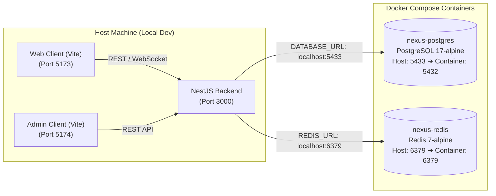

# Infrastructure & Docker Operations Guide

This guide establishes the standardized Docker operational procedures for both **Backend (BE)** and **Frontend (FE)** engineers working on **Project Nexus**.

---

## 1. Local Infrastructure Architecture Overview

In local development, Docker orchestrates the persistence and caching backing services, while Backend (NestJS) and Frontend (React/Vite) run directly on the host machine using Node.js to leverage instant Hot Module Replacement (HMR).



### Container Port & Resource Mapping

| Container Name | Service | Image | Host Port | Container Port | Purpose |
| :--- | :--- | :--- | :--- | :--- | :--- |
| `nexus-postgres` | PostgreSQL 17 | `postgres:17-alpine` | **`5433`** | `5432` | System ACID persistence, relational schema, logical separation |
| `nexus-redis` | Redis 7 | `redis:7-alpine` | **`6379`** | `6379` | Cache, Redlock distributed locking, atomic bidding queue, Pub/Sub |

> [!NOTE]
> **Why is PostgreSQL mapped to Host Port `5433`?**
> To prevent port collisions with any existing local PostgreSQL service running natively on the developer's host machine (which defaults to `5432`). Inside the container, PostgreSQL continues to listen on standard port `5432`.

---

## 2. Backend Developer Workflow (BE)

Backend engineers require the database and Redis instances to run migrations, build domain models, and test API endpoints.

### Step 1: Start Backing Services

From the repository root:

```bash
npm run docker:up
```

Starts `nexus-postgres` and `nexus-redis` in detached mode (`-d`).

### Step 2: Apply Database Schema (Prisma Migration)

Once the PostgreSQL container is healthy:

```bash
npm run prisma:migrate
```

Applies all pending migrations from `backend/prisma/migrations` to the `nexus_main` database.

### Step 3: Monitor Live Logs

```bash
npm run docker:logs
# Or monitor specific containers:
docker logs -f nexus-postgres
docker logs -f nexus-redis
```

### Step 4: Run Backend in Watch Mode

```bash
npm run dev:backend
```

* REST API: `http://localhost:3000/api/v1`
* Interactive Swagger UI: `http://localhost:3000/api/docs`

---

## 3. Frontend Developer Workflow (FE)

Frontend engineers do not need deep configuration of PostgreSQL or Redis. Running two commands is sufficient to have a fully operational backend API and WebSocket server.

### Fast 1-Minute Startup Routine

```bash
# 1. Start database and Redis
npm run docker:up

# 2. Start the Backend API & WebSocket server
npm run dev:backend

# 3. In a separate terminal, launch the Web client
npm run dev:web
```

* Web Client: `http://localhost:5173`
* Admin Client: `http://localhost:5174` (via `npm run dev:admin`)

### Core API Endpoints for Frontend

* **REST API Base URL:** `http://localhost:3000/api/v1`
* **WebSocket Auction Room:** `ws://localhost:3000/ws/auctions`
* **Swagger API Documentation:** `http://localhost:3000/api/docs`

---

## 4. Teardown, Cleanup & Reset Operations

### Scenario 1: Standard Teardown (Preserve Data)

At the end of a work session:

```bash
npm run docker:down
```

Stops the containers while retaining data in Docker volumes for subsequent runs.

### Scenario 2: Complete Reset (Wipe Volumes & Clean Slate)

When you need to completely wipe test products, auction records, and reset the database:

1. **Stop containers and permanently delete volumes:**

   ```bash
   npm run docker:clean
   # Equivalent to: docker compose down -v
   ```

2. **Spin up fresh containers:**

   ```bash
   npm run docker:up
   ```

3. **Re-apply database migrations from scratch:**

   ```bash
   npm run prisma:migrate
   ```

### Scenario 3: Fast Database Reset (Without Restarting Docker)

For backend developers iterating on schema changes:

```bash
cd backend
npx prisma migrate reset
```

Drops the database, applies all migrations, and runs seed scripts in ~3 seconds without restarting Docker.

---

## 5. Direct Container Shell Access (CLI)

### Access PostgreSQL (`psql`)

```bash
docker exec -it nexus-postgres psql -U postgres -d nexus_main
```

Useful commands:

* `\dt`: List all tables.
* `SELECT * FROM users;`: View user accounts.
* `\q`: Exit psql.

### Access Redis (`redis-cli`)

```bash
docker exec -it nexus-redis redis-cli
```

Useful commands:

* `PING`: Test connectivity (responds `PONG`).
* `KEYS *`: Inspect cached keys.
* `FLUSHALL`: Flush all Redis data.
* `exit`: Exit redis-cli.

---

## 6. Command Quick Reference Cheat Sheet

| Task | NPM Script (Recommended) | Equivalent Docker Command |
| :--- | :--- | :--- |
| **Start Services Detached** | `npm run docker:up` | `docker compose up -d` |
| **Stop Services (Keep Data)** | `npm run docker:down` | `docker compose down` |
| **Reset Services (Wipe Volumes)** | `npm run docker:clean` | `docker compose down -v` |
| **View Service Logs** | `npm run docker:logs` | `docker compose logs -f` |
| **Inspect Running Containers** | - | `docker ps` |
| **Inspect Resource Usage** | - | `docker stats` |

---

## 7. Common Troubleshooting

### 1. `failed to connect to the docker API at npipe://...`

* **Root Cause:** Docker Desktop is not running or the Linux engine has not finished starting.
* **Resolution:** Launch **Docker Desktop** on Windows and wait until the engine indicator is green before running commands.

### 2. `port is already allocated` or Port Conflict

* **Root Cause:** Another process is binding host port `5433` or `6379`.
* **Resolution:** Inspect port bindings via PowerShell:

  ```powershell
  Get-NetTCPConnection -LocalPort 5433
  ```

  Terminate conflicting background processes or run `docker compose down`.

### 3. `Authentication failed against database server`

* **Root Cause:** Password mismatch between `.env` and an existing persistent PostgreSQL volume.
* **Resolution:** Run `npm run docker:clean` to purge the mismatched volume, then restart via `npm run docker:up`.
